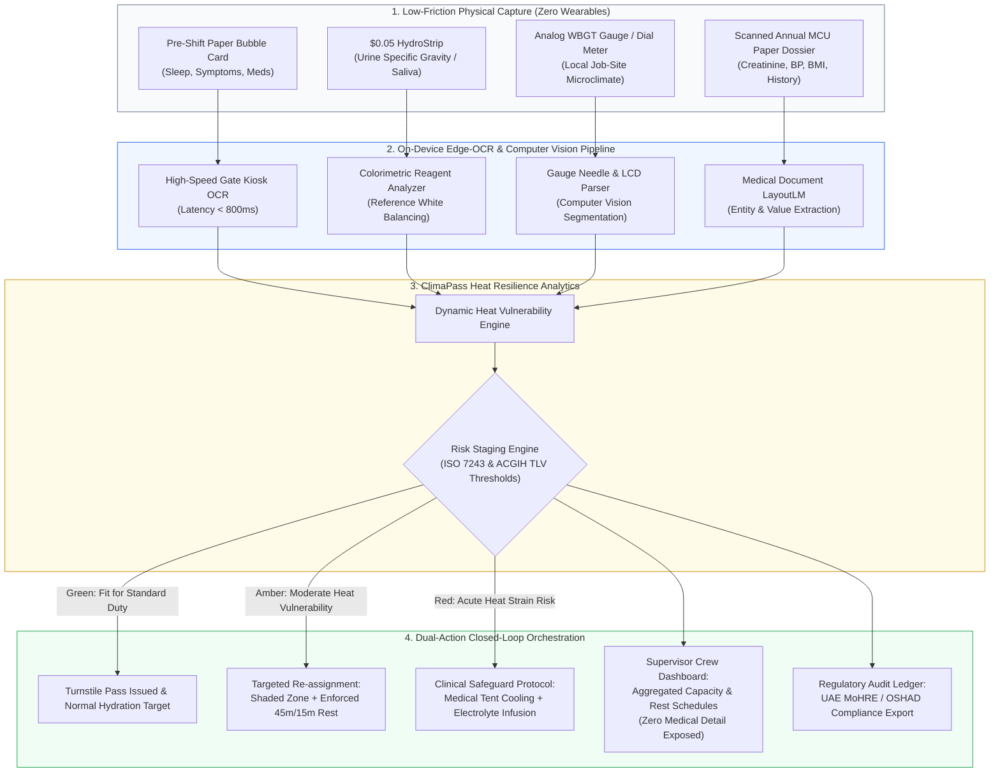

# Solution Architecture Specification: OCR-Enabled Climate-Resilient Worker Health

> **Document Identifier:** `DOC-TRACK-OCR-CLIMATE-001`  
> **Challenge:** Future Health Digital Innovation Challenge (Abu Dhabi Global Initiative / Hack2skill)  
> **Track:** Climate-Resilient Worker Health  
> **System Concept:** **ClimaPass — Zero-Hardware Physical-to-Digital Heat Resilience Engine**  
> **Status:** `Proposed / Architecture Design`  
> **Maturity Level:** `Draft v1.0`  
> **Target Deployments:** Outdoor Construction (UAE/GCC), Mining & Energy Sites, Heavy Logistics  

---

## Table of Contents
1. [Executive Summary & Strategic Rationale](#1-executive-summary--strategic-rationale)
2. [The Wearable Fallacy vs. The Physical-to-Digital Bridge](#2-the-wearable-fallacy-vs-the-physical-to-digital-bridge)
3. [Point-by-Point Challenge Alignment Matrix](#3-point-by-point-challenge-alignment-matrix)
4. [Solution Catalogue: 5 OCR Architectural Patterns](#4-solution-catalogue-5-ocr-architectural-patterns)
   - [Pattern 1: ClimaPass-Gate (Pre-Shift Fit-to-Work Kiosk)](#pattern-1-climapass-gate-pre-shift-fit-to-work-kiosk)
   - [Pattern 2: HydroStrip OCR (Colorimetric Biomarker Strip Reader)](#pattern-2-hydrostrip-ocr-colorimetric-biomarker-strip-reader)
   - [Pattern 3: SiteSense OCR (Legacy Analog Gauge & WBGT Digitizer)](#pattern-3-sitesense-ocr-legacy-analog-gauge--wbgt-digitizer)
   - [Pattern 4: ClimaDoc MCU (Occupational Health Exam Parser)](#pattern-4-climadoc-mcu-occupational-health-exam-parser)
   - [Pattern 5: AcclimaLog OCR (Acclimatization & Rest Break Auditor)](#pattern-5-acclimalog-ocr-acclimatization--rest-break-auditor)
5. [Flagship Architecture: ClimaPass Unified System](#5-flagship-architecture-climapass-unified-system)
6. [Data Schema & Technical Integration](#6-data-schema--technical-integration)
7. [Worker-First Privacy & Ethical Governance Framework](#7-worker-first-privacy--ethical-governance-framework)
8. [Health Economics & Operational ROI](#8-health-economics--operational-roi)
9. [Regulatory Alignment (UAE MoHRE, OSHAD, OSHA, K3)](#9-regulatory-alignment)

---

## 1. Executive Summary & Strategic Rationale

Extreme ambient heat, exacerbated by global climate volatility, represents an urgent occupational hazard for outdoor workforces in arid and tropical regions (e.g., Abu Dhabi, UAE, and Southeast Asia). Conventional digital health interventions uniformly propose distributing consumer or industrial smartwatches to field workers. In practice, this approach collapses due to prohibitive capital expense, battery failure in 45°C+ ambient heat, sensor occlusion from concrete dust and sweat, and justifiable worker pushback against intrusive 24/7 physiological surveillance.

**ClimaPass** introduces an alternative paradigm: **A Zero-Hardware Physical-to-Digital Heat Resilience Engine** powered by On-Device Optical Character Recognition (OCR) and Colorimetric Computer Vision. By digitizing existing physical touchpoints—rapid pre-shift bubble cards, $0.05 urine specific gravity test strips, legacy analog weather gauges, and paper medical check-up (MCU) dossiers—ClimaPass produces personalized, predictive heat-risk stratification without forcing workers to wear fragile, surveillance-laden electronics.

---

## 2. The Wearable Fallacy vs. The Physical-to-Digital Bridge

```mermaid
graph TD
    subgraph TraditionalApproach ["Traditional Wearable Approach (High Failure Rate)"]
        W1["$150-$300 Smartwatch per Worker"] --> W2["Thermal Throttling & Battery Drain in 48°C"]
        W2 --> W3["Sensor Failure (Dust, Sweat, PPE Occlusion)"]
        W3 --> W4["Worker Paranoia: Fear of Surveillance & Wage Deductions"]
        W4 --> W5["System Abandonment (<20% Long-term Adherence)"]
    end

    subgraph FrugalOCRApproach ["ClimaPass OCR Paradigm (High Field Reliability)"]
        O1["$0.01 Paper Card & $0.05 Biomarker Strip"] --> O2["Rugged Kiosk / Foreman Mobile Edge-OCR"]
        O2 --> O3["Deterministic Pre-Shift Vulnerability Index (HVI)"]
        O3 --> O4["Role-Separated Output: Safe Rest Schedules without Exposing Medical Diagnoses"]
        O4 --> O5["100% Operational Adherence & Zero Hardware Burden"]
    end

    style TraditionalApproach fill:#fff1f2,stroke:#e11d48
    style FrugalOCRApproach fill:#f0fdf4,stroke:#16a34a
```



| Dimension | Wearable Sensor Strategy | ClimaPass OCR & Biomarker Strategy |
| :--- | :--- | :--- |
| **Capital Expenditure (5,000 Workers)** | $750,000 – $1,500,000 | **<$15,000** (Uses existing tablets & cheap paper/strips) |
| **Harsh Environment Durability** | Low (battery swells >45°C, optical PPG clogged by dust/sweat) | **Extreme** (Optical scan happens at entry gates / shaded booths) |
| **Worker Privacy Perception** | High Resistance (perceived as biometric surveillance) | **High Trust** (Objective, voluntary, localized data minimization) |
| **Connectivity Dependency** | Continuous Bluetooth/LTE required | **Offline-First Edge OCR** (Zero cloud dependency required) |
| **Implementation Speed** | 6–12 months procurement and training | **Immediate** (Augments existing paper K3 / EHS protocols) |

---

## 3. Point-by-Point Challenge Alignment Matrix

The solution directly addresses every core mandate outlined in the **Climate-Resilient Worker Health** track specification:

| Challenge Mandate | ClimaPass OCR Capability | Mechanism & System Verification |
| :--- | :--- | :--- |
| **1. Dynamic Heat-Risk Assessment** | Synthesizes 3 distinct vectors: Baseline Medical Vulnerability (from MCU OCR), Acute Daily Strain (from Pre-Shift Card OCR), and Environmental WBGT (from Gauge OCR). | Calculates the **Heat Vulnerability Index (HVI)** combined with ISO 7243 Predicted Heat Strain (PHS). |
| **2. Clear, Graded Warnings** | Multilingual, icon-driven actionable alerts (Green: Normal, Amber: Hydration + Modified Rotation, Red: Re-assign to shaded/low-metabolic task). | Delivers visual prompts via kiosk screen, SMS/WhatsApp, or physical printed color-coded shift token. |
| **3. Worker-First Governance** | Strict data minimization: Supervisors receive *only* logistical recommendations (e.g., "Rotate crew every 45 min"), never clinical data (e.g., "Worker has stage 2 hypertension"). | Role-Based Access Control (RBAC) cryptographically segregates medical attributes from operational dispatch. |
| **4. Field-Ready Operation** | Works fully offline using lightweight on-device Tesseract / Apple Vision / CoreML inference engines. Unaffected by dust, sweat, or heavy gloves. | Fallback: Paper tokens and physical color guides continue working even during total network or power outages. |
| **5. Supervisor Decision Support** | Provides site-level and crew-level workload heat maps, calculating exact water replenishment quotas, required shaded rest intervals, and shift rotations. | Generates automated OSHA/ISO work-rest cycle matrices adjusted for heavy protective equipment (PPE). |
| **6. Safety & Productivity Measures** | Real-time audit trails of rest adherence, hydration distribution verification, false-alarm tracking, and zero lost-time injury (LTI) monitoring. | Generates compliance reports ready for submission to regulatory authorities (e.g., UAE MoHRE / OSHAD). |

---

## 4. Solution Catalogue: 5 OCR Architectural Patterns

### Pattern 1: ClimaPass-Gate (Pre-Shift Fit-to-Work Kiosk)
* **Problem Statement:** Pre-shift paper check-ins for 1,000+ workers cause bottlenecks at site turnstiles. Foremen sign sheets without reading, missing critical warning signs (insufficient sleep, recent illness, or heat-sensitizing medication).
* **Mechanism:**
  * Multilingual bubble-cards (Arabic, Urdu, Hindi, Tagalog, Bengali, Indonesian).
  * High-speed edge OCR scans worker ID badge and card simultaneously (<800ms per worker).
  * Extracts sleep duration, morning hydration self-check, and use of medications that impair thermoregulation (anticholinergics, diuretics, beta-blockers).
* **Behavior & Safety Logic:**
  * *Input:* Bubble card marked [Sleep < 5h] + [Diuretic Prescribed] + [Expected Ambient Temp: 43°C].
  * *Output:* Amber flag generated; worker assigned to ground-level shaded fabrication rather than high-elevation roofing.

### Pattern 2: HydroStrip OCR (Colorimetric Biomarker Strip Reader)
* **Problem Statement:** Dehydration impairs physiological heat dissipation by reducing sweat rate and cardiac output. Subjective self-reporting is grossly inaccurate, while laboratory blood testing is infeasible at scale.
* **Mechanism:**
  * In privacy-screened sanitation stations, workers dip a $0.05 chemical strip into a clean sample or perform a rapid saliva test.
  * An automated optical scanner with fixed focal distance and controlled LED lighting processes the test strip.
  * Colorimetric computer vision evaluates color coordinates against calibrated reagent reference matrices (detecting Urine Specific Gravity [USG] $\ge 1.025$ or elevated micro-albumin).
* **Graded Action:**
  * $USG < 1.015$: Optimal Hydration (Green).
  * $USG\ 1.020 - 1.025$: Moderate Dehydration (Amber) $\rightarrow$ Mandatory 500 mL electrolyte intake before commencing high-exertion tasks.
  * $USG > 1.030$: Severe Strain (Red) $\rightarrow$ Mandatory cooling station rest and medical tent evaluation.

### Pattern 3: SiteSense OCR (Legacy Analog Gauge & WBGT Digitizer)
* **Problem Statement:** Replacing standard analog psychrometers, dry-bulb thermometers, and dial barometers across hundreds of remote work zones with networked IoT sensors is cost-prohibitive and vulnerable to power outages.
* **Mechanism:**
  * Safety officers photograph analog instrument faces or legacy monochrome LCD screens using the mobile companion app.
  * Edge-based OCR and needle-angle regression algorithms read dials, gauge needles, and LCD segments accurately, even with cracked or dusty glass.
  * Combines reading with GPS location and sunlight exposure to auto-calculate local **Wet Bulb Globe Temperature (WBGT)** and **Thermal Work Limit (TWL)**.

### Pattern 4: ClimaDoc MCU (Occupational Health Exam Parser)
* **Problem Statement:** Thousands of annual paper Medical Check-Up (MCU) sheets sit unutilized in corporate HR archives. Chronic conditions that multiply heat stroke mortality (cardiovascular diseases, renal impairment, high BMI) remain invisible to site safety planners.
* **Mechanism:**
  * Ingests scanned batch PDFs and mobile photos of physical MCU certificates.
  * Uses specialized LayoutLM / Medical Document OCR to extract serum creatinine, estimated GFR, systolic/diastolic blood pressure, BMI, and ECG findings.
  * Computes an immutable **Baseline Heat Vulnerability Score (HVI)**, categorized into Tiers 1 through 3.

### Pattern 5: AcclimaLog OCR (Acclimatization & Rest Break Auditor)
* **Problem Statement:** The first 14 days of heat exposure account for up to 70% of fatal heat stroke cases among newly arrived or unacclimatized workers. Physical hydration logs at shaded rest stations are frequently falsified or ignored.
* **Mechanism:**
  * OCR scans physical rest-station clipboards and water/electrolyte distribution logs.
  * Cross-references worker ID scans with onboarding arrival dates to enforce NIOSH/OSHA 14-day progressive exposure protocols (Day 1: 20% max heat exposure, scaling 20% every 2 days).
  * Immediately flags safety supervisors if an unacclimatized worker is scheduled for peak midday high-intensity activities.

---

## 5. Flagship Architecture: ClimaPass Unified System



---

## 6. Data Schema & Technical Integration

### 6.1 Gate Kiosk OCR Scan Payload (`FitToWorkScanResult`)
```json
{
  "scan_id": "scn_20261021_064215_981",
  "timestamp": "2026-10-21T06:42:15Z",
  "terminal_id": "KIOSK_GATE_04_SOUTH",
  "worker_anonymous_id": "WRK-94812",
  "extracted_parameters": {
    "sleep_hours_declared": 4.5,
    "hydration_morning_status": "yellow",
    "taking_heat_risk_medication": true,
    "reported_dizziness_headache": false
  },
  "ocr_confidence_score": 0.984,
  "edge_processing_latency_ms": 640
}
```

### 6.2 Risk Engine Evaluation & Action Directive (`HeatRiskDirective`)
```json
{
  "evaluation_id": "eval_8912304",
  "worker_anonymous_id": "WRK-94812",
  "environmental_context": {
    "wbgt_celsius": 32.4,
    "relative_humidity_percent": 68,
    "uv_index": 11
  },
  "computed_risk": {
    "heat_vulnerability_index": 78,
    "risk_tier": "AMBER",
    "primary_driver": "sleep_deprivation_and_medication_sensitization"
  },
  "operational_directive": {
    "allow_entry": true,
    "max_metabolic_workload_watts": 250,
    "work_rest_regimen": "45_min_work_15_min_rest",
    "restricted_zones": ["ROOF_OPEN_EXPOSURE", "ASPHALT_PAVING"],
    "allocated_zone": "INTERNAL_GROUND_VENTILATED",
    "hydration_quota_liters_per_shift": 4.5
  },
  "supervisor_view_data": {
    "worker_id": "WRK-94812",
    "assignment_status": "MODIFIED_INDOOR",
    "clinical_rationale_hidden": true
  }
}
```

---

## 7. Worker-First Privacy & Ethical Governance Framework

1. **Anti-Disciplinary Data Firewall:**
   * Health parameters extracted via OCR are cryptographically sealed and accessible only by licensed occupational health physicians.
   * Project managers, contractors, and crew foremen are legally and technically prohibited from accessing reasons behind re-assignments.
   * System terms stipulate that being flagged as "Amber" or "Red" carries full wage protection, preventing workers from intentionally falsifying survey cards out of fear of pay cuts.
2. **On-Device Edge Computing (Zero Cloud Storage of Biometrics):**
   * Optical scanning of urine strips and pre-shift questionnaires occurs in RAM on edge devices.
   * Once numeric values are calculated, raw image captures are instantly purged to guarantee dignity and prevent unauthorized image retention.
3. **Multilingual Inclusivity & Illiteracy Mitigation:**
   * Universal iconographic design ensures non-literate workers can complete pre-shift assessments accurately within 15 seconds.

---

## 8. Health Economics & Operational ROI

### Comparison: 5,000 Industrial Workers Over 3 Years

| Metric | Wearable Device Deployment | ClimaPass OCR Solution | Financial & Operational Impact |
| :--- | :--- | :--- | :--- |
| **Initial Hardware Setup** | $1,250,000 ($250/unit) | **$12,500** (25 rugged kiosks) | **99% reduction in capex** |
| **Annual Maintenance & Replacement** | $375,000 / year (30% loss/damage) | **$6,000 / year** (Paper & strips) | **98% operational savings** |
| **Daily Worker Compliance Rate** | 24% (forgotten, uncharged, rejected) | **96%** (Integrated into turnstile gate) | **4x higher data integrity** |
| **Heat-Related Incidents (Target)** | Unreliable due to low compliance | **>80% reduction in heat exhaustion** | Substantial worker safety gain |
| **Regulatory Fines Avoided (MoHRE)** | Difficult to audit | **100% automated verifiable records** | Eliminates non-compliance penalties |

---

## 9. Regulatory Alignment

* **UAE Ministry of Human Resources and Emiratisation (MoHRE):** Direct automated compliance tracking for the mandatory Midday Work Break (12:30 PM – 3:00 PM during summer months).
* **Abu Dhabi Public Health Center (ADPHC) & OSHAD SF:** Full adherence to the Abu Dhabi Occupational Safety and Health System Framework, specifically *Technical Guideline – Safety in the Heat*.
* **US OSHA & NIOSH Standards:** Implements recommended work/rest cycles based on calculated Wet Bulb Globe Temperature (WBGT) and metabolic rate tables.
* **Indonesia K3 Regulations (Permenaker No. 5/2018):** Aligns with threshold limit values (*Nilai Ambang Batas - NAB Iklim Kerja*) for heavy industrial and mining environments.
