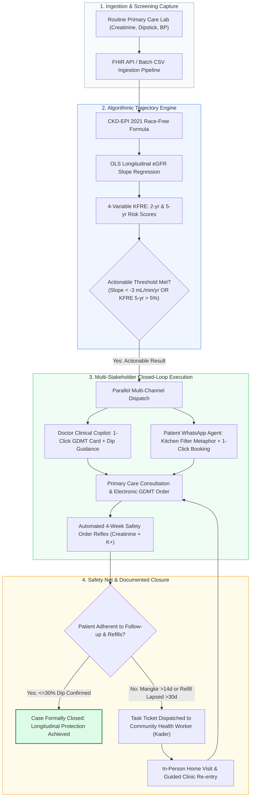
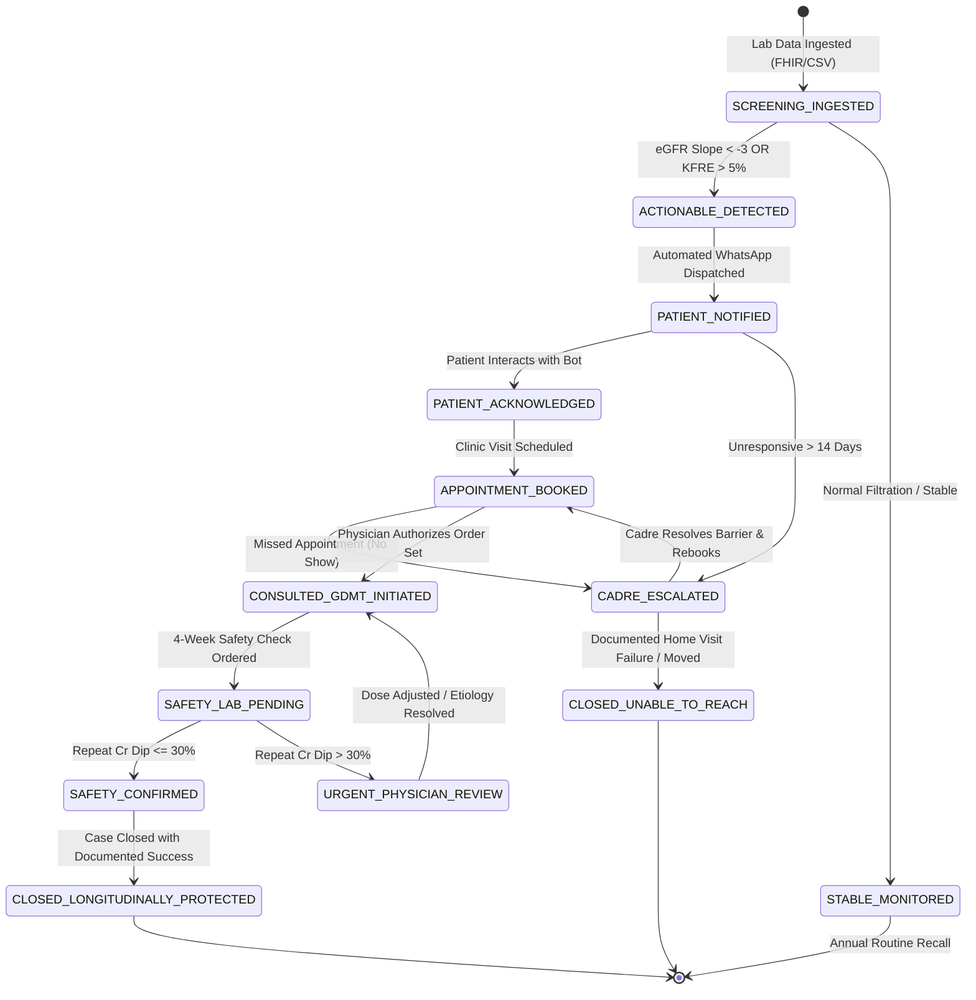

# Challenge Alignment & Track Specification: Closing the Screening-to-Care Loop

> **Document Identifier:** `DOC-TRACK-ALIGNMENT-002`  
> **Challenge:** Future Health Digital Innovation Challenge (Abu Dhabi Global Initiative / Hack2skill)  
> **Track:** Track 02 — Population Health  
> **Selected Challenge Statement:** **Closing the Screening-to-Care Loop**  
> **Solution Name:** **RENAL-PULSE** (Cardiorenal Upstream Interception & Scalable Care Engine)  
> **Status:** `Approved / Ready for Submission`  
> **Last Updated:** October 2026  

---

## Table of Contents
1. [Executive Summary](#1-executive-summary)
2. [Challenge Definition & Problem Statement](#2-challenge-definition--problem-statement)
3. [End-to-End Solution Architecture](#3-end-to-end-solution-architecture)
4. [Point-by-Point Solution Mapping](#4-point-by-point-solution-mapping)
   - [Criterion 1: End-to-End Case Visibility](#criterion-1-end-to-end-case-visibility)
   - [Criterion 2: Clear Ownership & Timely Progression](#criterion-2-clear-ownership--timely-progression)
   - [Criterion 3: Patient-Centered Communication & Reassurance](#criterion-3-patient-centered-communication--reassurance)
   - [Criterion 4: Cross-Provider Consultation & Coordination](#criterion-4-cross-provider-consultation--coordination)
   - [Criterion 5: Safe, Human-Governed Escalation](#criterion-5-safe-human-governed-escalation)
   - [Criterion 6: Closure & Patient Impact Measures](#criterion-6-closure--patient-impact-measures)
5. [Case Lifecycle & State Machine Specification](#5-case-lifecycle--state-machine-specification)
6. [Ecosystem Value & Health Economics (Markov Model)](#6-ecosystem-value--health-economics-markov-model)
7. [Pitch Defense & Judge Q&A Matrix](#7-pitch-defense--judge-qa-matrix)
8. [Cross-References & Documentation Registry](#8-cross-references--documentation-registry)

---

## 1. Executive Summary

A healthcare screening program only generates clinical and economic value if an actionable result directly translates into documented, guideline-directed intervention. Across global health systems, routine primary care laboratory and electronic health records (EHR) capture latent signals of chronic organ destruction—such as serum creatinine, blood pressure, and dipstick proteinuria. However, up to **85% of at-risk patients drop through the cracks** before receiving organ-protective therapies.

This structural failure—the **"Signal-to-Action Translation Chasm"**—is driven by three core breakdown points:
1. **The Diagnostic Blindspot:** Isolated, static lab cutoffs obscure rapid loss rates (e.g., eGFR slopes $< -3\text{ mL/min/1.73m}^2/\text{yr}$).
2. **Clinician Therapeutic Inertia & Dosing Anxiety:** Primary care physicians face 3–5 minute consults, lack longitudinal trajectory tools, and fear expected 10–25% benign hemodynamic creatinine dips upon initiating SGLT2 inhibitors or ARBs.
3. **The Asymptomatic Trap & Cultural Denial:** Patients experience zero pain or swelling in Stages 1–3a, dismiss alerts, or avoid medications due to cultural fears that *"daily chemical pills destroy the kidneys."*

**RENAL-PULSE** closes the screening-to-care loop by integrating:
* An **Algorithmic Trajectory Engine** that computes longitudinal eGFR slopes and 4-variable KFRE risks.
* A **Doctor Clinical Copilot** delivering 1-click Guideline-Directed Medical Therapy (GDMT) order sets and reassurance regarding benign hemodynamic dips.
* An **Empathetic WhatsApp Behavioral Agent** utilizing the *"Kitchen Water Filter"* (*Saringan Dapur*) metaphor to overcome patient denial and automate clinic scheduling.
* A **Community Safety Net** dispatching geocoded tasks to Community Health Workers (*Kader* / CHWs) when digital engagement lapses.

---

## 2. Challenge Definition & Problem Statement

### 2.1 The Official Challenge Question
> *"How might we use innovative, low-friction approaches to ensure that every actionable screening result leads to timely communication, rapid patient-to-clinician or clinician-to-clinician consultation, appropriate confirmation and follow-up, clear ownership, completed referral, and documented closure across providers and care settings?"*

### 2.2 Objective
Ensure every actionable screening result is:
1. **Communicated** through low-friction, culturally attuned channels.
2. **Confirmed** with reflex safety labs and clinical verification.
3. **Converted into timely care** via empowered primary care clinicians.
4. **Governed by clear ownership** and closed with auditable clinical documentation.

---

## 3. End-to-End Solution Architecture

---

## 4. Point-by-Point Solution Mapping

### Criterion 1: End-to-End Case Visibility
*Provide a complete view of each actionable result from issuance through patient notification, acknowledgement, confirmatory testing, referral, appointment, treatment or surveillance, and documented closure.*

| Life Stage | RENAL-PULSE Capability | Evidence & System Artifact |
| :--- | :--- | :--- |
| **Result Issuance** | Ingests routine serum creatinine, urinalysis, and BP via FHIR `DiagnosticReport` / `Observation` endpoints. | Ingestion Pipeline logs timestamped raw lab values into patient history. |
| **Notification** | Triggers automated bilingual WhatsApp outreach via Twilio API. | Webhook captures `delivered` and `read` status receipts. |
| **Acknowledgement** | Patient interacts with quick-reply buttons resolving asymptomatic denial. | Inbound webhook transition logged as `PATIENT_ACKNOWLEDGED`. |
| **Appointment** | Direct interactive calendar slot selection within WhatsApp. | Synchronized with Puskesmas/EHR scheduling API; calendar invite dispatched. |
| **Treatment Initiation** | Doctor Copilot displays 1-click GDMT order bundle (SGLT2i + ARB). | Electronic prescription logged in EHR; patient labeled `GDMT_INITIATED`. |
| **Confirmatory Surveillance** | System schedules automated 4-week repeat creatinine and potassium check. | Automated reflex lab order placed in clinic system. |
| **Documented Closure** | Confirms adherence and verifies that post-initiation dip is $\le 30\%$. | Audit log marks case `CLOSED_PROTECTED` with timestamp and physician ID. |

---

### Criterion 2: Clear Ownership & Timely Progression
*Maintain accountable ownership at every transition, support agreed service levels, and ensure that overdue, rejected or unassigned cases are visible for timely action.*

* **Explicit Transition Matrix:**
  * **Phase 1 (Hours 0–24) — Trajectory Engine:** Responsible for ingesting raw data, calculating race-free CKD-EPI 2021 eGFR, OLS regression slope, and KFRE failure risk.
  * **Phase 2 (Days 1–7) — Patient Behavioral Navigator:** Responsible for engaging patient via WhatsApp and securing appointment booking.
  * **Phase 3 (Consultation Day) — Primary Care Clinician:** Responsible for in-person examination, trajectory review, and GDMT order authorization.
  * **Phase 4 (Days 14–30) — Community Health Worker (Kader):** Inherits case ownership if the patient is unresponsive after 14 days or lapses on medication refills for $>30\text{ days}$.
* **Overdue & Leakage Queue:** The Doctor Copilot includes a dedicated **"Stalled & Unclosed Cases"** view, highlighting any patient whose care transition exceeds agreed SLA thresholds (e.g., Red badge for $>14\text{ days}$ unconfirmed).

---

### Criterion 3: Patient-Centered Communication & Reassurance
*Ensure patients receive clear, culturally and linguistically appropriate information about their results, urgency and next steps through suitable channels; confirm understanding and help them feel safely guided.*

* **Low-Friction WhatsApp Channel:** Zero app installation required. Eliminates the 90% churn rate of standalone consumer health apps by meeting patients on their primary daily messenger.
* **The "Kitchen Water Filter" (*Saringan Dapur*) Metaphor:** Replaces alarming, jargon-heavy phrases like *"Kidney Failure"* or *"Stage 3b CKD"* with an accessible physical analogy:
  > *"Bayangkan ginjal Bapak/Ibu seperti saringan air di dapur yang pori-porinya mulai bekerja terlalu keras tanpa suara. Obat ini bekerja sebagai perisai pelindung agar saringan tidak mudah sobek dan tetap awet bertahun-tahun."*
* **Guided Decision Tree for Patient Anxieties:**
  1. *Asymptomatic Denial:* Explains that early nephron loss does not stimulate pain nerves.
  2. *Chemical Pill Anxiety:* Clarifies the widespread myth (*"obat kimia merusak ginjal"*), proving that uncontrolled high pressure inside the kidney destroys tissue, while modern SGLT2i acts as an organ shield.
* **Closed-Loop Understanding:** The conversational agent requires explicit confirmation before displaying clinic booking slots, ensuring the patient is reassured rather than alarmed.

---

### Criterion 4: Cross-Provider Consultation & Coordination
*Support timely patient-to-clinician and clinician-to-clinician consultation, coordinated referral hand-offs and continuity across relevant providers and care settings.*

* **Patient-to-Clinician Coordination:** The WhatsApp agent registers the patient's specific concerns (e.g., fear of pill toxicity, financial worries) and pre-populates the consultation brief on the doctor's screen before the patient enters the room.
* **Clinician-to-Clinician / Secondary Referral Packaging:**
  * For early-stage patients (Stages 1–3b), care is managed completely within primary care, avoiding specialist overload.
  * For rapid progressors ($<-5\text{ mL/min/year}$) or advanced failure risk (5-year KFRE $>20\%$), the Copilot generates a standardized **FHIR Referral Bundle** exportable to hospital nephrologists containing longitudinal eGFR curves, uACR trends, and medication history—eliminating duplicate testing and referral rejections.
* **Reflex Safety Coordination:** Automatically syncs follow-up lab orders between the primary care clinic's laboratory and physician schedule.

---

### Criterion 5: Safe, Human-Governed Escalation
*Ensure clinically urgent and exceptional cases receive timely attention from qualified staff, and that closure occurs only when the required evidence or authorized human decision is documented.*

* **Human-in-the-Loop Clinical Authority:** The AI engine and Copilot never prescribe autonomously. Only a licensed physician can authorize, adjust, or decline the recommended GDMT order set.
* **Hemodynamic Dip Safety Rule ($\le 30\%$ vs. $>30\%$):**
  * When serum creatinine increases by $10–25\%$ within 4 weeks of starting SGLT2i or ARB, the system presents clinical reassurance that this reflects intraglomerular pressure decompression (KDIGO 2024 Grade 1A).
  * If creatinine rises $>30\%$, the Copilot immediately flags a clinical alert prompting physician evaluation for volume depletion, NSAID use, or renal artery stenosis.
* **Grassroots Community Safety Net:** When digital engagement fails, the system automatically creates a localized task for Community Health Workers (*Kader Kesehatan* / Posyandu). The cadre receives an actionable, script-guided prompt to visit the patient's home, resolve logistical barriers (e.g., transportation, family support), and escort them to the clinic.
* **Irreversible Closure Audit:** A case cannot be closed automatically by timeout. Closure requires documented proof: verified attendance, logged electronic prescription, or signed medical refusal.

---

### Criterion 6: Closure & Patient Impact Measures
*Demonstrate improvement in one or more relevant measures, including time to notification, confirmation, consultation and care; referral and appointment completion; treatment initiation; and patient understanding.*

| Impact Measure | Historical Baseline (Status Quo) | RENAL-PULSE Target | Validation Method |
| :--- | :--- | :--- | :--- |
| **Time to Notification** | 14–45 days (or never communicated) | **$<2$ hours** from lab ingestion | System timestamp delta logs |
| **Consultation Booking Conversion** | $<15\%$ clinic attendance | **$>65\%$** attendance completion | Verified EHR appointment check-ins |
| **Primary Care GDMT Initiation** | $<10\%$ prescription rate in primary care | **$>75\%$** guideline uptake | Electronic prescription records |
| **Unresolved Actionable Results** | 70–85% drop-off rate | **$<15\%$** dropped cases | Central backlog counter in Command Center |
| **Cadre Escalation Resolution** | 0% (no systematic communication to CHWs) | **$>80\%$** home visits completed within 14 days | Mobile Kader task completion logs |
| **Long-Term Health System ROI** | Rp 13T BPJS / $50k/pt/yr downstream dialysis | **30–39% reduction** in 5-yr kidney failure | Markov State-Transition Actuarial Simulation |

---

## 5. Case Lifecycle & State Machine Specification

Every screened individual transitions through a formal state machine to ensure no patient remains unassigned or forgotten:

---

## 6. Ecosystem Value & Health Economics (Markov Model)

To prove measurable impact for institutional payers (such as **Abu Dhabi Department of Health / Malaffi** and **BPJS Kesehatan Indonesia**), RENAL-PULSE embeds an actuarial Markov simulation:

1. **Dialysis Cost Avoidance:** Hemodialysis costs **\$35,000–\$65,000 per patient annually** in high-income economies and **Rp 13.0+ Trillion annually** for BPJS.
2. **Clinical Trial Grounding:**
   - **DAPA-CKD (NEJM 2020):** Dapagliflozin reduced sustained eGFR decline $\ge 50\%$, ESKD, or renal death by **39%** (HR 0.61; NNT = 19).
   - **EMPA-KIDNEY (NEJM 2023):** Empagliflozin reduced kidney disease progression or cardiovascular death by **28%** (HR 0.72).
3. **Closing the Loop ROI:** Initiating GDMT during Stages 1–3a delays the requirement for dialysis by **5 to 10+ years**. A health system closing the care loop for 1,000 rapid progressors saves an estimated **\$15M–\$25M** in averted catastrophic claims over 5 years.

---

## 7. Pitch Defense & Judge Q&A Matrix

### Q1: "Why not choose 'Population and Workforce Health Early Warning' instead?"
* **Answer:** An early warning system without an execution mechanism falls into the **"Dashboard Trap"**—alerting managers to disease spikes without closing the care loop for individual patients. "Closing the Screening-to-Care Loop" represents the true operational bottleneck in healthcare: we already have the lab data; the tragedy is that 85% of patients drop out before receiving care.

### Q2: "Why WhatsApp instead of a dedicated mobile app?"
* **Answer:** Standalone chronic disease mobile apps suffer a 90% 30-day churn rate, especially among elderly, rural, and working-class populations. WhatsApp has $>90\%$ daily penetration in both the Middle East (UAE) and Southeast Asia (Indonesia), requiring zero download, zero logins, and zero learning curve.

### Q3: "How does the system ensure safety if doctors are rushed?"
* **Answer:** The Doctor Copilot reduces cognitive burden through pre-calculated contraindication screening and 1-click order sets, while embedding essential safety fail-safes (e.g., hemodynamic dip reassurance, contraindication checks for eGFR $<20$, and automated reflex safety lab scheduling).

---

## 8. Cross-References & Documentation Registry

| Document Name | File Path | Focus |
| :--- | :--- | :--- |
| **Product Requirements Document (PRD)** | [docs/PRD-renal-pulse.md](file:///Users/mb-rci-backup/Documents/antigravity/future-health/docs/PRD-renal-pulse.md) | Technical and product requirements. |
| **Problem Space Discovery** | [docs/research/PROBLEM_SPACE_DISCOVERY.md](file:///Users/mb-rci-backup/Documents/antigravity/future-health/docs/research/PROBLEM_SPACE_DISCOVERY.md) | User discovery research, empathy maps, and JTBD. |
| **User Flows & Architecture** | [docs/USER_FLOWS.md](file:///Users/mb-rci-backup/Documents/antigravity/future-health/docs/USER_FLOWS.md) | Detailed UX flowcharts and decision tree logic. |
| **Clinical Mathematical Proofs** | [docs/CLINICAL_FORMULAS.md](file:///Users/mb-rci-backup/Documents/antigravity/future-health/docs/CLINICAL_FORMULAS.md) | Formula validation for CKD-EPI 2021, eGFR slope, and KFRE. |
| **Initial Context & Competition Brief** | [docs/INITIAL_CONTEXT.md](file:///Users/mb-rci-backup/Documents/antigravity/future-health/docs/INITIAL_CONTEXT.md) | High-level strategy and competition track rationale. |
