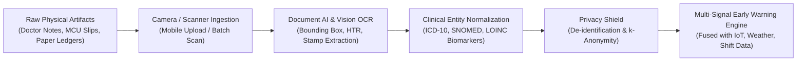
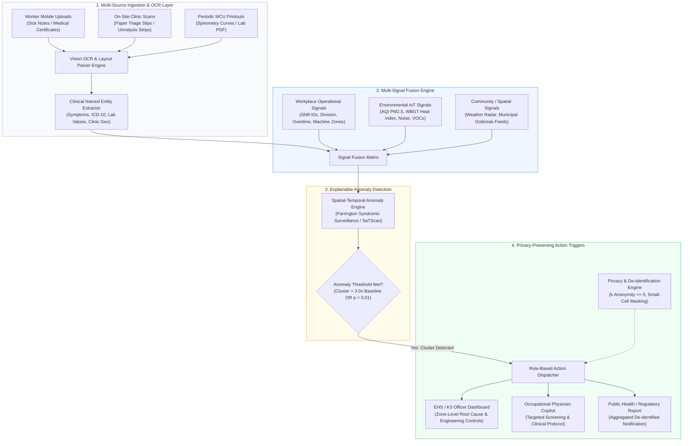

# Strategic Solution Architecture: OCR-Driven Population & Workforce Health Early Warning

> **Document Identifier:** `DOC-ARCH-OCR-EWS-001`  
> **Challenge:** Future Health Digital Innovation Challenge (Abu Dhabi Global Initiative / Hack2skill)  
> **Track:** Track 02 — Population Health  
> **Challenge Statement:** **Population and Workforce Health Early Warning**  
> **Topic:** OCR-Enabled Administrative & Diagnostic Scan Surveillance Systems  
> **Status:** `Draft / Proposal Architecture`  
> **Version:** `1.0.0`  
> **Date:** October 2026  

---

## Table of Contents
1. [Executive Summary & Problem Statement](#1-executive-summary--problem-statement)
2. [The Role of OCR: Bridging the "Administrative Data Black Hole"](#2-the-role-of-ocr-bridging-the-administrative-data-black-hole)
3. [End-to-End System Architecture](#3-end-to-end-system-architecture)
4. [Solution Pattern Catalog](#4-solution-pattern-catalog)
   - [Pattern 01: SICK-PULSE (Syndromic Sick-Note & Fit-to-Work OCR Surveillance)](#pattern-01-sick-pulse-syndromic-sick-note--fit-to-work-ocr-surveillance)
   - [Pattern 02: THERMO-OCCUPULSE (Industrial Heat-Stress & Occupational Nephropathy Early Warning)](#pattern-02-thermo-occupulse-industrial-heat-stress--occupational-nephropathy-early-warning)
   - [Pattern 03: PULMO-SCAN (Occupational Spirometry, Audiometry & Chemical Exposure OCR)](#pattern-03-pulmo-scan-occupational-spirometry-audiometry--chemical-exposure-ocr)
   - [Pattern 04: LEDGER-PULSE (Grassroots Primary Care Ledger & Pharmacy Book OCR Early Warning)](#pattern-04-ledger-pulse-grassroots-primary-care-ledger--pharmacy-book-ocr-early-warning)
5. [Comparative Analysis & Rubric Scoring Matrix](#5-comparative-analysis--rubric-scoring-matrix)
6. [Technical Implementation & Vision-AI Pipeline](#6-technical-implementation--vision-ai-pipeline)
   - [6.1 Multi-Modal Ingestion Pipeline](#61-multi-modal-ingestion-pipeline)
   - [6.2 Standardized JSON Output Schema](#62-standardized-json-output-schema)
7. [Privacy-Preserving Governance & Anti-Disciplinary Guardrails](#7-privacy-preserving-governance--anti-disciplinary-guardrails)
8. [Operational Validation Framework & Metrics](#8-operational-validation-framework--metrics)
9. [Strategic Recommendations & Competition Pitch Strategy](#9-strategic-recommendations--competition-pitch-strategy)
10. [Document Changelog & Revision History](#10-document-changelog--revision-history)

---

## 1. Executive Summary & Problem Statement

In the **Population and Workforce Health Early Warning** challenge, the central mandate is to fuse multi-source signals—clinical, workplace, environmental, and administrative—to intercept emerging health hazards before they escalate into high-severity illness, epidemic outbreaks, or catastrophic operational downtime.

### The Core Paradox: Latent Signals vs. Retrospective Audits
While health threats invariably leave early footprints, over **80% of routine occupational and primary care health data remains trapped in unstructured physical formats**:
1. **Paper Medical Leave Certificates (*Surat Keterangan Sakit*):** Workers photograph handwritten or printed doctor notes and upload them to HR portals solely for attendance validation and payroll processing. The clinical diagnoses and symptoms are discarded.
2. **Periodic Medical Check-Up (MCU) Reports:** Annual worker health reports, audiograms, spirometry tracings, and urinalysis printouts are filed into static archives or multi-page unstructured PDFs.
3. **Primary Care & Pharmacy Paper Ledgers:** In decentralized settings (Puskesmas Pembantu, remote industrial on-site clinics, independent dispensaries), daily visits and symptom logs are recorded manually in paper ledgers, taking 2 to 4 weeks to reach centralized public health registries.

By the time traditional retrospective audits analyze these records, outbreaks have spread across factory shifts, acute heat-stress has progressed to irreversible chronic kidney disease (CKDu), or chronic chemical exposure has caused permanent pulmonary fibrosis.

---

## 2. The Role of OCR: Bridging the "Administrative Data Black Hole"

Optical Character Recognition (OCR), augmented by multi-modal Vision-Language Models (VLMs) and Clinical Named Entity Recognition (NER), acts as the **high-throughput ingestion catalyst** that unlocks these dark data streams without requiring workers, nurses, or clinicians to change their physical documentation habits.



---

## 3. End-to-End System Architecture



---

## 4. Solution Pattern Catalog

### Pattern 01: SICK-PULSE (Syndromic Sick-Note & Fit-to-Work OCR Surveillance)

| Specification Field | Description |
| :--- | :--- |
| **Document Pattern Name** | `SICK-PULSE` (Syndromic Sick-Note & Fit-to-Work OCR Surveillance) |
| **Target User Roles** | Corporate Health & Safety (EHS/K3) Managers, Occupational Health Physicians, Enterprise HR Ops |
| **System Maturity** | `High Feasibility / Ready for Prototype` |
| **Applicable Environments** | Manufacturing plants, corporate campuses, logistics hubs, retail chains, municipal services |

#### 1. Problem Statement & Friction Point
Employees regularly upload smartphone photos of medical certificates (*Surat Sakit / Fit-to-Work notes*) to HR attendance systems. HR administrators verify only the dates for payroll deductions. The rich diagnostic signal—written by local clinic physicians—is completely discarded. Consequently, workplace infectious outbreaks (norovirus, influenza, dengue) or toxic exposures are recognized only after massive absenteeism paralyzes operations.

#### 2. OCR Ingestion & Entity Extraction
* **Input Media:** Smartphone photos (JPEG/PNG) or PDFs of doctor sick leave notes (handwritten and printed).
* **Extracted Entities:**
  * Clinic Name, City/District, Provider Stamp.
  * Date of Consultation and Duration of Rest (Days).
  * Primary Complaint / Diagnosis (Text & Automated ICD-10 mapping).
  * Prescribed Drug Classes (e.g., Bronchodilators, Antiemetics, Antibiotics).

#### 3. Multi-Signal Surveillance Mapping
* **Signal A (OCR Clinical):** Aggregated syndromic clusters (Acute Respiratory Infection [ARI/ISPA], Gastrointestinal [GI], Dermatological, Heat Strain).
* **Signal B (Workplace):** Department code, production line ID, shift assignment, building zone, overtime duration.
* **Signal C (Environmental/Community):** Local indoor air sensor metrics (HVAC PM2.5, VOC levels), ambient wet-bulb temperature, district dengue/malaria alert levels.

#### 4. Anomaly Detection & Trigger Logic
Uses the **CDC EARS (Early Aberration Reporting System) / Farrington Bayesian algorithm** comparing rolling 7-day baseline incidence to 24–48 hour case volume per workplace cluster.
* *Example Alert:*  
  `[ALERT-MED-042]` *Zone B Assembly (Shift 2) shows a 4.1x elevation in respiratory diagnoses over 48 hours ($p < 0.005$). Correlation found with delayed HVAC filter maintenance on Air Handling Unit AHU-02.*

#### 5. Actionable Decision Support
* **For EHS / K3 Officer:** Prompt to inspect Zone B ventilation scrubbers, deploy air quality monitors, and mandate N95 respirators.
* **For Occupational Clinic Doctor:** Standardized clinical protocol to initiate rapid antigen testing or environmental swab kits.
* **For HR / Facilities:** Automated sanitation work order dispatched for Zone B common areas and cafeteria.

#### 6. Privacy & Governance
* Worker names, National ID numbers, and Employee IDs are permanently unlinked and hashed prior to ingestion into the syndromic registry.
* Small-cell suppression ($k \ge 5$ cases per reporting unit) prevents identification of individual workers.
* Strict legal boundary: HR attendance view shows only binary `[Verified Medical Leave: Approved]`, while the clinical dashboard displays anonymized syndromic patterns.

---

### Pattern 02: THERMO-OCCUPULSE (Industrial Heat-Stress & Occupational Nephropathy Early Warning)

| Specification Field | Description |
| :--- | :--- |
| **Document Pattern Name** | `THERMO-OCCUPULSE` (Industrial Heat-Stress & Occupational Nephropathy Early Warning) |
| **Target User Roles** | Industrial Hygienists, Site Safety Supervisors, Corporate Medical Directors, Health Regulators |
| **System Maturity** | `High Synergy with Existing Cardiorenal Codebase` |
| **Applicable Environments** | Construction projects (UAE / Gulf), open-pit mining, smelting, agricultural plantations, industrial logistics |

#### 1. Problem Statement & Friction Point
Workers exposed to high temperatures and heavy physical labor face chronic dehydration, acute heat exhaustion, and Chronic Kidney Disease of non-traditional origin (CKDu). Routine health checkups and on-site clinic slips are captured on paper. Creatinine levels, urine specific gravity, and dipstick proteinuria sit dormant in clinic filing cabinets until a worker collapses with heat stroke or irreversible renal damage.

#### 2. OCR Ingestion & Entity Extraction
* **Input Media:** Scans of annual Periodic Medical Examination (PME/MCU) paper reports; photos of physical urine dipstick color chart logs from on-site first-aid stations.
* **Extracted Entities:**
  * Baseline Serum Creatinine, eGFR, Blood Urea Nitrogen (BUN).
  * Urinalysis parameters: Urine Specific Gravity (USG: $1.005–1.035$), Dipstick Protein ($0$ to $4+$), Hematuria.
  * Resting Blood Pressure and Pulse Rate.
  * Daily hydration triage symptoms: muscle cramps, dark urine, dizziness.

#### 3. Multi-Signal Surveillance Mapping
* **Signal A (OCR Biomarkers):** Real-time shifts in Urine Specific Gravity ($>1.025$) and dipstick microalbuminuria from on-site clinic logs.
* **Signal B (Workplace Operations):** Heavy labor task categorization (scaffolding, welding, roofing), direct solar exposure hours, protective gear permeability.
* **Signal C (Environmental IoT):** Wet-Bulb Globe Temperature (WBGT), solar irradiance, ambient humidity, and ambient wind speed.

#### 4. Anomaly Detection & Trigger Logic
Computes the **Cumulative Renal Thermal Stress Score (CRSS)**:
$$\text{CRSS} = f(\text{WBGT}_\text{shift}, \text{Hours Exposed}, \Delta \text{USG}, \text{Baseline eGFR})$$
* *Example Alert:*  
  `[ALERT-HEAT-019]` *High Renal Stress Cluster: 16 outdoor scaffolders in Sector 4 exhibit acute dehydration (USG $\ge 1.030$) and trace proteinuria during sustained WBGT $> 32.5^\circ\text{C}$.*

#### 5. Actionable Decision Support
* **Site Supervisor:** Enforces mandatory OSHA/NIOSH Work-Rest Regimens (e.g., 30 min work / 30 min shaded rest cycle); dispatches chilled electrolyte hydration units.
* **On-Site Paramedic:** Benchmarks high-risk workers for active core cooling and repeat urinalysis before next shift.

#### 6. Privacy & Governance
* Individual health metrics are abstracted into group-level Thermal Vulnerability Indices by job role and zone.
* Eliminates the risk of punitive job reassignment by mandating engineering and scheduling controls at the cohort level.

---

### Pattern 03: PULMO-SCAN (Occupational Spirometry, Audiometry & Chemical Exposure OCR)

| Specification Field | Description |
| :--- | :--- |
| **Document Pattern Name** | `PULMO-SCAN` (Occupational Spirometry, Audiometry & Chemical Exposure OCR) |
| **Target User Roles** | Occupational Pulmonologists, Factory EHS Officers, Chemical Safety Compliance Regulators |
| **System Maturity** | `Specialized / High Regulatory Value` |
| **Applicable Environments** | Smelters, battery manufacturing, textile mills, paint/coating workshops, cement manufacturing |

#### 1. Problem Statement & Friction Point
Screening for occupational lung disease (silicosis, asbestosis, occupational asthma) and hearing damage relies on spirometers and audiometers that produce thermal paper printouts or physical test cards. Furthermore, daily solvent and chemical usage manifests are maintained in paper logbooks. Accelerated declines in lung function ($>15\%$ drop within a shift or annual loss $>60\text{ mL/yr}$) are discovered years after irreversible parenchymal damage has set in.

#### 2. OCR Ingestion & Entity Extraction
* **Input Media:** Thermal paper spirometry strips, audiometric hearing threshold audiograms, physical chemical handling/spraying logs.
* **Extracted Entities:**
  * Forced Vital Capacity (FVC), Forced Expiratory Volume in 1 second (FEV1), FEV1/FVC ratio.
  * Audiometric decibel loss across 500 Hz to 8000 Hz (identifying 4000 Hz acoustic notch).
  * Daily chemical manifest: Solvent volume, VOC spray hours, resin types.

#### 3. Multi-Signal Surveillance Mapping
* **Signal A (OCR Diagnostics):** Cross-shift and annual $\Delta\text{FEV1}$ and $\Delta\text{FVC}$ curves.
* **Signal B (Workplace Logs):** Machine zone ID, chemical batch numbers, local exhaust fan status.
* **Signal C (Environmental IoT):** Industrial IoT particulate monitors (PM2.5, PM10, crystalline silica fractions, VOC parts-per-million).

#### 4. Anomaly Detection & Trigger Logic
Identifies localized statistical deviations where workers in a specific zone exhibit an accelerated spirometric slope divergence compared to plant-wide baselines ($p < 0.01$).
* *Example Alert:*  
  `[ALERT-PULM-008]` *Significant FEV1 decline ($>12\%$ mean drop) observed in 9 paint-booth operators over the past 30 days, coinciding with solvent batch switch #B-409 and VOC elevation.*

#### 5. Actionable Decision Support
* **EHS Engineering:** Immediate leak detection and HEPA/carbon filter replacement order for Spray Booth 3.
* **Occupational Health Clinic:** Reflex booking of full-body plethysmography and chest low-dose CT for affected cohort.

---

### Pattern 04: LEDGER-PULSE (Grassroots Primary Care Ledger & Pharmacy Book OCR Early Warning)

| Specification Field | Description |
| :--- | :--- |
| **Document Pattern Name** | `LEDGER-PULSE` (Grassroots Primary Care Ledger & Pharmacy Book OCR Early Warning) |
| **Target User Roles** | District Epidemiologists (Dinas Kesehatan), Public Health Surveillance Officers, Primary Care Directors |
| **System Maturity** | `High Public Health Impact in LMICs` |
| **Applicable Environments** | Sub-district clinics (Pustu/Poskesdes), community pharmacies, rural health outposts |

#### 1. Problem Statement & Friction Point
In rural primary care networks and private community pharmacies, patient visits, symptoms, and over-the-counter (OTC) drug purchases are logged in manual ledger books (*Buku Register Rawat Jalan / Buku Penjualan Obat*). Manual data consolidation to regional surveillance takes up to a month, leaving public health authorities blind to waterborne or vector-borne outbreaks during the critical containment window.

#### 2. OCR Ingestion & Entity Extraction
* **Input Media:** Smartphone snapshots of handwritten ledger pages taken by community health workers or clinic staff.
* **Extracted Entities:**
  * Date, Age Group, Village / Neighborhood (RT/RW).
  * Chief Complaint (e.g., watery diarrhea, high fever with petechiae, acute jaundice).
  * Dispensed Medications (e.g., Oral Rehydration Salts, Paracetamol, Ciprofloxacin).

#### 3. Multi-Signal Surveillance Mapping
* **Signal A (OCR Ledger):** Spikes in symptom presentations and OTC sales volume.
* **Signal B (Environmental/Climate):** High-resolution satellite precipitation data, river turbidity sensors, flood warnings.
* **Signal C (Community):** Primary school absenteeism paper reports.

#### 4. Anomaly Detection & Trigger Logic
Applies **Kulldorff Spatial Scan Statistics (SaTScan)** to detect emerging geographic clusters of syndromic complaints 10–14 days ahead of hospital admission surges.

#### 5. Actionable Decision Support
* **District Public Health Officer:** Dispatches rapid response teams for water source chlorination and localized prophylaxis.
* **Municipal Water Authority:** Inspects local distribution pipelines for fecal contamination or backflow.

---

## 5. Comparative Analysis & Rubric Scoring Matrix

| Evaluation Dimension | Weight | Pattern 01: SICK-PULSE | Pattern 02: THERMO-OCCUPULSE | Pattern 03: PULMO-SCAN | Pattern 04: LEDGER-PULSE |
| :--- | :---: | :---: | :---: | :---: | :---: |
| **Innovation & Originality** | 25% | **4.8** (Transforms passive admin into clinical radar) | **4.9** (Novel intersection of heat, kidneys & work) | **4.2** (Specialized diagnostic curves) | **4.6** (Digitizes offline grassroots ledgers) |
| **Impact Potential** | 25% | **4.7** (Universal corporate applicability) | **5.0** (Prevents heatstroke & fatal CKDu) | **4.4** (Arrests irreversible lung damage) | **4.9** (Prevents large-scale epidemics) |
| **Technical Feasibility** | 20% | **4.9** (High quality doctor note OCR) | **4.6** (Urine strip & lab scan OCR) | **3.8** (Complex curve analysis) | **4.1** (Handwriting variations) |
| **Multi-Signal Strength** | 15% | **4.8** (Clinical + HR + IoT Air) | **5.0** (Biomarkers + WBGT + Solar) | **4.7** (Spiro + PM2.5 + Chemicals) | **4.6** (Ledgers + Satellites + Weather) |
| **Abu Dhabi / Global Fit** | 15% | **4.7** (Applicable to UAE workforce) | **5.0** (Direct fit: UAE summer heat & workers) | **4.3** (Heavy industry/oil & gas) | **4.2** (Primary care LMIC focus) |
| **Weighted Total Score** | **100%** | **4.79** (#2) | **4.91** (#1 Champion) | **4.26** (#4) | **4.53** (#3) |

---

## 6. Technical Implementation & Vision-AI Pipeline

### 6.1 Multi-Modal Ingestion Pipeline

```
[Mobile Device / Flatbed Scanner]
             │
             ▼
[Pre-Processing & Rectification Layer]
 • Contrast Enhancement & Binarization
 • Perspective Correction & Document Deskewing
 • PII Redaction Filter (Names, ID numbers blacked out locally)
             │
             ▼
[Dual-Engine Vision-AI Extraction]
 ├── Layout Parser (LayoutLMv3 / Document Transformer)
 └── Vision LLM (e.g., Gemini Flash Vision / Specialized Med-OCR)
             │
             ▼
[Clinical Named Entity Recognition & Mapping]
 • Symptom & Diagnosis Extraction -> ICD-10-CM Classification
 • Medication Extraction -> ATC Drug Classification
 • Lab Extraction -> LOINC Code Standardization
             │
             ▼
[Structured Surveillance JSON Payload]
```

### 6.2 Standardized JSON Output Schema

```json
{
  "document_id": "doc_992a18f4",
  "ingested_at": "2026-10-20T14:32:00Z",
  "document_type": "MEDICAL_LEAVE_CERTIFICATE",
  "ocr_confidence": 0.94,
  "privacy_shield": {
    "pii_redacted": true,
    "anonymized_subject_hash": "e3b0c44298fc1c149afbf4c8996fb92427ae41e4649b934ca495991b7852b855",
    "k_anonymity_group": "ZONE_B_ASSEMBLY_SHIFT_2"
  },
  "clinical_entities": {
    "symptoms": ["fever", "productive_cough", "dyspnea"],
    "primary_diagnosis": "Acute upper respiratory tract infection",
    "icd10_mapped": "J06.9",
    "rest_duration_days": 3,
    "prescribed_medications": ["Amoxicillin", "Salbutamol"]
  },
  "workplace_context": {
    "department_code": "MFG-B2",
    "facility_id": "PLANT-JAKARTA-01",
    "shift_id": "NIGHT_SHIFT_02"
  },
  "fused_signals": {
    "environmental_aqi_pm25": 142.5,
    "wbgt_heat_index_celsius": 28.4,
    "ventilation_status": "MAINTENANCE_OVERDUE"
  }
}
```

---

## 7. Privacy-Preserving Governance & Anti-Disciplinary Guardrails

To earn trust among workers, labor unions, and corporate leaders, the architecture enforces strict structural boundaries:

1. **Firewall Between Health Surveillance and Employment Discipline:**
   * Human Resources and immediate supervisors **never** have access to extracted medical diagnoses, symptoms, or individual risk scores.
   * HR systems receive only an auditable status verification: `Status: Legitimate Medical Leave (3 Days)`.
2. **Small-Cell Suppression ($k \ge 5$ Rule):**
   * Surveillance dashboards only render spatial clusters if at least 5 individual workers are affected within that zone or shift.
   * If a cluster contains fewer than 5 workers, data is automatically rolled up into a higher-level organizational unit (e.g., Plant Division rather than Assembly Sub-line) to prevent re-identification.
3. **Data Residency & Compliance:**
   * Full compliance with UAE Federal Decree-Law No. 45/2021 on Personal Data Protection (PDP), Indonesia’s UU PDP No. 27/2022, and international HIPAA/GDPR health data standards.

---

## 8. Operational Validation Framework & Metrics

To fulfill Challenge Requirement 5 (*Operational Validation*), proposed prototypes must report the following benchmark matrix:

| Metric | Target Benchmark | Validation Methodology |
| :--- | :--- | :--- |
| **Lead Time Improvement** | **5 to 14 Days Earlier** | Historical back-testing against documented past outbreak/heat incident timelines. |
| **OCR Text Extraction Accuracy** | **$\ge 92\%$** on handwritten notes; **$\ge 98\%$** on printed reports | Evaluated on synthetic and de-identified real test sets under varying lighting and skew conditions. |
| **Positive Predictive Value (PPV)** | **$\ge 75\%$** | Ratio of confirmed environmental or infectious hazards to triggered alerts. |
| **False Alarm Rate** | **$< 5\%$** of monitoring days | Calibration of anomaly thresholds to avoid alert fatigue among EHS teams. |
| **Missing Input Tolerance** | Graceful degradation to single-signal tracking | System functions when IoT feeds drop offline, relying on OCR trends with wider confidence intervals. |

---

## 9. Strategic Recommendations & Competition Pitch Strategy

### Recommended Selection: The "Two-Horse" Strategy

1. **Top Recommendation for Abu Dhabi Track Alignment:** **THERMO-OCCUPULSE**
   * **Why it wins:** Direct alignment with UAE national priorities (worker welfare in high-heat infrastructure projects, Department of Health Abu Dhabi heat illness prevention mandates). Furthermore, it directly reuses the cardiorenal mathematical algorithms (CKD-EPI, eGFR trajectories) developed in the RENAL-PULSE codebase, multiplying technical credibility.
2. **Alternative for Universal Enterprise Appeal:** **SICK-PULSE**
   * **Why it wins:** Instant understanding from any judge or executive. Every company suffers from the "black hole" of paper sick notes and unexpected workforce absenteeism.

---

## 10. Document Changelog & Revision History

| Version | Date | Author | Description of Changes |
| :--- | :--- | :--- | :--- |
| `1.0.0` | October 2026 | Antigravity AI Team | Initial documentation template release detailing 4 OCR-driven population & workforce health early warning patterns. |

---
*End of Documentation — Prepared for Future Health Digital Innovation Challenge.*
