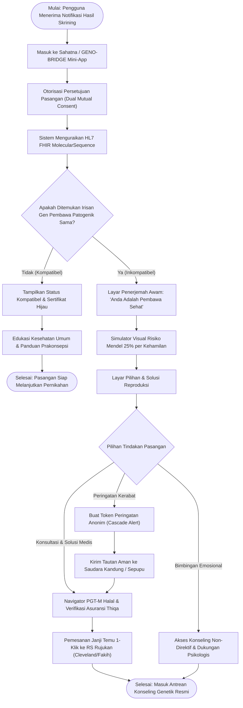
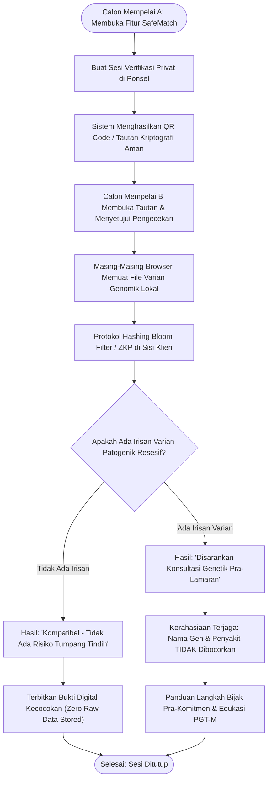
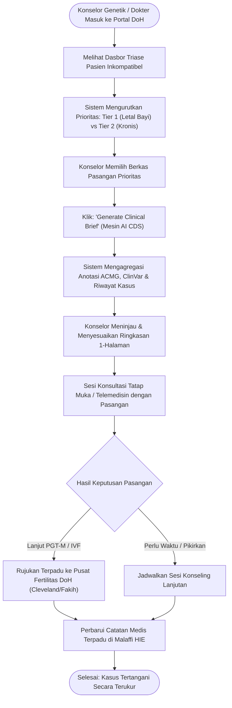

# Dokumen Persyaratan Produk (PRD): GENO-BRIDGE
**Versi Dokumen:** 1.1.0  
**Status:** Disetujui untuk Implementasi  
**Target Kompetisi:** Future Health Digital Innovation Challenge (Abu Dhabi Global Initiative / Hack2skill)  
**Trek:** Fertilitas & Kesehatan Reproduksi — *Tantangan 03: Memahami dan Mengurangi Risiko Penyakit Keturunan*  
**Penyelarasan Ekosistem:** Department of Health – Abu Dhabi (DoH), Abu Dhabi Public Health Center (ADPHC), M42 Health, Malaffi HIE, Sahatna App, Dewan Fatwa UEA  

---

## 1. Ringkasan Eksekutif (Summary)

**GENO-BRIDGE** adalah *Autonomous Preconception Genomic Copilot* dan *Privacy-Preserving Family Risk Exchange* berbasis kecerdasan buatan (AI) yang dirancang khusus untuk ekosistem kesehatan Abu Dhabi. Solusi ini secara langsung mengatasi "jurang penerjemahan mil terakhir" (*last-mile translation chasm*) dari program wajib skrining genetik pranikah 570 gen di Abu Dhabi. GENO-BRIDGE menerjemahkan data *next-generation sequencing* (NGS) yang kompleks menjadi edukasi risiko berbahasa awam, memfasilitasi pencocokan kompatibilitas pra-lamaran dengan protokol nir-bocor privasi (*Zero-Knowledge Proof* / ZKP), mengefisiensikan beban kerja klinis konselor genetik, dan memandu pasangan yang tidak kompatibel menuju jalur reproduksi medis berbantu yang sah dan halal (*Pre-implantation Genetic Testing for Monogenic defects* / PGT-M).

*   **Area Produk:** Kesehatan Populasi, Genomik Preventif, Perawatan Prakonsepsi Digital, *Clinical Decision Support* (CDS).
*   **Tipe Pekerjaan:** Inisiatif Produk Baru (Sistem Antarmuka Ganda: *Citizen/Couple Mobile Copilot* + *Clinical Genetics Workspace*).
*   **Dokumentasi Konteks Terkait:**
    *   Sintesis Riset Strategis: `docs/research/RESEARCH_AND_IDEATION_SYNTHESIS.md`
    *   Panduan & Direktif Agen: `AGENTS.md`
    *   Kriteria Validasi Klinis: `docs/CLINICAL_FORMULAS.md`

---

## 2. Tujuan Produk (Product Objective)

### Sasaran Utama
Melenyapkan morbiditas dan mortalitas pediatrik yang dapat dicegah akibat penyakit autosomal resesif berat pada populasi dengan tingkat konsanguinitas (pernikahan kekerabatan) yang tinggi, dengan cara membekali calon pasangan dan dokter panduan genomik yang tepat waktu, privat, selaras budaya lokal, dan dapat ditindaklanjuti *sebelum* komitmen sosial pranikah yang mengikat atau kehamilan terjadi.

### Mengapa Ini Sangat Penting?
1.  **Keparahan Klinis & Kemanusiaan:** 5% hingga 14% pasangan di Abu Dhabi teridentifikasi memiliki mutasi pembawa (*carrier*) pada gen resesif yang sama. Tanpa intervensi, setiap kehamilan memiliki **risiko 25% (1 dari 4)** melahirkan anak dengan kelainan bawaan fatal atau kecacatan seumur hidup (misal: *Spinal Muscular Atrophy*, *Beta-Thalassemia Major*, *Cystic Fibrosis*, *Congenital Adrenal Hyperplasia*).
2.  **Keberlanjutan Finansial Sistem Kesehatan:** Biaya medis seumur hidup untuk menangani satu anak dengan kelainan genetik berat mencapai **AED 4.000.000 hingga AED 12.000.000 ($1,1M–$3,3M USD)**. Mencegah 50 kasus fatal per tahun menghemat lebih dari **AED 250.000.000** bagi kas asuransi nasional (Thiqa/DoH).
3.  **Efisiensi Sistem Kesehatan:** Abu Dhabi menghadapi kelangkaan konselor genetik bersertifikasi. Otomatisasi sintesis data varian genetik, edukasi pasien, dan triase pra-konsultasi dapat melipatgandakan kapasitas layanan konselor hingga 500%.

### Batasan Perilaku yang Wajib Dipertahankan
*   **Otonomi Pernikahan Tanpa Paksaan:** Sistem dilarang menghakimi, memaksa, atau mewajibkan pembatalan pernikahan. Keputusan untuk menikah 100% merupakan hak prerogatif pasangan.
*   **Otoritas Klinis Tetap pada Tenaga Medis (*Human-in-the-Loop*):** Diagnosis medis definitif, tes konfirmasi, dan persetujuan tindakan PGT-M tetap berada di bawah wewenang dokter spesialis genetika dan fertilitas berlisensi DoH.

---

## 3. Hasil bagi Pengguna (User Outcome)

```
       SEBELUM GENO-BRIDGE                                     DENGAN GENO-BRIDGE
┌───────────────────────────────────────┐             ┌───────────────────────────────────────┐
│ • Skrining 3 minggu sebelum nikah     │             │ • Pengecekan pra-lamaran mandiri lewat│
│ • Laporan PDF lab sulit dimengerti    │             │   Zero-Knowledge Proof (SafeMatch)    │
│ • Panik, rasa bersalah & stigma sosial│             │ • Penjelasan instan bahasa manusiawi  │
│ • Antre konselor genetik hingga 1 bln │ ──> ──> ──> │ • Simulasi visual risiko kehamilan 25%│
│ • Bingung status hukum agama / fatwa  │             │ • Panduan navigasi PGT-M Halal & resmi│
│ • Menikah buta risiko / batal tragis  │             │   sesuai fatwa Dewan Fatwa UEA        │
│                                       │             │ • Waktu persiapan konselor turun 85%  │
└───────────────────────────────────────┘             └───────────────────────────────────────┘
```

### Bagi Warga / Pasangan Calon Pengantin:
*   Mampu memahami hasil skrining genomik 570 gen dalam waktu kurang dari 2 menit tanpa kepanikan atau rasa bersalah keliru.
*   Dapat memverifikasi kecocokan genetik pembawa secara rahasia dengan calon pasangan *sebelum* pengumuman lamaran publik melalui fitur *SafeMatch* berbasis *Zero-Knowledge Proof* (ZKP).
*   Mendapatkan kepastian alur rujukan medis berbantu (IVF + PGT-M) yang ditanggung asuransi Thiqa dan telah dinyatakan Halal secara resmi oleh otoritas keagamaan.

### Bagi Konselor Genetik & Dokter Layanan Primer:
*   Menerima ringkasan klinis (*Clinical Brief*) otomatis berstandar ACMG untuk pasangan yang berisiko, memangkas waktu analisis riwayat lab dari 45 menit menjadi 3 menit.
*   Memantau distribusi frekuensi mutasi pembawa pada level populasi di seluruh distrik Abu Dhabi.

---

## 4. Ruang Lingkup Proyek (Scope)

### Dalam Lingkup (In Scope - MVP)
1.  **Citizen / Couple Mobile Copilot (Pengalaman Web Ramah Ponsel selaras Sahatna):**
    *   Penguraian data sintetis panel 570 gen dalam format HL7 FHIR R4 (`MolecularSequence` / `DiagnosticReport`).
    *   Mesin penerjemah bahasa awam yang membedakan status "pembawa (*carrier*)" vs "sakit (*affected*)".
    *   Simulator interaktif pewarisan Mendel 4-kuadran (menjelaskan probabilitas 25% di setiap kehamilan).
    *   Demonstrator *Pre-Engagement SafeMatch* berbasis simulasi kriptografi *Zero-Knowledge Proof* di sisi klien (*client-side*).
    *   Navigator Keputusan PGT-M Halal yang memuat fatwa resmi Dewan Fatwa UEA dan direktori klinik rujukan berlisensi DoH (Cleveland Clinic Abu Dhabi, Fakih IVF).
2.  **Clinical Genetics Workspace (Dashboard Web Tenaga Medis):**
    *   Antrean triase pasien berisiko berdasarkan derajat keparahan letalitas penyakit.
    *   Pusat pembuatan Ringkasan Konseling Klinis otomatis (1-klik) lengkap dengan anotasi OMIM dan klasifikasi ClinVar.
    *   Peta sebaran frekuensi alel pembawa sintetis antar-wilayah Abu Dhabi.

### Luar Lingkup (Out of Scope - Fase Lanjutan)
*   Integrasi produksi langsung ke server *live* Malaffi HIE atau OAuth UAE PASS (disimulasikan dengan muatan data standar FHIR R4 JSON untuk kebutuhan hackathon).
*   Pemrosesan file mentah instrumen sekuensing laboratorium basah (file format FASTQ/BAM).
*   Kalkulasi skor risiko poligenik (*Polygenic Risk Score* / PRS) untuk penyakit degeneratif dewasa.
*   Entri resep obat langsung ke sistem apotek rumah sakit.

---

## 5. Peta Perjalanan Pengguna & Diagram Alur (User Journey & Flow Diagrams)

### 5.1. Peta Perjalanan Pengguna Menyeluruh (End-to-End User Journey Map)

| Fase / Tahapan | Aktor & Titik Sentuh | Pikiran & Emosi Pengguna | Hambatan Utama (*Pain Points*) | Intervensi & Solusi GENO-BRIDGE | Hasil Kunci (*Outcome*) |
| :--- | :--- | :--- | :--- | :--- | :--- |
| **1. Pra-Lamaran / Eksplorasi Dini** | Calon Pasangan; Ponsel Pribadi | *"Kami ingin tahu apakah cocok secara genetik tanpa diketahui keluarga besar."* | Takut timbul aib keluarga jika tes di lab biasa; belum ada komitmen resmi. | **Fitur SafeMatch (ZKP):** Pencocokan kriptografi sisi-klien tanpa saling melihat data DNA mentah. | Status kompatibilitas biner rahasia (Aman vs Disarankan Konseling). |
| **2. Notifikasi Hasil Pranikah** | Pasangan; Aplikasi Sahatna / SMS | *"Hasil lab kami sudah keluar, tapi istilah kodenya sangat menakutkan."* | Laporan laboratorium PDF berupa teks teknis (*c.93-21G>A*); panik mengira diri sakit. | **Plain-Language Engine:** Terjemahan otomatis ke bahasa manusiawi: *"Anda berdua sehat, hanya membawa varian resesif."* | Pasangan tenang; memahami bahwa *carrier* $\ne$ sakit. |
| **3. Pemahaman Risiko 25%** | Pasangan; Layar Couple Copilot | *"Apakah anak kami pasti sakit semua? Bagaimana peluang sebenarnya?"* | Mitos bahwa 25% risiko berarti 3 anak pertama aman; kecenderungan pasrah buta. | **Mendelian Visualizer 4-Kuadran:** Simulasi interaktif probabilitas dinamis per kehamilan. | Pemahaman tuntas bahwa risiko 25% berlaku mandiri di *setiap* kehamilan. |
| **4. Penentuan Sikap & Opsi Halal** | Pasangan; Layar Opsi Reproduksi | *"Apakah bayi tabung (PGT-M) diperbolehkan secara agama? Berapa biayanya?"* | Keraguan hukum Islam terhadap seleksi embrio; bingung biaya dan klinik rujukan. | **Navigator PGT-M Halal:** Kutipan fatwa resmi Dewan Fatwa UEA & direktori klinik rujukan Thiqa. | Pasangan mantap memilih jalur PGT-M tanpa rasa bersalah moral/agama. |
| **5. Sesi Klinis & Rujukan Terarah** | Pasangan & Konselor; Ruang Konseling | *"Konselor memahami situasi kami secara detail dan solutif."* | Waktu tunggu konselor lama; waktu konsultasi habis untuk membaca berkas rekam medis. | **AI Clinical Brief 1-Klik:** Ringkasan varian ACMG/ClinVar siap saji bagi konselor dalam 3 menit. | Pasangan mendapatkan jadwal siklus PGT-M di RS rujukan berlisensi DoH. |

---

### 5.2. Diagram Alur A: Alur Pasangan Pranikah Resmi (Official Premarital Couple Flow)

Alur ini memetakan perjalanan pasangan yang telah menjalani skrining resmi 570 gen di pusat kesehatan DoH:



---

### 5.3. Diagram Alur B: Pencocokan Pra-Lamaran Privat (Pre-Engagement SafeMatch via ZKP)

Alur ini memetakan bagaimana dua individu mengecek kompatibilitas genetik secara rahasia *sebelum* lamaran resmi:



---

### 5.4. Diagram Alur C: Alur Konselor Genetik Klinis (Clinical Counselor Workspace Flow)

Alur ini memetakan bagaimana konselor genetik mengelola kasus inkompatibel secara cepat dan presisi:



---

## 6. Persyaratan Fungsional (Functional Requirements)

| ID | Deskripsi Persyaratan | Prioritas | Catatan Arsitektur & Klinis |
| :--- | :--- | :---: | :--- |
| **FR-01** | **Ingesti Genomik FHIR:** Sistem harus dapat memproses resource HL7 FHIR R4 `MolecularSequence` dan `DiagnosticReport` berisi varian patogenik panel gen target (*HBB, SMN1, CFTR, CYP21A2, PCDH15*, dll.). | **P0** | Sesuai panduan *HL7 Clinical Genomics Implementation Guide*. |
| **FR-02** | **Deteksi Inkompatibilitas Pembawa:** Mesin otomatis mencocokkan profil genomik kedua pasangan yang telah memberikan persetujuan untuk mendeteksi tumpang tindih mutasi resesif pada gen yang sama. | **P0** | Menandai mutasi pada gen autosomal resesif yang sama; membedakan karier sehat dari kondisi bergejala. |
| **FR-03** | **Penerjemah Bahasa Awam Emosional:** Mengubah notasi varian medis (misal: *HBB:c.93-21G>A*) menjadi penjelasan suportif dalam bahasa Inggris dan istilah medis/religius Arab yang ramah. | **P0** | Menekankan pesan kunci: "Menjadi pembawa gen adalah hal yang wajar; setiap manusia membawa 3–5 varian gen resesif." |
| **FR-04** | **Simulator Risiko Mendel Interaktif:** Tampilan visual interaktif 4-kuadran (25% sakit, 50% pembawa sehat, 25% bebas gen) dengan visualisasi probabilitas dinamis. | **P0** | Mematahkan mitos keliru "1 dari total 4 anak pasti sakit"; menegaskan bahwa risiko 25% berlaku independen pada *setiap* kehamilan. |
| **FR-05** | **SafeMatch Pra-Lamaran (Simulasi ZKP):** Protokol kriptografi di browser yang memungkinkan 2 calon pasangan mengecek apakah mereka memiliki irisan gen karier yang sama tanpa saling memperlihatkan data DNA mentah masing-masing. | **P0** | Memakai metode *private set intersection / Bloom filter hashing*; hanya menghasilkan status biner (`Kompatibel` / `Perlu Konseling Genetik`). |
| **FR-06** | **Navigator Reproduksi & PGT-M Halal:** Panduan interaktif bertahap mengenai prosedur bayi tabung (IVF) disertai seleksi embrio bebas mutasi (PGT-M), menyertakan fatwa resmi Dewan Fatwa UEA. | **P0** | Mengintegrasikan ketetapan fatwa *General Authority of Islamic Affairs & Endowments*. |
| **FR-07** | **Antrean Triase Klinis Konselor:** Tampilan dasbor bagi dokter/konselor yang mengurutkan pasangan inkompatibel berdasarkan tingkat keparahan penyakit (Tier 1: Letal bayi; Tier 2: Kronis melemahkan). | **P0** | Dapat difilter berdasarkan kedekatan tanggal pernikahan dan waktu selesai tes skrining. |
| **FR-08** | **Generator Ringkasan Klinis 1-Klik:** Menghasilkan draf dokumen konseling terstandar mencakup kode OMIM, klasifikasi ClinVar, pola pewarisan, dan rekomendasi poin diskusi untuk konselor. | **P0** | Menghemat waktu telaah konselor; siap diekspor ke PDF atau disalin ke rekam medis rumah sakit. |
| **FR-09** | **Peringatan Risiko Keluarga Anonim (*Cascade Alert*):** Fitur bagi individu pembawa gen untuk mengirimkan token tautan digital anonim kepada saudara kandung/sepupu agar memeriksakan gen spesifik tersebut sebelum menikah. | **P1** | Tanpa menyertakan identitas pribadi pengirim maupun data riwayat medis terbuka. |
| **FR-10** | **Dasbor Analitik Populasi:** Peta agregat sebaran frekuensi pembawa mutasi sintetis di wilayah Abu Dhabi, Al Ain, dan Al Dhafra. | **P1** | Tampilan data anonim teragregasi untuk perencanaan strategi dinas kesehatan publik. |

---

## 7. Aturan Bisnis & Produk (Business & Product Rules)

### 1. Kaidah Etika & Netralitas Keputusan
*   **Aturan BR-01 (Prinsip Non-Koersif):** Sistem tidak boleh dan dilarang menyarankan pasangan untuk membatalkan pernikahan, atau melabeli pasangan "tidak layak menikah". Semua redaksi berfokus pada *pemberdayaan pilihan reproduksi yang aman*.
*   **Aturan BR-02 (Batas Diagnostik):** Aplikasi wajib menampilkan penafian legal permanen: *"GENO-BRIDGE adalah instrumen pendukung keputusan prakonsepsi dan navigasi layanan. Sistem ini tidak memberikan diagnosis medis mutlak. Seluruh keputusan wajib dikonsultasikan dengan konselor genetik berlisensi DoH."*

### 2. Aturan Privasi & Tata Kelola Data
*   **Aturan BR-03 (Persetujuan Granular Ganda):** Penautan data genomik pasangan hanya dapat terjadi setelah adanya otorisasi digital eksplisit dari kedua belah pihak. Persetujuan dapat dicabut sepihak kapan saja, yang seketika memutuskan keterhubungan data pasangan.
*   **Aturan BR-04 (Nir-Bocor Data Mentah pada SafeMatch):** Pada alur *Pre-Engagement SafeMatch*, Pengguna A tidak dapat melihat daftar gen Pengguna B, begitu pula sebaliknya. Hasil yang ditampilkan hanyalah status kompatibilitas dan saran langkah konsultasi.
*   **Aturan BR-05 (Minimisasi Data):** Hanya 570 gen yang disetujui DoH yang diproses. Varian yang belum diketahui signifikansinya (*Variant of Uncertain Significance* / VUS) hanya ditampilkan di dasbor konselor medis dan tidak diekspos langsung ke aplikasi pasangan guna mencegah kecemasan berlebih.

### 3. Kaidah Kultural & Bioetika Islam
*   **Aturan BR-06 (Kesesuaian Fatwa Bioetika Islam):** Seluruh panduan medis reproduksi berbantu (IVF) dan seleksi embrio (PGT-M) wajib merujuk pada fatwa resmi otoritas keagamaan UEA: sperma dan sel telur wajib berasal dari suami-istri yang sah, embrio ditanamkan ke rahim istri yang sah, dan tindakan bertujuan menghindarkan keturunan dari penderitaan penyakit genetik berat.

---

## 8. Referensi Desain & Arsitektur Antarmuka

```
┌────────────────────────────────────────────────────────────────────────┐
│                      REFERENSI DESAIN & ARSITEKTUR                     │
├──────────────────────┬─────────────────────────────────────────────────┤
│ Sistem Token Desain  │ DESIGN.md (Tailwind CSS, Tipografi IBM Plex     │
│                      │ Sans Arabic & Inter, Palet Emerald Medis/Slate) │
├──────────────────────┼─────────────────────────────────────────────────┤
│ Tata Kelola Desain   │ docs/DESIGN_SYSTEM_GOVERNANCE.md                │
├──────────────────────┼─────────────────────────────────────────────────┤
│ Arsitektur Frontend  │ Feature-Sliced Design (FSD):                    │
│                      │ app → pages → widgets → features → entities    │
├──────────────────────┼─────────────────────────────────────────────────┤
│ Pustaka Ikon         │ Lucide React (Dna, ShieldCheck, HeartPulse,     │
│                      │ CalendarClock, FileText, Lock)                  │
└──────────────────────┴─────────────────────────────────────────────────┘
```

---

## 9. Catatan Teknis & Arsitektur Integrasi

### Diagram Alur Arsitektur Sistem

```
                                  [ ANTARMUKA MOBILE WARGA ]
                                                │
                     ┌──────────────────────────┴──────────────────────────┐
                     ▼                                                     ▼
        [ Ingesti Pasangan Sahatna ]                         [ SafeMatch Mesin ZKP ]
     Parsing HL7 FHIR MolecularSequence                Simulasi SHA-256 Bloom Filter Klien
     dari format JSON Malaffi/DoH                      (Tanpa Penyimpanan Mentah di Server)
                     │                                                     │
                     └──────────────────────────┬──────────────────────────┘
                                                │
                                                ▼
                                    [ GENO-BRIDGE FASTAPI CORE ]
                     ┌─────────────────────────────────────────────────────┐
                     │ • Logika Kompatibilitas Pewarisan Mendel            │
                     │ • Basis Pengetahuan Anotasi ClinVar / OMIM          │
                     │ • Mesin Penerjemah Bahasa Manusiawi                 │
                     │ • Generator Ringkasan Konseling Klinis              │
                     └──────────────────────────┬──────────────────────────┘
                                                │
                                                ▼
                                  [ DASBOR KLINIS GENETIKA ]
                               Workspace Konselor DoH (React 19)
```

### Standar Teknis Kunci:
*   **Interoperabilitas Data:** HL7 FHIR R4 (`MolecularSequence`, `Observation`, `DiagnosticReport`, `Patient`).
*   **Backend:** Python 3.11+ / FastAPI dengan validasi schema Pydantic v2.
*   **Frontend:** React 19 / Vite / Tailwind CSS / Lucide Icons.
*   **Manajemen Status:** TanStack Query + Zustand.
*   **Standar Keamanan:** Simulasi enkripsi ujung-ke-ujung di peramban, kepatuhan terhadap regulasi privasi data kesehatan DoH Abu Dhabi.

---

## 10. Metrik Keberhasilan (Success Metrics)

### Metrik Kuantitatif Produk
*   **Waktu Pemahaman Risiko (*Time to Risk Comprehension*):** Waktu rata-rata bagi pengguna awam untuk memahami status risiko genetiknya turun dari **$\approx 3$ hari menjadi $<2$ menit**.
*   **Waktu Persiapan Konselor Genetik:** Waktu yang dibutuhkan konselor untuk meninjau riwayat dan menyiapkan poin edukasi turun dari **45 menit menjadi $<3$ menit** (efisiensi 85%).
*   **Adopsi SafeMatch Pra-Lamaran:** $>30\%$ pengguna target memanfaatkan skrining kompatibilitas rahasia sebelum pengumuman pertunangan resmi.
*   **Penyelesaian Jalur Rujukan (*Referral Completion Rate*):** Tingkat kehadiran pasangan berisiko tinggi ke sesi konsultasi spesialis PGT-M/IVF meningkat dari baseline historis $<20\%$ menjadi $>70\%$.

### Metrik Kualitatif
*   **Tingkat Konflik Keputusan Pasien (*Decisional Conflict Scale*):** Penurunan skor kecemasan dan kebingungan yang signifikan secara statistik pada pasangan inkompatibel.
*   **Skor Kegunaan Klinis (*System Usability Scale* / SUS):** Nilai evaluasi kegunaan sistem oleh dokter/konselor genetik mencapai $>85$.
*   **Tingkat Kepercayaan Kultural & Religius:** $>90\%$ pengguna lokal menyatakan bahwa pendekatan komunikasi aplikasi menghormati norma keluarga dan keyakinan agama mereka.

---

## 11. Kriteria Penerimaan (Acceptance Criteria)

*   [ ] **AC-01 (Parsing Genomik):** Sistem sukses memproses sepasang payload JSON FHIR R4 genomik dan mendeteksi kesamaan mutasi gen pembawa dalam waktu $<500\text{ ms}$.
*   [ ] **AC-02 (Visualisasi Risiko):** Saat pasangan pembawa mutasi yang sama terdeteksi (misal: keduanya heterozigot *HBB* c.93-21G>A), antarmuka menampilkan diagram 4-kuadran yang secara tegas memperlihatkan pembagian 25% sakit, 50% pembawa sehat, dan 25% bebas gen.
*   [ ] **AC-03 (Privasi SafeMatch):** Pengujian fitur *SafeMatch* pra-lamaran hanya memunculkan hasil kesimpulan kompatibilitas tanpa membocorkan nama gen, daftar mutasi, atau file DNA pasangan lainnya.
*   [ ] **AC-04 (Navigasi Halal PGT-M):** Halaman navigasi menampilkan kutipan fatwa resmi Dewan Fatwa UEA, tahapan medis IVF+PGT-M, dan opsi rujukan ke klinik resmi DoH.
*   [ ] **AC-05 (Workspace Konselor):** Konselor medis dapat melihat daftar antrean prioritas pasangan berisiko dan mengunduh draf Ringkasan Konseling Klinis secara otomatis dalam 1 klik.
*   [ ] **AC-06 (Penanganan Kesalahan):** Apabila data FHIR rusak atau varian tidak dikenali, sistem memunculkan pembatas kesalahan yang aman (*error boundary*) dan mengarahkan ke telaah manual konselor.

---

## 12. Manajemen Risiko & Strategi Mitigasi

| Risiko Potensial | Dampak | Probabilitas | Rencana Mitigasi |
| :--- | :--- | :---: | :--- |
| **Salah Tafsir Risiko Probabilistik** | Tinggi | Sedang | Menyediakan simulator visual dinamis skenario keluarga nyata; memberikan peringatan tegas agar tidak berspekulasi pada "peluang aman 75%". |
| **Stigmatisasi Sosial / Keluarga** | Tinggi | Sedang | Protokol *Zero-Knowledge SafeMatch* menjamin data gen tidak terekspos sebelum komitmen nikah; edukasi menegaskan bahwa *semua manusia* membawa mutasi genetik. |
| **Ketidakpercayaan Dokter terhadap Ringkasan AI** | Tinggi | Rendah | Setiap ringkasan klinis menyertakan sitasi ilmiah pedoman ACMG, nomor aksesi ClinVar, serta tautan langsung ke laporan asli laboratorium. |
| **Keraguan Religius terhadap Tindakan Bayi Tabung / PGT-M** | Sedang | Sedang | Mengintegrasikan langsung salinan ketetapan fatwa dari *General Authority of Islamic Affairs & Endowments* yang menyatakan PGT-M Halal. |

---

## 13. Pertanyaan Terbuka & Arahan Implementasi

| Pertanyaan Kunci | Penanggung Jawab | Wajib Selesai Sebelum Coding? | Resolusi / Arahan Tindakan |
| :--- | :---: | :---: | :--- |
| Gen resesif apa saja yang wajib dimasukkan dalam dataset demo sintetis? | *Clinical Lead* | Ya | Sertakan *HBB* (Thalassemia), *SMN1* (SMA), *CFTR* (Cystic Fibrosis), dan *CYP21A2* (CAH). |
| Mekanisme kriptografi apa yang paling ideal untuk simulasi ZKP di MVP? | *Lead Architect* | Ya | Implementasikan *client-side SHA-256 Bloom Filter intersection hashing* untuk membuktikan kelayakan matematis tanpa server perantara. |
| Apakah VUS (*Variant of Uncertain Significance*) boleh dilihat oleh pasangan? | *Medical Advisor* | Ya | **Tidak.** VUS dibatasi secara ketat hanya pada dasbor konselor klinis guna mencegah kepanikan pasangan yang tidak berdasar. |
