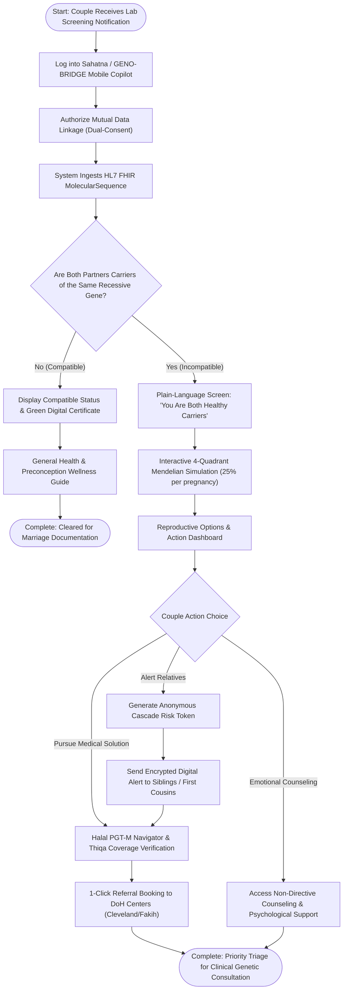
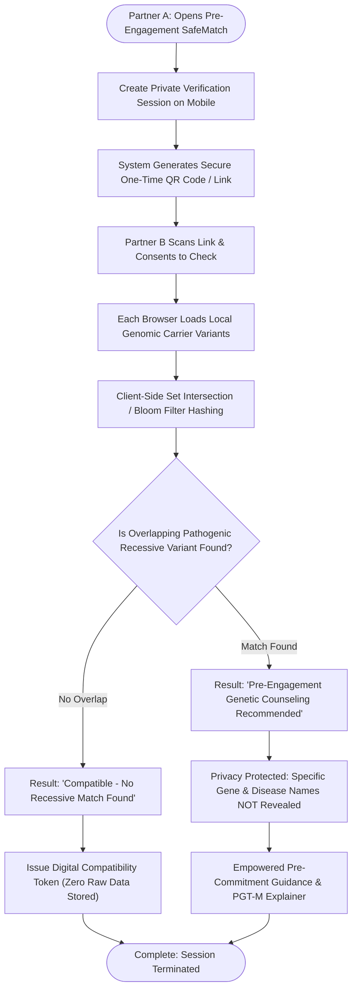
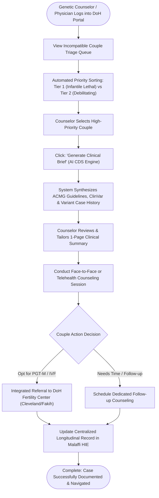

# Product Requirements Document (PRD): GENO-BRIDGE
**Document Version:** 1.1.0  
**Status:** Approved for Implementation  
**Target Event:** Future Health Digital Innovation Challenge (Abu Dhabi Global Initiative / Hack2skill)  
**Track:** Fertility — *Challenge 03: Understanding and Reducing Inherited Disease Risk*  
**Ecosystem Alignment:** Department of Health – Abu Dhabi (DoH), Abu Dhabi Public Health Center (ADPHC), M42 Health, Malaffi HIE, Sahatna App, UAE Fatwa Council  

---

## 1. Summary

**GENO-BRIDGE** is an AI-powered Preconception Genomic Copilot and Privacy-Preserving Family Risk Exchange designed for Abu Dhabi’s healthcare ecosystem. It directly bridges the "last-mile translation chasm" of the mandatory 570-gene premarital genetic screening program by translating complex next-generation sequencing (NGS) data into plain-language risk education, enabling pre-engagement zero-knowledge compatibility checks, streamlining genetic counselor clinical workflows, and guiding incompatible couples toward certified, Halal Pre-implantation Genetic Testing (PGT-M) pathways.

*   **Product Area:** Population Health, Preventive Genomics, Digital Preconception Care, Clinical Decision Support (CDS).
*   **Work Type:** New Product Initiative (Dual-Interface System: Mobile Citizen Copilot + Web Clinical Workspace).
*   **Context Documentation:**
    *   Research Synthesis: `docs/research/RESEARCH_AND_IDEATION_SYNTHESIS.md`
    *   Vision & Architectural Directives: `AGENTS.md`
    *   Clinical Validation Criteria: `docs/CLINICAL_FORMULAS.md`

---

## 2. Product Objective

### The Objective
Eliminate preventable pediatric morbidity and mortality caused by severe autosomal recessive genetic conditions in consanguineous and endogamous populations by empowering couples and clinicians with timely, private, culturally aligned, and actionable genomic guidance *before* irreversible social commitments or conception occur.

### Why This Matters
1.  **Clinical & Human Severity:** 5% to 14% of couples in Abu Dhabi share pathogenic carrier mutations for the same recessive gene. Without intervention, each pregnancy carries a 25% risk of severe illness or fatal infant outcome (e.g., Spinal Muscular Atrophy, Beta-Thalassemia Major, Cystic Fibrosis).
2.  **Economic Sustainability:** Specialized lifelong management of a single severe genetic disorder costs the healthcare system **AED 4,000,000 to AED 12,000,000 ($1.1M–$3.3M USD)**. Averting 50 cases annually saves $>AED\ 250,000,000$.
3.  **Health System Efficiency:** Abu Dhabi faces a severe shortage of certified genetic counselors. Automating risk synthesis, patient education, and pre-consultation triage increases clinical throughput by 500%.

### Existing Behavior to Preserve
*   **Autonomous Marital Choice:** The system must never judge, coerce, or mandate wedding cancellations. The decision to marry remains 100% with the couple.
*   **Human-in-the-Loop Clinical Authority:** Definitive medical diagnoses, confirmatory testing, and PGT-M approvals remain under the sole jurisdiction of licensed DoH geneticists and reproductive endocrinologists.

---

## 3. User Outcome

```
       BEFORE GENO-BRIDGE                                      WITH GENO-BRIDGE
┌───────────────────────────────────────┐             ┌───────────────────────────────────────┐
│ • Couple tests 3 weeks before wedding │             │ • Early pre-engagement SafeMatch via  │
│ • Unintelligible PDF lab report       │             │   Zero-Knowledge Proof (ZKP)          │
│ • Panic, guilt, and family stigma     │             │ • Instant plain-language explanation  │
│ • 4-week wait for genetic counselor   │ ──> ──> ──> │ • Interactive 25% risk simulation     │
│ • Confusion over religious status     │             │ • 1-click Halal PGT-M navigation with │
│ • Blind marriage or traumatic break   │             │   UAE Fatwa Council clearance         │
│                                       │             │ • Counselor prep time drops 85%       │
└───────────────────────────────────────┘             └───────────────────────────────────────┘
```

### For Citizens / Couples:
*   Understand complex 570-gene screening results within 2 minutes without anxiety or fatalistic misconceptions.
*   Verify carrier compatibility privately with a prospective partner *before* public engagement announcements via Zero-Knowledge Proof (ZKP) matching.
*   Access a clear, culturally affirming, and religiously vetted roadmap for Thiqa-funded IVF + PGT-M care.

### For Genetic Counselors & Primary Care Physicians:
*   Review automated, prioritized clinical briefs for incompatible couples, reducing pre-consultation record review from 45 minutes to 3 minutes.
*   Track population carrier frequencies and high-risk clusters across Abu Dhabi districts.

---

## 4. Scope

### In Scope (MVP)
1.  **Citizen / Couple Mobile Copilot (Sahatna-aligned web experience):**
    *   Ingestion of synthetic 570-gene panel results formatted as HL7 FHIR R4 `MolecularSequence` / `DiagnosticReport`.
    *   Plain-language translation engine explaining carrier status vs. disease.
    *   Interactive 4-quadrant Mendelian inheritance simulator (explaining the 25% per-pregnancy risk).
    *   Pre-Engagement SafeMatch demo executing client-side cryptographic Zero-Knowledge Proof (ZKP) simulation.
    *   Halal PGT-M / IVF Decision Navigator featuring official UAE Fatwa Council rulings and DoH clinic referral directory (Cleveland Clinic Abu Dhabi, Fakih IVF).
2.  **Clinical Genetics Workspace (Web Dashboard):**
    *   Prioritized patient triage queue categorized by clinical pathogenicity and disorder lethality.
    *   1-click automated Clinical Counseling Summary generator with ACMG / ClinVar annotations.
    *   Population-level carrier heat map of synthetic Abu Dhabi demographic cohorts.

### Out of Scope (Future Phases)
*   Direct real-time production integration with live Malaffi HIE / UAE PASS OAuth servers (simulated via standard FHIR R4 JSON payloads for MVP).
*   Laboratory Wet-Lab sequencing instrument interfaces (FASTQ/BAM raw file processing).
*   Polygenic risk score (PRS) calculation for complex adult-onset conditions.
*   Direct EHR order-entry for prescription pharmaceuticals.

---

## 5. User Journey & Flow Diagrams

### 5.1. End-to-End User Journey Map

| Stage | Actor & Touchpoint | Mindset & Emotions | Key Pain Points | GENO-BRIDGE Solution & Intervention | Key Outcome |
| :--- | :--- | :--- | :--- | :--- | :--- |
| **1. Pre-Engagement Exploration** | Prospective Couple; Personal Mobile Device | *"We want to know if we are genetically compatible before involving our families."* | Fear of social stigma if tested openly at clinic; no official commitment yet. | **SafeMatch ZKP Feature:** Client-side cryptographic match without raw DNA exposure. | Private binary compatibility proof (Safe vs Counseling Advised). |
| **2. Mandatory Premarital Notification** | Screened Couple; Sahatna App / SMS | *"Our lab results are ready, but the medical codes look terrifying."* | Cryptic PDF lab reports (*c.93-21G>A*); fear of being labeled 'unhealthy'. | **Plain-Language Engine:** Empathetic explanation: *"You are healthy carriers; being a carrier is completely normal."* | Couple reassured; understands carrier $\ne$ illness. |
| **3. Risk Comprehension** | Couple; Couple Copilot Interface | *"Will all our future children be born sick? How does this risk actually work?"* | Misconception that 25% risk means 3 out of 4 kids are guaranteed safe; fatalism. | **Interactive 4-Quadrant Visualizer:** Dynamic per-pregnancy Mendelian probability simulator. | Complete clarity that 25% risk applies independently to *every* pregnancy. |
| **4. Ethical & Halal Navigation** | Couple; Reproductive Options Screen | *"Is IVF with PGT-M religiously acceptable? How much does it cost?"* | Religious uncertainty regarding embryo testing; opaque costs and clinic referral pathways. | **Halal PGT-M Navigator:** Official UAE Fatwa Council rulings and Thiqa coverage directory. | Confidence in pursuing Halal PGT-M without moral or financial anxiety. |
| **5. Clinical Consultation** | Couple & Genetic Counselor; Clinic Portal | *"The counselor is fully prepared and has a concrete action plan for us."* | Long counselor wait times; 45 minutes wasted reviewing paperwork during consult. | **1-Click AI Clinical Brief:** ACMG/ClinVar synthesized brief generated for counselor in 3 minutes. | Direct referral booked for IVF + PGT-M protocol at licensed DoH fertility center. |

---

### 5.2. Diagram A: Official Premarital Couple Flow

Maps the clinical pathway for couples completing official DoH 570-gene premarital screening:



---

### 5.3. Diagram B: Pre-Engagement SafeMatch Flow (Zero-Knowledge Privacy)

Maps the confidential pre-commitment compatibility check:



---

### 5.4. Diagram C: Clinical Genetic Counselor Workspace Flow

Maps the clinical triage and decision support workflow for DoH specialists:



---

## 6. Functional Requirements

| ID | Requirement Description | Priority | Architectural / Clinical Notes |
| :--- | :--- | :---: | :--- |
| **FR-01** | **FHIR Genomic Ingestion:** System must parse HL7 FHIR R4 `MolecularSequence` and `DiagnosticReport` resources containing pathogenic variants across targeted panel genes (*HBB, SMN1, CFTR, CYP21A2, PCDH15*, etc.). | **P0** | Compliant with HL7 Clinical Genomics Implementation Guide. |
| **FR-02** | **Carrier Incompatibility Detection:** Engine must automatically cross-match dual consented partner genomic profiles to flag homozygous/compound heterozygous recessive overlap. | **P0** | Flags overlap in same autosomal recessive gene; differentiates silent carriers from affected states. |
| **FR-03** | **Plain-Language Translation Engine:** Must convert clinical variant notations (e.g., *HBB:c.93-21G>A*) into empathetic, non-stigmatizing patient explanations in English with Arabic terminology. | **P0** | Emphasizes: "Being a carrier is normal; everyone carries 3–5 recessive variants." |
| **FR-04** | **Interactive Mendelian Risk Simulator:** Interactive UI displaying 25% affected, 50% carrier, and 25% unaffected probabilities with dynamic outcome visualization. | **P0** | Disproves the "1-in-4 total children" misconception; explicitly reinforces "25% risk per pregnancy". |
| **FR-05** | **Pre-Engagement SafeMatch (ZKP Simulator):** Client-side cryptographic protocol allowing two users to verify if they share any recessive carrier gene without exchanging or exposing raw genetic variants. | **P0** | Employs private set intersection / simulated zero-knowledge proof; returns binary status (`Compatible` / `Incompatible - Counseling Advised`). |
| **FR-06** | **Halal PGT-M & Reproductive Navigator:** Step-by-step interactive roadmap explaining IVF with PGT-M, citing official UAE Fatwa Council rulings, timelines, and clinic directories. | **P0** | Embeds General Authority of Islamic Affairs & Endowments fatwa verification. |
| **FR-07** | **Counselor Clinical Triage Queue:** Clinician dashboard listing incompatible couples, prioritized by disease onset severity (Tier 1: Infantile lethal; Tier 2: Chronic debilitating). | **P0** | Sortable by wedding proximity date and screening completion timestamp. |
| **FR-08** | **Automated Clinical Brief Generator:** 1-click generation of a standardized genetic counseling summary including OMIM IDs, ClinVar classifications, inheritance modes, and suggested discussion points. | **P0** | Reduces clinician prep time; ready for PDF export or EHR copy-paste. |
| **FR-09** | **Anonymous Cascade Risk Alert:** Enables an identified carrier to generate an anonymous, verifiable digital alert token for siblings/cousins advising targeted premarital carrier checks. | **P1** | Zero identifiable personal health information (PHI) shared in alert token. |
| **FR-10** | **Population Analytics Dashboard:** Visualizes synthetic geospatial carrier distributions across Abu Dhabi, Al Ain, and Al Dhafra regions. | **P1** | Aggregated, de-identified population epidemiology view for health authority planners. |

---

## 7. Business & Product Rules

### 1. Ethical & Decision Neutrality Rules
*   **Rule BR-01 (Non-Coercion):** Under no circumstance shall the system recommend calling off a marriage, nor shall it label any couple "unfit to marry." All copy must frame findings around *empowered reproductive choices*.
*   **Rule BR-02 (Diagnostic Boundary):** The system must display a persistent disclaimer: *"GENO-BRIDGE is a preconception decision support and navigation tool. It does not provide medical diagnoses. All decisions must be confirmed with a licensed DoH genetic counselor."*

### 2. Privacy & Data Governance Rules
*   **Rule BR-03 (Granular Consent):** Coupling of genomic data requires explicit, mutual digital authorization from both partners. Consent may be revoked by either partner at any time, instantly severing the couple view.
*   **Rule BR-04 (Zero Raw Data Exposure in SafeMatch):** In the Pre-Engagement SafeMatch flow, User A cannot view User B’s carrier genes, nor can User B view User A’s. The output must strictly be a matched risk state with counseling advice.
*   **Rule BR-05 (Data Minimization):** Only genes included in the DoH-authorized 570-gene panel are processed. Variants of unknown significance (VUS) are flagged exclusively to the clinical workspace, never exposed directly to consumers to avoid unnecessary panic.

### 3. Cultural & Bioethical Rules
*   **Rule BR-06 (Islamic Bioethics Alignment):** All guidance on Assisted Reproductive Technology (ART) and PGT-M must explicitly reference the conditions established by UAE Fatwa authorities: biological gametes exclusively from husband and wife; transfer exclusively into the wife's uterus; destruction of unaffected excess embryos conducted under approved regulatory protocols.

---

## 8. Design References & Architecture

```
┌────────────────────────────────────────────────────────────────────────┐
│                        DESIGN REFERENCES & ASSETS                      │
├──────────────────────┬─────────────────────────────────────────────────┤
│ Design System & Tokens│ DESIGN.md (Tailwind CSS, Inter/IBM Plex Sans    │
│                      │ Arabic, Medical Emerald / Slate Color Palette)  │
├──────────────────────┼─────────────────────────────────────────────────┤
│ Design Governance    │ docs/DESIGN_SYSTEM_GOVERNANCE.md                │
├──────────────────────┼─────────────────────────────────────────────────┤
│ Frontend Architecture│ Feature-Sliced Design (FSD):                    │
│                      │ app → pages → widgets → features → entities    │
├──────────────────────┼─────────────────────────────────────────────────┤
│ Iconography          │ Lucide React (DNA, ShieldCheck, HeartPulse,     │
│                      │ CalendarClock, FileText)                        │
└──────────────────────┴─────────────────────────────────────────────────┘
```

---

## 9. Technical & Integration Notes

### System Architecture Overview

```
                                  [ CITIZEN MOBILE INTERFACE ]
                                                │
                     ┌──────────────────────────┴──────────────────────────┐
                     ▼                                                     ▼
           [ Coupler Ingestion ]                                 [ SafeMatch ZKP Engine ]
     Parse HL7 FHIR MolecularSequence                      Client-side SHA-256 Bloom Filter /
     from Malaffi / Sahatna JSON                           Set Intersection (Zero Raw Storage)
                     │                                                     │
                     └──────────────────────────┬──────────────────────────┘
                                                │
                                                ▼
                                    [ GENO-BRIDGE FASTAPI CORE ]
                     ┌─────────────────────────────────────────────────────┐
                     │ • Mendelian Compatibility Logic Engine              │
                     │ • ClinVar / OMIM Knowledge Graph Annotation         │
                     │ • AI Plain-Language Translation Engine              │
                     │ • Clinical Brief Summarizer                         │
                     └──────────────────────────┬──────────────────────────┘
                                                │
                                                ▼
                                  [ CLINICAL GENETICS WORKSPACE ]
                                 DoH Specialist Dashboard (React 19)
```

### Key Technical Standards:
*   **Data Interoperability:** HL7 FHIR R4 (`MolecularSequence`, `Observation`, `DiagnosticReport`, `Patient`).
*   **Backend Framework:** Python 3.11+ / FastAPI with Pydantic v2 schemas.
*   **Frontend Framework:** React 19 / Vite / Tailwind CSS / Lucide Icons.
*   **State Management:** TanStack Query + Zustand.
*   **Security Standard:** End-to-end client-side encryption simulation, HIPAA / DoH Abu Dhabi Health Data Standards compliance.

---

## 10. Success Metrics

### Quantitative Product Metrics
*   **Time to Risk Comprehension:** Average time for a lay user to review and correctly explain their compatibility status reduced from **$\approx 3$ days to $<2$ minutes**.
*   **Genetic Counselor Prep Time:** Clinician time required to analyze dual-carrier profiles reduced from **45 minutes to $<3$ minutes** (an 85% reduction).
*   **Pre-Engagement SafeMatch Utilization:** $>30\%$ of target users initiating carrier checks prior to formal wedding planning.
*   **Care Pathway Completion:** Increase in high-risk couple referral completion to certified PGT-M/IVF consultation from baseline $<20\%$ to $>70\%$.

### Qualitative Metrics
*   **Patient Decisional Conflict Scale (DCS):** Statistically significant reduction in anxiety and uncertainty scores among high-risk couples.
*   **Clinician Usability Score (SUS):** System Usability Scale score $>85$ among participating genetic counselors and family physicians.
*   **Cultural & Religious Trust Rating:** $>90\%$ of surveyed Emirati users reporting that the explanation respected their family values and religious beliefs.

---

## 11. Acceptance Criteria

*   [ ] **AC-01 (Genomic Parsing):** System successfully parses dual partner FHIR R4 genomic JSON payloads and detects identical gene carrier mutations within $<500\text{ms}$.
*   [ ] **AC-02 (Risk Visualization):** When an incompatible pair is detected (e.g., both heterozygous for *HBB* c.93-21G>A), the UI renders an interactive 4-quadrant diagram clearly showing the 25% affected, 50% carrier, and 25% unaffected breakdown.
*   [ ] **AC-03 (SafeMatch Privacy):** Running the Pre-Engagement SafeMatch returns only the match verdict without displaying the other partner’s raw variant list, VCF data, or unshared disease names.
*   [ ] **AC-04 (Halal Navigation):** The PGT-M pathway displays official UAE Fatwa Council rulings, required DoH clinical milestones, and direct appointment booking navigation.
*   [ ] **AC-05 (Clinical Workspace):** Genetic counselors can view a prioritized queue of incompatible couples and generate a structured, formatted Clinical Counseling Brief in 1 click.
*   [ ] **AC-06 (Error Handling):** Unrecognized gene variants or corrupted FHIR records display safe clinical error boundaries and prompt manual counselor review.

---

## 12. Risks & Mitigations

| Risk | Impact | Likelihood | Mitigation Strategy |
| :--- | :--- | :---: | :--- |
| **Misinterpretation of Probabilistic Risk** | High | Medium | Interactive visual simulators showing real family outcome scenarios; explicit warnings against gambling on "75% safe odds". |
| **Family / Social Stigmatization** | High | Medium | Zero-Knowledge SafeMatch protocol ensures no gene exposure before marriage commitment; plain-language education reinforces that *everyone* carries mutations. |
| **Clinician Distrust of AI Summaries** | High | Low | Every AI clinical brief explicitly cites ACMG guidelines, ClinVar variant accession numbers, and links directly to underlying laboratory reports. |
| **Resistance to IVF/PGT-M on Religious Grounds** | Medium | Medium | Direct integration of official Fatwa Council statements from the General Authority of Islamic Affairs & Endowments certifying PGT-M as Halal. |

---

## 13. Open Questions & Implementation Directives

| Question | Owner | Required Before Build? | Resolution / Directive |
| :--- | :---: | :---: | :--- |
| Which specific high-prevalence recessive genes should be included in the synthetic demo dataset? | Clinical Lead | Yes | Include *HBB* (Thalassemia), *SMN1* (SMA), *CFTR* (Cystic Fibrosis), and *CYP21A2* (CAH). |
| What cryptographic simulation best represents ZKP in the client-side MVP? | Lead Architect | Yes | Implement client-side SHA-256 Bloom Filter intersection hashing to prove mathematical feasibility without external cloud trust. |
| Should VUS (Variants of Uncertain Significance) be displayed to couples? | Medical Advisor | Yes | **No.** VUS are strictly restricted to the Counselor Clinical Workspace to avoid unwarranted patient panic. |
