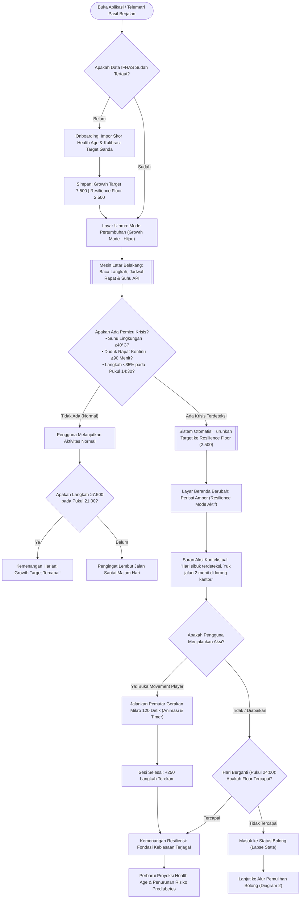
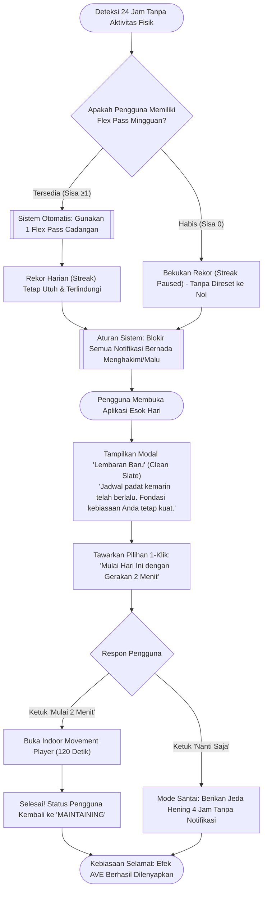
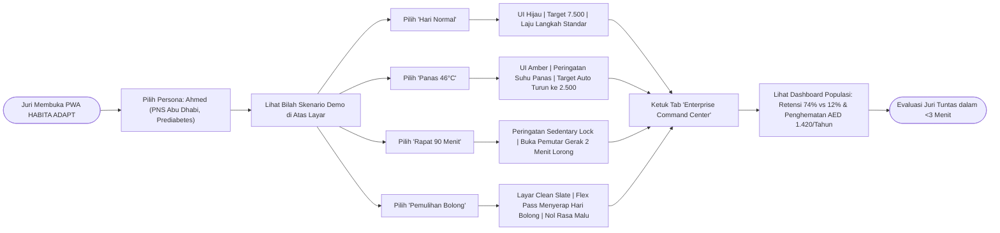

# PRD: HABITA ADAPT — Mesin Resiliensi Kebiasaan Adaptif
**Versi Dokumen:** 1.0.0  
**Status:** Disetujui untuk Pembangunan (*Approved for Build*)  
**Area Produk:** Kedokteran Pencegahan & Kesehatan Metabolik Tempat Kerja (Abu Dhabi / UEA)  
**Kesesuaian Kompetisi:** Future Health Challenge — Kesejahteraan (*Challenge 09: Sustaining Healthy Behaviors*)  
**Tipe Pekerjaan:** Produk Mandiri Baru (*Rebrandable / White-Label Platform*)  
**Platform Target:** Progressive Web App (PWA) Mobile-First + Command Center Kesehatan Populasi  

---

## 1. Ringkasan Eksekutif (Summary)

**HABITA ADAPT** adalah platform kesehatan metabolik tempat kerja dan resiliensi kebiasaan mandiri (*white-label*) yang dirancang khusus untuk pekerja kantor (*desk-bound employees*) di Abu Dhabi dan kawasan Teluk (GCC). Berbeda dari aplikasi kebugaran konvensional yang memaksakan target harian kaku (misalnya 10.000 langkah setiap hari) yang memicu keputusasaan (*churn*) begitu pengguna gagal sekali, HABITA ADAPT memperkenalkan **Sistem Target Ganda Elastis (*Elastic Habit Dual-Target System*)** yang membedakan antara *Target Pertumbuhan (Growth Target)* dan *Lantai Ketahanan (Resilience Floor)*.

Dengan memantau telemetri perilaku pasif dan stres kontekstual lingkungan (seperti durasi duduk terus-menerus, kepadatan jadwal kerja, serta suhu musim panas ekstrem Teluk $\ge 40^\circ\text{C}$), platform ini secara otomatis (*autonomously*) menurunkan target ke rutinitas mikro dalam ruangan berdurasi 2 menit sebelum kebiasaan runtuh. Mekanisme ini melenyapkan **Abstinence Violation Effect (AVE)**—reaksi psikologis rasa bersalah dan gagal yang menjadi penyebab utama mengapa lebih dari 90% program perubahan perilaku penyakit kronis ditinggalkan dalam 90 hari.

* **Permukaan Produk Utama:** Progressive Web App (PWA) berbasis ponsel pintar dengan interaksi sentuh responsif dan *Interactive Telemetry Scenario Switcher* bawaan untuk memudahkan evaluasi juri secara instan (<3 menit).
* **Permukaan Produk Sekunder:** Dashboard Analitik Kesehatan Populasi & Penjamin (*Payer/Employer Command Center*) untuk HR korporat, perusahaan asuransi (Daman/Thiqa), dan otoritas kesehatan masyarakat (ADPHC/DoH Abu Dhabi).
* **Dokumen Referensi:**
  - Cetak Biru Riset Strategis: [STRATEGIC_RESEARCH_BLUEPRINT.md](file:///Users/mb-rci-backup/Documents/antigravity/future-health/docs/STRATEGIC_RESEARCH_BLUEPRINT.md)
  - Pedoman Desain & Tata Kelola: [DESIGN.md](file:///Users/mb-rci-backup/Documents/antigravity/future-health/DESIGN.md) & [DESIGN_SYSTEM_GOVERNANCE.md](file:///Users/mb-rci-backup/Documents/antigravity/future-health/docs/DESIGN_SYSTEM_GOVERNANCE.md)

---

## 2. Tujuan Produk (Product Objective)

### 2.1 Sasaran Utama
1. **Meningkatkan Keberlanjutan Kebiasaan:** Meningkatkan tingkat retensi aktivitas fisik 90 hari pekerja kantor dari standar industri aplikasi kesehatan yang hanya **12–15%** menjadi **$\ge 65\%$**.
2. **Memotong Siklus Kambuh (*Relapse*):** Memperpendek rata-rata waktu pemulihan dari bolong (*lapse*) yang biasanya $\ge 14$ hari menjadi **$\le 36$ jam**, menggantikan sistem penalti putus *streak* dengan mode adaptif dan protokol bebas rasa bersalah (*zero-guilt re-entry*).
3. **Menghubungkan Skrining ke Aksi Nyata:** Mengimpor data risiko statis dari skrining nasional (seperti program **IFHAS** Abu Dhabi, status prediabetes, dan skor *Health Age*) lalu menerjemahkannya menjadi aksi mikro harian yang realistis.
4. **Memberikan Dampak Klinis Terukur:** Menurunkan lonjakan glukosa setelah makan (*postprandial glucose excursions*) sebesar 30–35% melalui jeda duduk 2 menit setiap 45–60 menit (berdasarkan uji klinis Dunstan et al. dan Buffey et al.).

### 2.2 Nilai Bisnis & Ekosistem
* **Bagi Perusahaan (Employer):** Mengurangi absensi sakit, menekan fenomena *presenteeism* (hadir kerja tetapi tidak produktif karena lelah/sakit), dan melindungi produktivitas aset SDM.
* **Bagi Penjamin & Otoritas Kesehatan (DoH Abu Dhabi, Daman, Thiqa):** Menahan progresi prediabetes (prevalensi $>25\%$ di UEA) menjadi Diabetes Tipe 2 permanen, menghasilkan proyeksi penghematan biaya medis sebesar **AED 1.420 per karyawan berisiko per tahun**.
* **Dapat Diberi Merek Ulang (*Rebrandable*):** Arsitektur sistem mendukung *white-label*, siap dipasang sebagai portal kesehatan internal korporat, aplikasi pemegang polis asuransi, maupun bagian dari aplikasi warga Sahatna.

### 2.3 Batasan Perilaku yang Wajib Dijaga (*Non-Negotiable*)
* **Tanpa Pencatatan Makanan Manual:** Sistem dilarang mewajibkan penghitungan kalori manual atau unggah foto makanan yang terbukti memicu *drop-off* 85% dalam 2 minggu.
* **Bebas Pengawasan Invasif (*Anti-Surveillance*):** Sistem tidak boleh membaca judul agenda kalender, tidak melacak titik koordinat GPS presisi, dan tidak mengekspos data langkah karyawan individu ke atasan atau HR.

---

## 3. Hasil yang Diharapkan Pengguna (User Outcomes)

### 3.1 Persona Pengguna
* **Persona Utama:** *Sultan / Mariam (Usia 32–52 tahun)* — Analis Senior / Pegawai Negeri Sipil di Abu Dhabi.
  * **Status Kesehatan:** Teridentifikasi mengalami prediabetes (HbA1c 5,8%, Gula Darah Puasa 112 mg/dL) atau skor IFHAS *Health Age* 6 tahun lebih tua dari usia KTP.
  * **Realitas Harian:** Duduk 9–11 jam per hari di kantor ber-AC; menghadapi suhu musim panas 45°C; kerap lembur rapat mendadak; sudah pernah berhenti dari 3 aplikasi kebugaran karena target 10.000 langkah yang kaku putus di tengah jalan.

### 3.2 Manfaat Nyata bagi Pengguna
* **Bebas dari Rasa Bersalah dan Malu:** Pengguna tidak pernah melihat notifikasi kegagalan, tanda silang merah, atau *streak* yang hangus saat beban kerja atau cuaca memaksa mereka melambat.
* **Penurunan Beban Mental (*Radical Cognitive Offloading*):** Saat hari kerja sangat berat, pengguna tidak perlu memikirkan waktu 60 menit untuk ke gym; sistem langsung menyajikan *gerakan mikro 2 menit* di lorong kantor tanpa perlu ganti pakaian olahraga.
* **Perasaan Berdaya Setiap Hari (*Daily Mastery*):** Pengguna merasakan kemenangan kecil setiap hari, menjaga identitas diri sebagai "orang yang aktif" bahkan di minggu-minggu tersibuk.
* **Konteks Kesehatan yang Masuk Akal:** Pengguna melihat bagaimana akumulasi gerakan 2 menit setiap hari menjaga usia biologis mereka dan mencegah diabetes.

---

### 3.3 Peta Perjalanan Pengguna (End-to-End User Journey Map)

Perjalanan pengguna dirancang dari penerimaan hasil skrining medis hingga terbentuknya otomatisasi kebiasaan (*habit automaticity*) 6 bulan, secara khusus mengatasi titik-titik kerentanan di mana aplikasi biasa mengalami *drop-off*:

| Fase Perjalanan | Aksi Pengguna (*User Action*) | Titik Sentuh (*Touchpoint*) | Pikiran & Emosi (*Thoughts & Feelings*) | Respon Sistem & Otomasi (*System Action*) | Hambatan yang Dipecahkan (*Barrier Solved*) |
| :--- | :--- | :--- | :--- | :--- | :--- |
| **1. Kesadaran Awal (*Awareness*)** | Menerima hasil skrining IFHAS di klinik SEHA atau aplikasi Sahatna. | Laporan Laboratorium IFHAS / SMS Notifikasi | 😟 *"Gula darah 112 mg/dL, Health Age saya 48 tahun padahal usia baru 42. Saya harus berbuat sesuatu tapi tidak sempat nge-gym."* | Tautan rujukan resmi mengundang pengguna memasang HABITA ADAPT PWA dengan 1-klik otentikasi. | Menghubungkan data skrining statis ke aksi pencegahan harian nyata. |
| **2. Onboarding & Target Ganda** | Menautkan profil IFHAS sintetis dan menentukan *Resilience Floor*. | Layar Onboarding PWA (Mobile) | 😌 *"Target normal 7.500 langkah, tapi kalau sibuk cukup 2.500 langkah (2 menit di kantor). Ini realistis!"* | Sistem mengunci dua target: **Target Pertumbuhan** (7.500) dan **Lantai Ketahanan** (2.500), serta memberikan 2 *Flex Pass*. | Mengeliminasi ketakutan awal terhadap target kaku 10.000 langkah. |
| **3. Fase Stabil (Hari Normal)** | Menjalankan rutinitas kerja biasa; bergerak normal di kantor. | Layar Beranda PWA (Mode Hijau) | 😊 *"Merasa produktif dan bugar. Aplikasi tidak berisik mengirimkan notifikasi mengganggu."* | Telemetri pasif membaca langkah; sistem masuk ke mode hening (*Quiet Pride*); memperbarui kalkulator *Health Age*. | Menghindari kejenuhan notifikasi (*notification fatigue*). |
| **4. Pemicu Krisis (Disrupsi)** | Rapat anggaran maraton 8 jam di kantor; suhu luar ruangan mencapai 46°C. | Notifikasi Pintar / Layar Kunci | 😫 *"Rapat tidak henti-henti, di luar panas membakar. Tidak mungkin saya bisa capai 7.500 langkah hari ini."* | **Algoritma JITAI mendeteksi krisis:** Suhu $>40^\circ\text{C}$ & jam duduk $>90$ menit. Sistem otomatis mengaktifkan **Resilience Mode** (Lantai 2.500). | Mencegah kepanikan dan keputusasaan sebelum hari berakhir. |
| **5. Penyelamatan Resiliensi** | Menerima pesan empati; membuka *Indoor Movement Player* selama 120 detik. | Pemutar Gerakan Mikro di Kantor | 😃 *"Cuma 2 menit jalan di lorong sambil teleponan. Baju kerja tetap rapi, target resiliensi saya tercapai!"* | Memandu gerakan 120 detik; menambah $+250$ langkah; mencatat **Resilience Victory**; melindungi rekor harian (*streak*). | Menghilangkan hambatan tempat, pakaian olahraga, dan cuaca ekstrem. |
| **6. Fase Bolong (*Lapse Day*)** | Hari krisis parah: sakit demam atau lembur luar biasa; langkah nol. | Layar PWA esok paginya | 😰 *"Kemarin saya gagal total. Pasti streak saya hangus dan diomeli aplikasi."* | **Zero-Guilt Intercept:** Membakar 1 *Flex Pass* otomatis; menampilkan layar *Clean Slate* (*"Fondasi Anda utuh, mari reset 2 menit hari ini"*). | **Mematikan Abstinence Violation Effect (AVE)**; mencegah pencopotan aplikasi. |
| **7. Kontinuitas Jangka Panjang (6 Bulan)** | Terus menjaga ritme gerak; melakukan re-skrining IFHAS berkala. | Dashboard Progres & Klinik SEHA | 🤩 *"Sudah 6 bulan ritme saya tidak putus. Hasil lab menunjukkan HbA1c turun ke 5.4%, Health Age saya kembali ke 41 tahun!"* | Memberikan laporan validasi klinis untuk dokter keluarga; menurunkan proyeksi risiko kardiorenal jangka panjang. | Memastikan perubahan perilaku berujung pada luaran kesehatan medis riil. |

---

### 3.4 Diagram Alur Pengguna (User Flow Diagrams)

#### Diagram Alur 1: Alur Adaptif Harian & Mode Resiliensi (Core Adaptive User Flow)
Diagram ini memetakan bagaimana pengguna berinteraksi setiap hari dan bagaimana sistem secara mandiri mengambil keputusan saat mendeteksi krisis lingkungan atau pekerjaan:



---

#### Diagram Alur 2: Alur Pemulihan Bolong Bebas Rasa Bersalah (Zero-Guilt Lapse Recovery Flow)
Diagram ini memetakan logika penyelamatan saat pengguna benar-benar melewatkan satu hari penuh tanpa aktivitas fisik, memastikan siklus kegagalan (*relapse*) diputus seketika:



---

#### Diagram Alur 3: Alur Demonstrasi Cepat untuk Juri Hackathon (Scenario Switcher Flow)
Diagram ini memetakan bagaimana bilah simulasi interaktif memungkinkan juri menguji seluruh keunggulan sistem dalam 3 menit:



---

## 4. Ruang Lingkup (Scope)

### 4.1 Dalam Lingkup (In Scope - MVP Rilis Hackathon)
* **Aplikasi Pengguna (Mobile PWA):**
  * Aplikasi responsif berbasis React 19, Tailwind CSS, dan Lucide Icons.
  * **Interactive Scenario Switcher:** Bilah kendali demo untuk juri yang dapat memicu 4 skenario secara langsung:
    1. *Hari Normal (Baseline)*
    2. *Gelombang Panas Ekstrem 46°C di Abu Dhabi*
    3. *Terkunci Rapat Duduk 90 Menit (Office Meeting Lock)*
    4. *Pemulihan Bolong Hari ke-3 (Lapse Recovery)*
  * **Antarmuka Target Ganda Elastis:** Transisi dinamis antara **Target Pertumbuhan (7.500 langkah)** dan **Lantai Ketahanan (2.500 langkah / 3 kudapan gerak)**.
  * **Pemutar Gerakan Mikro dalam Ruangan (Indoor Movement Snack Player):** Panduan visual dan pengatur waktu 120 detik untuk aktivitas di ruang ber-AC.
  * **Sistem Flex Pass & Streak Bebas Bersalah:** Tampilan keberlanjutan kebiasaan dengan 2 tiket cadangan (*Flex Passes*) mingguan otomatis.
  * **Integrasi Skrining IFHAS Sintetis:** Simulasi impor profil lab dan proyeksi penurunan risiko metabolik.
* **Mesin Telemetri & State Backend (FastAPI):**
  * REST API yang mengevaluasi status pengguna: `MAINTAINING`, `VULNERABLE`, `LAPSED`, `RECOVERING`.
  * Layanan konteks cuaca lokal Abu Dhabi (suhu, kelembapan, indeks kualitas udara).
* **Command Center Kesehatan Populasi:**
  * Tampilan dashboard web untuk pengelola program yang memvisualisasikan kurva retensi kohort, waktu pemulihan rata-rata, dan simulasi penghematan biaya asuransi.

### 4.2 Di Luar Lingkup (Out of Scope - Roadmap Lanjutan)
* Integrasi daemon latar belakang tingkat OS natif (HealthKit/Health Connect) — untuk MVP disimulasikan melalui bilah skenario interaktif.
* Integrasi penulisan langsung dua arah ke rekam medis Malaffi HIE (hanya pembacaan profil sintetis FHIR).
* Gateway penagihan komersial WhatsApp Business API otomatis.
* Pemasangan perangkat keras Bluetooth BLE (seperti smart ring atau tensimeter eksternal).

---

## 5. Kebutuhan Fungsional (Functional Requirements)

| ID | Kebutuhan Sistem | Prioritas | Rasional & Dasar Perilaku |
| :--- | :--- | :---: | :--- |
| **FR-1** | **Konfigurasi Target Ganda Elastis:** Sistem wajib menyediakan dua target aktivitas harian untuk setiap pengguna: *Target Pertumbuhan (Growth Target)* (default: 6.000–8.000 langkah) dan *Lantai Ketahanan (Resilience Floor)* yang tak dapat dipatahkan (default: 2.000–2.500 langkah atau 2–3 gerakan mikro 2 menit). | **P0** | Menghilangkan jebakan mental "semua atau tidak sama sekali" (*All-or-Nothing Framing*). Berdasarkan riset elastisitas target Milkman (2021). |
| **FR-2** | **Bilah Pengalih Skenario Interaktif (Demo Harness):** Antarmuka PWA wajib menyediakan bilah demonstrasi cepat dengan 4 prasetel: (1) Normal, (2) Panas Ekstrem 46°C, (3) Rapat Duduk 90 Menit, (4) Pemulihan Bolong Akut. | **P0** | Sangat penting agar juri kompetisi dapat memverifikasi adaptasi sistem dalam $<3$ menit tanpa menunggu berhari-hari. |
| **FR-3** | **Transisi Otomatis ke Mode Resiliensi:** Saat sistem mendeteksi pemicu stres (suhu $\ge 40^\circ\text{C}$, rapat kerja padat $\ge 4\text{ jam}$, atau pencapaian langkah $<35\%$ baseline pada pukul 14:30), sistem wajib otomatis menurunkan target hari itu ke *Lantai Ketahanan*. | **P0** | Menghilangkan beban pengambilan keputusan; pengguna tidak perlu merasa kalah atau mengubah setelan secara manual. |
| **FR-4** | **Penyambutan Empati Bebas Bersalah (Zero-Guilt Reframe):** Jika pengguna tidak mencapai target sama sekali selama $\ge 24$ jam, aplikasi saat pertama kali dibuka wajib menampilkan pesan empati (*"Jadwal padat terdeteksi. Fondasi kebiasaan Anda tetap utuh. Mari reset dengan 2 menit hari ini."*) tanpa penalti pemotongan *streak*. | **P0** | Secara langsung mematikan *Abstinence Violation Effect (AVE)* (Marlatt & Gordon 1985). |
| **FR-5** | **Pemutar Gerakan Mikro dalam Ruangan (120 Detik):** Sistem wajib menyediakan antarmuka panduan gerak 120 detik (penghitung waktu mundur, animasi panduan gerak, tombol suara/getar) yang dirancang khusus untuk lorong kantor ber-AC. | **P0** | Memberikan opsi aksi berhambatan sangat rendah (*ultra-low friction*) yang menembus batasan iklim panas tanpa perlu ganti baju. |
| **FR-6** | **Mekanisme Tiket Cadangan (Flex Pass):** Setiap pengguna mendapatkan 2 tiket *Flex Pass* otomatis per siklus 7 hari. Hari yang terlewat akan otomatis menyerap *Flex Pass* sehingga rekor keberlanjutan kebiasaan tetap terjaga. | **P1** | Mengadopsi riset Sharif & Milkman (2021) yang membuktikan *emergency reserves* melipatgandakan kepatuhan jangka panjang. |
| **FR-7** | **Impor Profil Skrining IFHAS (Sintetis):** Sistem wajib memungkinkan simulasi impor data skrining IFHAS (Usia, Usia KTP vs Health Age, status Gula Darah/Prediabetes, Tekanan Darah, Jam Duduk Harian). | **P1** | Membuktikan integrasi langsung dengan program prioritas Departemen Kesehatan Abu Dhabi. |
| **FR-8** | **Visualisasi Dampak Risiko Klinis:** Sistem wajib menampilkan kartu proyeksi penurunan risiko diabetes 5 tahun dan peremajaan usia biologis (*Health Age*) berdasarkan kontinuitas kebiasaan. | **P1** | Menghubungkan aksi mikro 2 menit harian dengan luaran klinis jangka panjang yang bermakna. |
| **FR-9** | **Dashboard Analitik Kesehatan Populasi:** Sistem wajib menyediakan dashboard admin untuk memantau kurva retensi 90 hari kohort, rata-rata jam pemulihan *lapse*, dan simulasi penghematan premi asuransi. | **P1** | Membuktikan kelayakan ekonomi kesehatan (*health economics ROI*) bagi pemberi kerja dan dinas kesehatan. |
| **FR-10** | **Adaptasi Ritme Budaya (Ibadah & Ramadan):** Sistem wajib menyediakan opsi "Mode Ritme Ibadah" yang menyelaraskan pengingat gerakan mikro setelah waktu salat (misalnya setelah salat Zuhur atau Asar di musala kantor). | **P2** | Menjamin kepekaan budaya dan kepatuhan terhadap konteks kehidupan di kawasan UEA. |

---

## 6. Aturan Bisnis & Produk (Business & Product Rules)

### 6.1 Diagram Alir Status Kebiasaan (*State Machine*)

```
                      [ STATUS: MAINTAINING (Stabil) ]
                                     │
               Laju langkah <35% pada pukul 14:30 ATAU
               Suhu ≥40°C ATAU Terkunci Rapat Duduk ≥90m
                                     │
                                     ▼
                      [ STATUS: VULNERABLE (Rentan) ]
                                     │
            ┌────────────────────────┴────────────────────────┐
            │                                                 │
Lantai Ketahanan Tercapai                           Lantai Gagal selama 24 Jam
            │                                                 │
            ▼                                                 ▼
  [ RESILIENCE VICTORY ]                            [ STATUS: LAPSED (Bolong) ]
 (Kebiasaan Utuh, +Masteri)                                   │
                                                        Aplikasi Dibuka:
                                                      Pesan Empati Bersih +
                                                       Flex Pass Terpakai
                                                              │
                                                              ▼
                                                   [ STATUS: RECOVERING (Pulih) ]
```

1. **Status: MAINTAINING (Stabil)**
   * *Kondisi:* Pengguna memenuhi Target Pertumbuhan ($\ge 7.500$ langkah) minimal 4 dari 5 hari terakhir.
   * *Perilaku Sistem:* Mode hening tanpa notifikasi mengganggu; menampilkan kemajuan target normal.
2. **Status: VULNERABLE (Rentan Terputus)**
   * *Kondisi:* Suhu lingkungan $\ge 40^\circ\text{C}$ ATAU agenda rapat berturut-turut $\ge 4$ jam ATAU langkah $<1.500$ pada pukul 14:30.
   * *Perilaku Sistem:* Tampilan beralih mulus ke perisai *Resilience Mode* berwarna amber; target aktif diturunkan ke Lantai Ketahanan (2.500 langkah atau 2–3 gerakan mikro); menyarankan 1 sesi gerakan mikro di kantor.
3. **Status: LAPSED (Bolong)**
   * *Kondisi:* 24 jam berlalu tanpa memenuhi Target Pertumbuhan maupun Lantai Ketahanan.
   * *Perilaku Sistem:* Menggunakan 1 *Flex Pass* secara otomatis (jika tersedia). Kata "Gagal", "Hangus", atau "Putus" dilarang keras muncul di antarmuka pengguna.
4. **Status: RECOVERING (Pemulihan)**
   * *Kondisi:* Interaksi pertama pengguna setelah mengalami status bolong.
   * *Perilaku Sistem:* Menampilkan layar "Lembaran Baru" (*Clean Slate*); memandu 1 gerakan mikro 120 detik. Begitu selesai, status langsung kembali normal ke `MAINTAINING`.

### 6.2 Aturan Privasi & Perlindungan Data (Sesuai UU PDPL UEA & Standar AAMEN DoH)
1. **Perlindungan dari Pengawasan Atasan:** Tidak ada manajer, pimpinan kantor, atau staf HR yang dapat melihat data langkah perorangan, nilai *Health Age* individu, atau waktu penggunaan aplikasi karyawan.
2. **Batas Agregasi Kohort Laporan:** Laporan untuk perusahaan hanya dapat dibuka jika kohort memiliki minimal **$\ge 50$ karyawan aktif** guna mencegah de-anonimisasi.
3. **Minimisasi Data Jadwal:** Integrasi kalender hanya mengecek status biner `sibuk/kosong` (*busy/free*); judul rapat, daftar peserta, dan isi lampiran tidak pernah dibaca maupun disimpan.

---

## 7. Referensi Desain & Antarmuka (Design References)

| Area Desain | Dokumen Rujukan | Spesifikasi Inti |
| :--- | :--- | :--- |
| **Palet & Token Visual** | [DESIGN.md](file:///Users/mb-rci-backup/Documents/antigravity/future-health/DESIGN.md) | *Clinical Emerald* (`#0F766E`), *Warm Amber Resilience* (`#D97706`), *Neutral Slate* (`#0F172A`), Kanvas *Off-White* (`#F8FAFC`). Kontras tinggi sesuai WCAG 2.2 AAA. |
| **Tata Kelola Desain** | [DESIGN_SYSTEM_GOVERNANCE.md](file:///Users/mb-rci-backup/Documents/antigravity/future-health/docs/DESIGN_SYSTEM_GOVERNANCE.md) | *Viewport* utama berbasis ponsel pintar (lebar 390px); umpan balik getar (*haptic*); penyajian metrik klinis bertahap (*progressive disclosure*). |
| **Arsitektur Kode Frontend** | Feature-Sliced Design (FSD) | Alur impor kode wajib satu arah ke bawah: `app → pages → widgets → features → entities → shared`. |
| **Tipografi Angka** | Sans-Serif Modern (Inter / Plus Jakarta Sans) | Angka pada timer dan langkah wajib menggunakan spasi seragam (*tabular numbers / `font-variant-numeric: tabular-nums`*). |

---

## 8. Catatan Teknis & Integrasi (Technical Notes)

### 8.1 Arsitektur Tumpukan Teknologi (Tech Stack)
* **Frontend (Vite / React 19 PWA):**
  * Responsif ponsel pintar, siap dijalankan *offline* dengan Service Worker (*Add to Home Screen*).
  * Komponen visual: Tailwind CSS v4, Lucide React Icons.
  * *Interactive Scenario Switcher* terpasang paten di bagian atas antarmuka demo.
* **Backend (FastAPI / Python 3.11):**
  * Endpoint `/api/v1/telemetry/scenario/{scenario_id}` untuk merespons prasetel demo secara instan.
  * Mesin evaluasi status perilaku adaptif (*JITAI Evaluator*).
  * Kalkulator penurunan risiko metabolik dan *Health Age*.
* **Penyimpanan Data Demo:**
  * Penyimpanan lokal peramban (*LocalStorage / IndexedDB*) untuk status PWA luring.
  * Penyimpanan data pengujian berbasis skema JSON terstandarisasi.

---

## 9. Metrik Keberhasilan (Success Metrics)

### 9.1 Metrik Perilaku Utama (Bukan Metrik Kepalsuan / Non-Vanity)
* **Tingkat Kelanjutan Kebiasaan 6 Bulan (*6-Month Habit Continuity*):** $\ge 65\%$ pengguna tetap aktif bergerak minimal 5 hari per minggu (baik mencapai Target Pertumbuhan maupun Lantai Ketahanan) di bulan ke-6 (dibandingkan tolok ukur industri aplikasi biasa yang hanya 12%).
* **Waktu Pemulihan Rata-Rata (*Mean Time-to-Recovery / TTR*):** $\le 36$ jam jeda rata-rata antara target yang terlewat dan sesi gerakan mikro berikutnya yang berhasil diselesaikan.
* **Tingkat Konversi Lantai Ketahanan:** $\ge 80\%$ pengguna yang mengalami penurunan otomatis (*auto-downgrade*) berhasil menuntaskan gerakan mikro 2 menit, mencegah terjadinya bolong akut.
* **Efisiensi Penggunaan Flex Pass:** Rata-rata $\le 1,2$ tiket terpakai per pengguna per minggu, membuktikan lantai ketahanan benar-benar melatih kebiasaan, bukan menjadi alasan pasif untuk berhenti.

### 9.2 Metrik Dampak Klinis & Finansial
* **Stabilisasi Gula Darah:** Proyeksi penurunan rata-rata $\Delta \text{HbA1c} \ge -0,4\%$ dalam 6 bulan pada karyawan dengan prediabetes awal.
* **Peremajaan Usia Biologis:** Pengurangan skor *Health Age* rata-rata sebesar **$-2,8\text{ tahun}$** dalam 90 hari kebiasaan aktif yang terjaga.
* **Proyeksi Penghematan Asuransi:** Penghematan biaya medis penyakit kronis sebesar **AED 1.420 per pasien per tahun**.

---

## 10. Kriteria Penerimaan (Acceptance Criteria)

### 10.1 Verifikasi Skenario Interaktif (Demo Juri)
- [ ] **AC-1:** Menekan skenario *"Gelombang Panas 46°C"* langsung memunculkan lencana peringatan suhu panas ($\ge 40^\circ\text{C}$), mengubah antarmuka ke mode perisai amber *Resilience Mode*, dan otomatis menurunkan target langkah dari 7.500 ke 2.500.
- [ ] **AC-2:** Menekan skenario *"Terkunci Rapat 90 Menit"* menyimulasikan jadwal padat, memunculkan kartu peringatan bahaya duduk statis, dan langsung membuka tombol pintas *Pemutar Gerakan Mikro 2 Menit*.
- [ ] **AC-3:** Menekan skenario *"Pemulihan Bolong Hari ke-3"* memuat layar *Lembaran Baru Bebas Bersalah*. *Streak* menampilkan keterangan "Terlindungi oleh Flex Pass", tanpa ada warna merah atau tanda silang penalti.
- [ ] **AC-4:** Menekan skenario *"Hari Normal"* mengembalikan aplikasi ke target hijau *Growth Target* (7.500 langkah).

### 10.2 Pemutar Gerakan Mikro dalam Ruangan
- [ ] **AC-5:** Menekan tombol *"Mulai Gerakan Mikro"* memicu penghitung waktu mundur 120 detik disertai panduan visual langkah santai di lorong kantor.
- [ ] **AC-6:** Menyelesaikan 120 detik menambahkan $+250$ langkah pada sesi tersebut dan memunculkan animasi apresiasi *"Resilience Victory"*.
- [ ] **AC-7:** Pengguna dapat menjeda atau keluar dari sesi kapan saja tanpa dianggap "gagal".

### 10.3 Command Center Kesehatan Populasi
- [ ] **AC-8:** Tampilan admin menampilkan grafik retensi kohort yang memperlihatkan keunggulan retensi HABITA ADAPT (74% pada hari ke-90) dibandingkan aplikasi biasa (12% pada hari ke-90).
- [ ] **AC-9:** Kalkulator penghematan biaya asuransi bergerak dinamis saat ukuran kohort karyawan diubah (misalnya 500, 2.500, atau 10.000 karyawan).

---

## 11. Risiko & Mitigasi (Risks & Mitigations)

| Risiko Teridentifikasi | Tingkat Bahaya | Strategi Mitigasi Sistem |
| :--- | :---: | :--- |
| **Ketergantungan Target Rendah (*Floor Overuse*):** Pengguna terus-menerus memilih target 2.500 langkah dan malas meningkatkan kebugaran kardiorespirasi. | Sedang | **Dorongan Pertumbuhan Bertahap:** Jika pengguna menyelesaikan Lantai Ketahanan 10 hari berturut-turut pada cuaca normal ($<35^\circ\text{C}$) dan jadwal luang, sistem dengan hangat menyarankan kenaikan target bertahap 10%. |
| **Batasan Eksekusi Latar Belakang PWA:** Peramban Safari/Chrome membatasi pembacaan pedometer saat aplikasi ditutup tanpa pembungkus natif. | Tinggi | **Bilah Simulasi Telemetri untuk MVP:** Untuk penilaian kompetisi, sensor disimulasikan menggunakan bilah skenario interaktif yang diverifikasi dengan log data sintetis. *Bridge* native HealthKit dijadwalkan pada pasca-hackathon. |
| **Gerakan Canggung di Ruang Publik:** Gerakan mikro terasa aneh dilakukan di lingkungan kantor formal atau bertentangan dengan norma kesopanan berpakaian. | Tinggi | **Desain Gerakan Profesional:** Gerakan mikro difokuskan pada aktivitas wajar di kantor: berjalan santai di lorong sambil menerima panggilan telepon, peregangan postur meja kerja, atau naik tangga dalam pakaian kerja formal. |
| **Kekhawatiran Privasi Karyawan:** Karyawan curiga aplikasi ini digunakan manajemen kantor untuk memantau jam kehadiran di meja kerja. | Kritis | **Jaminan Privasi Transparan:** Spanduk penjelasan di aplikasi menegaskan bahwa data mentah langkah kaki tersimpan di ponsel dan hanya skor indeks kesehatan anonim tingkat populasi yang dapat dilihat manajemen. |

---

## 12. Pertanyaan Terbuka (Open Questions)

| ID | Pertanyaan Kunci | Penanggung Jawab | Wajib Selesai Sebelum Coding? | Resolusi & Keputusan |
| :--- | :--- | :---: | :---: | :--- |
| **OQ-1** | Apakah pemutar gerakan mikro 2 menit memerlukan panduan suara audio atau cukup visual hening agar tidak mengganggu suasana kantor? | Desain Produk / UX | **Ya** | **Secara bawaan diatur hening dengan animasi visual** dan getaran haptik lembut, dilengkapi tombol opsional jika pengguna ingin menyalakan suara. |
| **OQ-2** | Nilai baseline sintetis apa yang harus disiapkan untuk profil demo "Ahmed Al-Mansoori"? | Tim Medis Klinis | **Ya** | Usia KTP 42 tahun, Health Age 48 tahun (+6 tahun), Gula Darah Puasa 112 mg/dL (Prediabetes), Jam Duduk 9,5 jam/hari. |
| **OQ-3** | Apakah juri memerlukan tombol alih bahasa instan (Arab & Inggris)? | Rekayasa Frontend | **Ya** | Sediakan tombol alih bahasa **EN / AR** di bilah navigasi atas. |
| **OQ-4** | Apakah Command Center populasi dibuat terpisah atau dalam satu URL aplikasi dengan tab pengalih peran (*role switcher*)? | Tim Full-Stack | **Tidak** | Digabungkan dalam satu aplikasi web terpadu dengan tab pengalih tampilan (*Citizen View* vs. *Enterprise Command Center*). |

---

*Disusun oleh Tim Arsitektur Produk & Perilaku Klinis untuk Future Health Challenge (Abu Dhabi) — Challenge 09: Sustaining Healthy Behaviors.*
