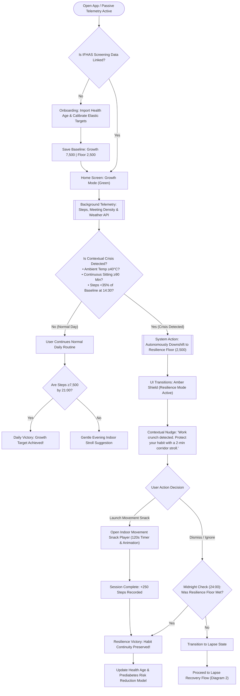
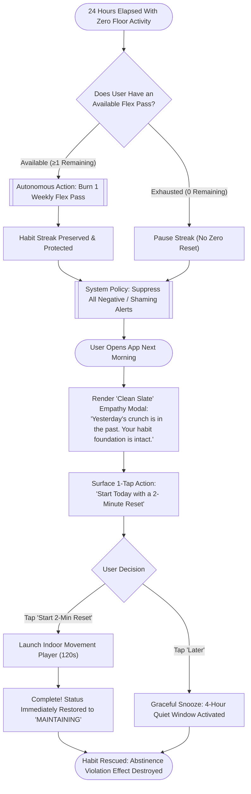
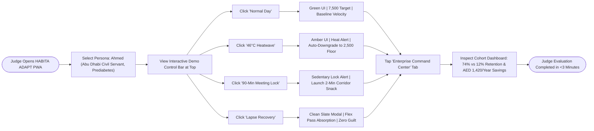

# PRD: HABITA ADAPT — Adaptive Habit Resilience Engine
**Document Version:** 1.0.0  
**Status:** Approved for Build  
**Product Area:** Preventive Medicine & Workplace Cardiometabolic Wellness (Abu Dhabi / UAE)  
**Track Alignment:** Future Health Challenge — Wellbeing (Challenge 09: Sustaining Healthy Behaviors)  
**Work Type:** New Standalone Product (Rebrandable Platform)  
**Target Platform:** Mobile-First Progressive Web App (PWA) + Executive Population Health Command Center  

---

## 1. Summary

**HABITA ADAPT** is a standalone, rebrandable workplace metabolic health and habit resilience platform engineered for desk-bound employees in Abu Dhabi and the wider GCC. Unlike conventional wellness applications that impose rigid, binary goals (e.g., 10,000 steps daily) and induce user churn upon the first missed streak, HABITA ADAPT introduces an **Elastic Habit Dual-Target System** (*Growth Target* vs. *Resilience Floor*).

By passively monitoring behavioral telemetry and contextual environmental stress (e.g., prolonged sedentary bouts, workplace schedule density, and extreme Gulf summer temperatures $\ge 40^\circ\text{C}$), the platform autonomously downshifts to a 2-minute climate-resilient indoor movement routine before habits collapse. This eliminates the **Abstinence Violation Effect (AVE)**—the psychological mechanism responsible for the 90-day abandonment of over 90% of chronic disease behavior-change initiatives.

* **Primary Product Surface:** Mobile-first Progressive Web App (PWA) with native-grade haptics, responsive touch interactions, and an embedded Interactive Telemetry Scenario Switcher for real-time hackathon evaluation.
* **Secondary Product Surface:** Population Health & Payer Analytics Dashboard (for enterprise HR, health insurers, and public health authorities like ADPHC).
* **Reference Documentation:** 
  - Strategic Research Blueprint: [STRATEGIC_RESEARCH_BLUEPRINT.md](file:///Users/mb-rci-backup/Documents/antigravity/future-health/docs/STRATEGIC_RESEARCH_BLUEPRINT.md)
  - Behavioral Landscape & Challenge 09 Analysis: Section 3 & 4 of Research Synthesis.

---

## 2. Product Objective

### 2.1 Core Objectives
1. **Dramatically Improve Habit Continuity:** Increase the 90-day physical activity maintenance rate of desk-bound employees from the digital health industry average of **12–15%** to **$\ge 65\%$**.
2. **Neutralize Behavioral Relapse:** Shorten the average lapse recovery window from $\ge 14$ days to **$\le 36$ hours** by replacing punitive streak resets with an autonomous "Resilience Mode" and zero-guilt re-entry protocols.
3. **Bridge Screening to Actionable Prevention:** Seamlessly ingest static risk outputs from national health screenings (such as Abu Dhabi's **IFHAS** program, prediabetes flags, and "Health Age" scoring) and convert them into personalized, sustainable daily micro-movements.
4. **Deliver Clinically Measurable Glycemic Impact:** Reduce postprandial glucose excursions by 30–35% through evidence-based 2-minute sedentary interruptions every 45–60 minutes (Dunstan et al., Buffey et al. benchmarks).

### 2.2 Business & Ecosystem Value
* **For Employers:** Decreases absenteeism, mitigates workplace presenteeism, and prevents chronic cardiometabolic decline in high-value desk-bound knowledge workers.
* **For Health Authorities & Payers (DoH Abu Dhabi, Daman, Thiqa):** Halts the upstream progression of prediabetes (prevalence $>25\%$ in UAE) to overt Type 2 Diabetes, yielding an estimated medical cost savings of **AED 1,420 per high-risk employee annually**.
* **Rebrandability:** Designed with white-label configuration capabilities, enabling deployment as an internal corporate wellness portal, an insurer-branded policyholder tool, or a public health initiative integrated with Sahatna.

### 2.3 Non-Negotiable Existing Behaviors to Preserve
* **No Manual Food Logging:** The platform strictly prohibits mandatory calorie tracking or meal logging, which is known to cause an 85% drop-off within 14 days.
* **No Intrusive Surveillance:** The platform must never read calendar event titles, capture precise GPS tracking coordinates, or expose employee-level activity data to corporate managers.

---

## 3. User Outcomes

### 3.1 Target Persona
* **Primary Persona:** *Sultan / Mariam (Age 32–52)* — Senior Analyst / Government Civil Servant in Abu Dhabi.
  * **Health Status:** Identified with prediabetes (HbA1c 5.8%, Fasting Blood Glucose 112 mg/dL) or an IFHAS "Health Age" 6 years older than chronological age.
  * **Daily Reality:** Sits for 9–11 hours daily in air-conditioned offices; endures severe summer heat (45°C) from May to October; experiences frequent late-meeting crunches; previously quit three separate fitness apps after failing rigid 10,000-step streaks.

### 3.2 Key User Outcomes
* **Freedom from Guilt and Failure:** The user never sees a broken streak, red penalty crosses, or shaming notifications when workload or climate disrupts their routine.
* **Radical Cognitive Offloading:** During high-stress workdays, the user does not have to plan a 60-minute gym session; the system prescribes a friction-free, 2-minute indoor movement snack that can be completed without athletic clothing.
* **Immediate Tangible Mastery:** The user feels a sense of achievement and self-efficacy daily, sustaining their psychological identity as an active person even during crisis weeks.
* **Understandable Health Context:** The user sees directly how their daily 2-minute micro-bouts cumulatively lower their biological Health Age and keep prediabetes from turning into irreversible disease.

---

### 3.3 End-to-End User Journey Map

The user journey is engineered from initial screening awareness to 6-month habit automaticity, directly resolving the critical drop-off points of conventional wellness applications:

| Journey Stage | User Action | Product Touchpoint | Thoughts & Emotional State | System Automation & Response | Critical Barrier Solved |
| :--- | :--- | :--- | :--- | :--- | :--- |
| **1. Clinical Awareness** | Receives IFHAS screening report at SEHA clinic or via Sahatna. | Laboratory Report / SMS Notification | 😟 *"Fasting glucose 112 mg/dL, Health Age is 48 (+6 years older). I must act, but I have no time for 60-minute gym workouts."* | Official referral link provides 1-tap onboarding into HABITA ADAPT PWA. | Converts passive screening data into active daily preventive lifestyle. |
| **2. Onboarding & Target Elasticity** | Links synthetic IFHAS profile and calibrates *Resilience Floor*. | Mobile PWA Onboarding Screen | 😌 *"Normal target 7,500 steps, but on crunch days 2,500 steps (2-min movement snack) is enough. This is actually doable!"* | Locks Dual-Target: **Growth Target** (7,500) vs **Resilience Floor** (2,500), issues 2 weekly Flex Passes. | Destroys intimidation of rigid 10,000-step mandates. |
| **3. Baseline Rhythm (Normal Day)** | Conducts daily office routine; walks normally between meetings. | Mobile PWA Home Screen (Green Mode) | 😊 *"Feeling productive and energetic. The app isn't constantly spamming me with noisy alerts."* | Passive telemetry monitors steps; enters "Quiet Pride" mode; updates Health Age projection. | Eliminates notification fatigue. |
| **4. Acute Disruption (Crunch Day)** | 8 hours of back-to-back budget meetings; outdoor temperature hits 46°C. | Smart Push / Ambient Lockscreen Card | 😫 *"Non-stop meetings and searing heat outside. There is zero chance I can hit 7,500 steps today."* | **JITAI Algorithm detects crunch:** Temp $>40^\circ\text{C}$ & continuous sitting $>90$ min. System autonomously downshifts to **Resilience Mode** (Floor: 2,500). | Preempts anxiety, guilt, and pre-emptive behavioral surrender. |
| **5. Resilience Rescue** | Receives empathy nudge; launches *Indoor Movement Snack Player* for 120s. | Indoor Movement Snack Player | 😃 *"Just 2 minutes of walking down the corridor while taking a phone call. Professional attire stays clean, habit is preserved!"* | Visual timer guidance; logs $+250$ steps; records **Resilience Victory**; protects streak. | Overcomes climate barriers, dress-code friction, and time scarcity. |
| **6. The Lapse Day & Recovery** | Severe disruption (illness, emergency); zero activity logged for 24h. | Next Morning PWA Launch | 😰 *"Yesterday was a disaster. My streak must be broken and the app is going to lecture me."* | **Zero-Guilt Intercept:** Burns 1 Flex Pass automatically; displays *Clean Slate* modal (*"Yesterday's crunch is over. Your habit foundation is intact"*). | **Destroys the Abstinence Violation Effect (AVE)**; stops app uninstalls. |
| **7. Long-Term Automaticity (Month 6)** | Sustains consistent micro-habits; undergoes routine IFHAS re-screening. | Long-Term Progress View & SEHA Clinic | 🤩 *"6 months of uninterrupted rhythm! Blood test shows HbA1c down to 5.4%, and Health Age is down to 41 years!"* | Generates clinical verification report for primary care physician; records sustained cardiorenal risk reduction. | Delivers durable, verified clinical biomarker improvement. |

---

### 3.4 User Flow Diagrams

#### Flow Diagram 1: Core Adaptive Loop & Resilience Flow
Maps the user's daily journey and how the system autonomously evaluates contextual stress:



---

#### Flow Diagram 2: Zero-Guilt Lapse Recovery Flow
Maps the interception logic when a user misses a full day, neutralizing the Abstinence Violation Effect:



---

#### Flow Diagram 3: Hackathon 3-Minute Demo Simulation Flow
Maps how judges interact with the real-time scenario switcher to evaluate the product in $<3$ minutes:



---

## 4. Scope

### 4.1 In Scope (MVP Release)
* **Mobile PWA Client:**
  * Self-contained, responsive mobile application built with React 19, Tailwind CSS, and Lucide icons.
  * **Interactive Scenario Switcher:** Demo control bar allowing judges/users to simulate:
    1. *Normal Day (Baseline Rhythm)*
    2. *46°C Extreme Summer Heat Alert*
    3. *90-Minute Sedentary Meeting Lock (Office Crunch)*
    4. *Day-3 Acute Lapse Recovery*
  * **Elastic Habit Engine UI:** Dynamic switching between **Growth Target (7,500 steps)** and **Resilience Floor (2,500 steps / 3 micro-bouts)**.
  * **Indoor Movement Snack Player:** Visual, timer-guided 120-second indoor exercises (corridor pacing, desk mobility, post-prayer indoor strolls).
  * **Zero-Guilt Streak & Flex Pass System:** Display of habit continuity and 2 weekly auto-absorbing "Flex Passes".
  * **Health Age & Risk Interception Card:** IFHAS biometric intake simulation showing real-time risk reduction projection.
* **Backend Telemetry & State Engine (FastAPI):**
  * REST API endpoints computing behavioral states: `MAINTAINING`, `VULNERABLE`, `LAPSED`, `RECOVERING`.
  * Weather & environmental context mock service (Abu Dhabi temperature, humidity, AQI).
  * Simulated step accumulation time-series and hourly cadence calculation.
* **Population Health Command Center:**
  * Web dashboard visualizing cohort retention, mean time-to-recovery (TTR), habit resilience distribution, and simulated payer cost savings.

### 4.2 Out of Scope (Post-Competition Roadmap)
* Native iOS CoreMotion / Android SensorManager background daemons (simulated via Web PWA and Telemetry Harness for MVP).
* Direct write-back integration to Malaffi Health Information Exchange (read-only FHIR synthetic ingestion model used for demo).
* Real-time automated WhatsApp Business API billing gateway (conversational UI previewed within PWA).
* Bluetooth hardware BLE pairing for third-party smart rings or connected blood pressure cuffs.

---

## 5. Functional Requirements

| ID | Requirement | Priority | Rationale & Behavioral Rule |
| :--- | :--- | :---: | :--- |
| **FR-1** | **Elastic Dual-Target Configuration:** The system must establish two distinct daily activity targets for every user: a *Growth Target* (default: 6,000–8,000 steps) and an unbreakable *Resilience Floor* (default: 2,000–2,500 steps or two 2-minute indoor micro-bouts). | **P0** | Prevents all-or-nothing cognitive framing. Grounded in Milkman's goal elasticity framework. |
| **FR-2** | **Interactive Scenario Switcher (Demo Harness):** The PWA must provide an accessible demo control bar with 4 presets: (1) Normal Baseline, (2) 46°C Heatwave Alert, (3) 90-min Sedentary Meeting Lock, (4) Acute Lapse State. | **P0** | Essential for hackathon judges to evaluate system adaptation in $<3$ minutes without waiting 48 real-world hours. |
| **FR-3** | **Autonomous State Transition to Resilience Mode:** When the system receives a contextual trigger (ambient temp $\ge 40^\circ\text{C}$, calendar density $\ge 4\text{ hours}$ continuous meetings, or step velocity $<35\%$ of baseline at 2:30 PM), it must automatically downshift the day's active objective to the *Resilience Floor*. | **P0** | Offloads user decision fatigue; eliminates the need for the user to admit defeat or manually change settings. |
| **FR-4** | **Zero-Guilt Empathy Intercept:** If a user fails to meet even the Resilience Floor for $\ge 24$ hours, the system must greet the user on next opening with an empathy reframe (*"Heavy schedule detected. Your habit foundation is intact. Let's do a 2-minute reset today."*) and zero streak penalty deductions. | **P0** | Directly neutralizes the Abstinence Violation Effect (AVE) (Marlatt & Gordon 1985). |
| **FR-5** | **Indoor Micro-Movement Snack Player:** The system must provide a step-by-step 120-second guided micro-movement interface (timer, visual movement animation, audio chime toggle) designed specifically for air-conditioned office spaces. | **P0** | Provides immediate, low-barrier execution that bypasses the climate barrier and requires zero athletic attire. |
| **FR-6** | **Flex Pass / Emergency Reserve Mechanics:** Every user must be allocated 2 automated "Flex Passes" per 7-day rolling window. Unmet days must automatically consume a Flex Pass, preserving the headline habit continuity counter. | **P1** | Replicates Sharif & Milkman (2021) research proving emergency reserves maximize long-term adherence. |
| **FR-7** | **IFHAS Screening Data Ingestion (Synthetic):** The system must allow users to simulate importing an IFHAS screening profile (Age, Chronological vs. Health Age, Fasting Glucose / Prediabetes status, SBP, Daily Seated Hours). | **P1** | Demonstrates clear ecosystem integration with Abu Dhabi Department of Health initiatives. |
| **FR-8** | **Clinical Impact & Risk Trajectory Visualization:** The system must display a dynamic card illustrating projected 5-year diabetes risk reduction and biological Health Age recalibration based on unbroken habit continuity. | **P1** | Connects daily micro-actions to long-term preventive health outcomes. |
| **FR-9** | **Population Health Analytics Dashboard:** The system must provide an administrative view aggregating cohort metrics: 90-day retention curve, average hours to lapse recovery, and projected insurance savings. | **P1** | Proves economic viability and scalability to healthcare hackathon judges and enterprise payers. |
| **FR-10** | **Cultural Rhythms Adaptation (Ramadan & Prayer Timing):** The system must allow toggling "Prayer Rhythms Mode", shifting micro-movement suggestions to post-prayer transitions (e.g., post-Dhuhr or post-Asr indoor strolls). | **P2** | Ensures cultural alignment with UAE and Islamic daily schedules. |

---

## 6. Business & Product Rules

### 6.1 Habit State Machine Rules
```
                      [ STATE: MAINTAINING ]
                                │
                 Step velocity <35% at 14:30 OR
                 Temp ≥40°C OR Meeting Lock ≥90m
                                │
                                ▼
                      [ STATE: VULNERABLE ]
                                │
            ┌───────────────────┴───────────────────┐
            │                                       │
Resilience Floor Met                     Floor Unmet for 24h
            │                                       │
            ▼                                       ▼
  [ RESILIENCE VICTORY ]                    [ STATE: LAPSED ]
(Streak preserved, +Mastery)                        │
                                          Next App Opening:
                                       Zero-Guilt Reframe +
                                        Flex Pass Auto-Burn
                                                    │
                                                    ▼
                                          [ STATE: RECOVERING ]
```

1. **State: MAINTAINING**
   * *Condition:* User has logged activity $\ge$ Growth Target (7,500 steps) on $\ge 4$ of the last 5 days.
   * *System Behavior:* Minimal notifications ("Quiet Pride" mode); displays Growth Target.
2. **State: VULNERABLE**
   * *Condition:* Ambient temp $\ge 40^\circ\text{C}$ OR cumulative meetings $\ge 4$ hours OR 2:30 PM steps $<1,500$.
   * *System Behavior:* UI transitions smoothly to amber Resilience Shield; active goal switches to Resilience Floor (2,500 steps or two 2-min movement snacks); prompts single indoor snack.
3. **State: LAPSED**
   * *Condition:* 24 consecutive hours elapsed without logging either Growth Target or Resilience Floor.
   * *System Behavior:* Triggers automatic consumption of 1 Flex Pass (if available). The word "Failed" or "Broken" is strictly banned from all UI strings.
4. **State: RECOVERING**
   * *Condition:* First user interaction following a lapse.
   * *System Behavior:* Displays Clean Slate Empathy screen; prompts a single 120-second indoor movement snack to re-anchor the habit loop. Upon completion, immediately returns state to `MAINTAINING`.

### 6.2 Data & Privacy Rules (UAE PDPL & AAMEN Compliance)
1. **Zero Employer Snooping:** No manager, supervisor, or HR personnel can view individual step counts, individual Health Ages, or specific app usage timestamps.
2. **Minimum Cohort Size for Reporting:** Enterprise population reports must require an aggregation threshold of at least **$\ge 50$ active employees** to prevent re-identification.
3. **Data Minimization:** Calendar integration only queries the binary `busy/free` boolean status; event titles, attendee names, locations, and descriptions must never be fetched or stored.

---

## 7. Design & Interaction References

Execution specifications must adhere to the design governance principles defined in the workspace:

| Design Domain | Governing Standard / Document | Specification Summary |
| :--- | :--- | :--- |
| **Visual Tokens & Palette** | [DESIGN.md](file:///Users/mb-rci-backup/Documents/antigravity/future-health/DESIGN.md) | Clinical Emerald (`#0F766E`), Warm Amber Resilience (`#D97706`), Neutral Slate (`#0F172A`), Off-White Canvas (`#F8FAFC`). High-contrast WCAG 2.2 AAA compliance. |
| **Design Governance** | [DESIGN_SYSTEM_GOVERNANCE.md](file:///Users/mb-rci-backup/Documents/antigravity/future-health/docs/DESIGN_SYSTEM_GOVERNANCE.md) | Mobile-first viewport (390px base width); micro-haptics on completion; progressive disclosure of clinical telemetry. |
| **Component Architecture** | Feature-Sliced Design (FSD) | Strictly follow `app → pages → widgets → features → entities → shared`. Imports flow strictly downward. |
| **Typography Scale** | Clean Sans-Serif (Inter / Plus Jakarta Sans) | Strict tabular numerals (`font-variant-numeric: tabular-nums`) for timers, step counts, and Health Age calculations. |

---

## 8. Technical & Integration Notes

### 8.1 Architecture & Stack
```
┌────────────────────────────────────────────────────────────────────────┐
│                        FRONTEND CLIENT (Vite / React 19)              │
│  • PWA Service Worker (Offline-ready, Add to Home Screen)              │
│  • Lucide React Icons, Tailwind CSS v4                                │
│  • Embedded Telemetry Scenario Switcher Component                      │
└───────────────────────────────────┬────────────────────────────────────┘
                                    │ HTTP / JSON REST
                                    ▼
┌────────────────────────────────────────────────────────────────────────┐
│                        BACKEND ENGINE (FastAPI / Python 3.11)          │
│  • /api/v1/telemetry/scenario/{scenario_id} (Preset Context Dispatcher)│
│  • /api/v1/habit/evaluate-state (JITAI State Machine Evaluator)        │
│  • /api/v1/biomarkers/health-age (IFHAS Risk Projection Calculator)    │
│  • /api/v1/analytics/population-summary (Command Center Aggregates)    │
└────────────────────────────────────────────────────────────────────────┘
```

### 8.2 Existing Endpoints & Data Mocking
* **Telemetry Feeds:** Built-in scenario presets deliver instant mock telemetry payloads simulating hourly step velocity and weather parameters without requiring real-world GPS or Bluetooth.
* **IFHAS Synthetic Integration:** Ingests synthetic JSON schema conforming to Abu Dhabi DoH standard screening outputs (HbA1c, fasting glucose, blood pressure, lipid panels).

---

## 9. Success Metrics

### 9.1 Primary Product Metrics (The "Non-Vanity" Scorecard)
* **6-Month Habit Continuity Rate:** $\ge 65\%$ of users maintaining active routines (Growth Target or Resilience Floor $\ge 5$ days/week) at 180 days (vs. 12% industry baseline).
* **Mean Time-to-Recovery (TTR):** $\le 36$ hours average elapsed time between a missed target and the subsequent completed movement snack.
* **Resilience Floor Conversion:** $\ge 80\%$ of users who experience an automated downshift complete their 2-minute movement snack, successfully averting an acute lapse.
* **Flex Pass Burn Efficiency:** $\le 1.2$ average Flex Passes consumed per user per week, demonstrating that the floor actively sustains behavior rather than serving as passive abandonment.

### 9.2 Clinical & Health Economics Metrics
* **Glycemic Stabilization:** Projected mean $\Delta \text{HbA1c} \ge -0.4\%$ at 6 months among employees with baseline prediabetes.
* **Health Age Reversal:** Average biological Health Age reduction of **$-2.8\text{ years}$** within 90 days of sustained habit resilience.
* **Simulated Payor Savings:** Projected reduction of **AED 1,420 / patient / year** in downstream cardiometabolic diagnostics and acute interventions.

---

## 10. Acceptance Criteria

### 10.1 Scenario Switcher & Simulation (Judge Verification)
- [ ] **AC-1:** Selecting *"46°C Summer Heat Crunch"* immediately triggers an ambient heat alert badge ($\ge 40^\circ\text{C}$), transitions the UI into amber "Resilience Mode", and automatically reduces the daily step target from 7,500 to 2,500.
- [ ] **AC-2:** Selecting *"90-Min Meeting Lock"* simulates high calendar density, flashes an ambient "Sedentary Lock Detected" prompt, and surfaces the 2-Minute Corridor Movement Snack player.
- [ ] **AC-3:** Selecting *"Day-3 Acute Lapse"* loads the "Clean Slate" zero-guilt interface. The streak counter displays "Preserved via Flex Pass", and no negative error/penalty styling appears.
- [ ] **AC-4:** Selecting *"Normal Day"* restores standard green Growth Target (7,500 steps) and standard pacing cadence.

### 10.2 Indoor Movement Snack Player
- [ ] **AC-5:** Tapping *"Start Movement Snack"* launches a 120-second countdown with visual movement guidance (e.g., indoor pacing cadence).
- [ ] **AC-6:** Completing the 120 seconds increments the session step count by $+250$ steps and triggers a positive "Resilience Victory" micro-celebration.
- [ ] **AC-7:** The player includes a 1-tap exit/pause button without recording a failure.

### 10.3 Population Health Command Center
- [ ] **AC-8:** The admin view renders cohort retention curves contrasting HABITA ADAPT (projected 74% at 90 days) against standard wellness apps (12% at 90 days).
- [ ] **AC-9:** Displays calculated annual cost savings dynamically calibrated to the selected employee cohort size (e.g., 500, 2,500, or 10,000 employees).

---

## 11. Risks & Mitigations

| Risk | Severity | Mitigation Strategy |
| :--- | :---: | :--- |
| **"Floor Overuse" Hazard:** Users permanently adopt the 2,500-step Resilience Floor, failing to strive for higher cardiorespiratory fitness. | Moderate | **Intelligent Growth Nudge:** If the system observes 10 consecutive days of Resilience Floor completion during normal weather ($<35^\circ\text{C}$) and low calendar load, it gently suggests a 10% target step ramp-up. |
| **PWA Background Execution Limits:** Mobile Safari/Chrome restrict continuous background pedometer execution without native wrappers. | High | **Interactive Telemetry Harness for MVP:** For the competition demo, telemetry is controlled via the interactive scenario switcher and verified against historical synthetic logs. Native HealthKit bridge specified for post-hackathon build. |
| **Cultural Mismatch of Movement Suggestions:** Recommending movements that feel awkward or undignified in professional Gulf office settings. | High | **Professional Micro-Bouts:** Movement snacks are strictly designed as natural workplace actions: walking corridor telephone pacing, standing desk posture shifts, and stair climbing in business attire. |
| **Enterprise Privacy Skepticism:** Employees suspect management is tracking their desk absences. | Critical | **Cryptographic Privacy Guarantee:** Prominent in-app banner verifying that individual telemetry never leaves the device; only k-anonymized aggregate scores are visible to HR. |

---

## 12. Open Questions

| ID | Question | Owner | Required Before Build? | Resolution / Status |
| :--- | :--- | :---: | :---: | :--- |
| **OQ-1** | Should the PWA include an audio narration guide for the 2-minute movement snack, or keep it strictly visual/silent for quiet offices? | Product / UX | **Yes** | **Default to silent visual animation** with subtle haptic vibrations and an optional sound toggle. |
| **OQ-2** | What exact synthetic baseline values should be pre-loaded into the demo persona "Ahmed Al-Mansoori"? | Clinical Lead | **Yes** | Age 42, Chronological Age 42, Health Age 48 (+6 yrs), Fasting Glucose 112 mg/dL, Sedentary Time 9.5 hrs/day. |
| **OQ-3** | Will the hackathon judges require real-time multilingual (Arabic + English) toggle during the 3-minute pitch? | Engineering | **Yes** | Include an immediate **EN / AR** language toggle in the navigation header. |
| **OQ-4** | Can the Population Health Command Center live on the same web port as the PWA or separate? | Full-Stack Lead | **No** | Unified single-page application with a role/view switcher tab (`Citizen PWA View` vs. `Enterprise Command Center View`). |

---

*Authored by the Product & Behavioral Architecture Team for Future Health Challenge (Abu Dhabi) — Challenge 09: Sustaining Healthy Behaviors.*
