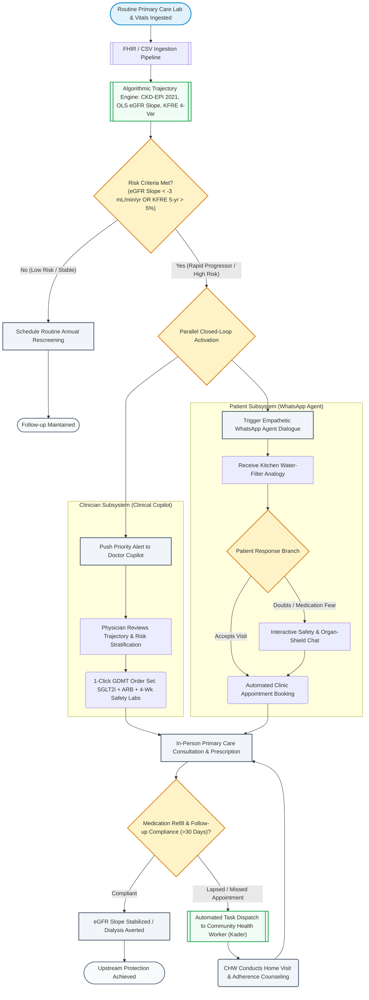
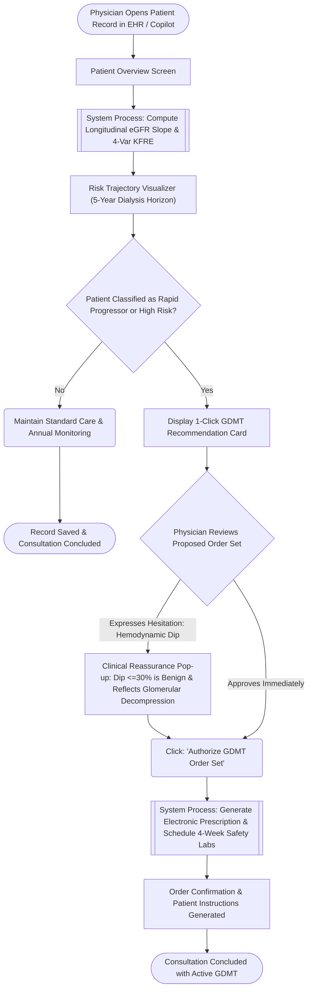
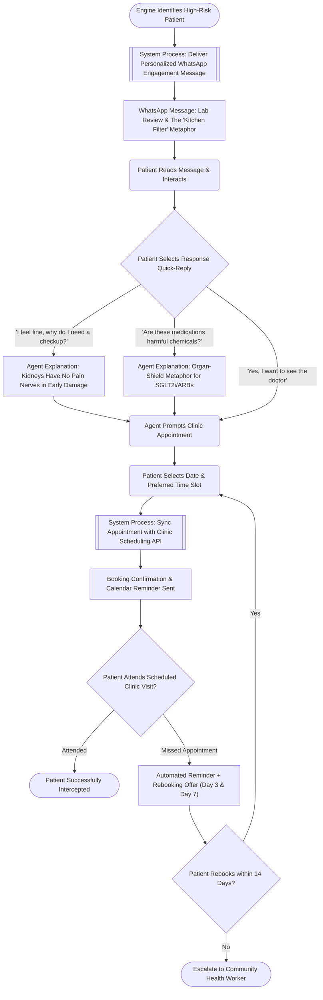
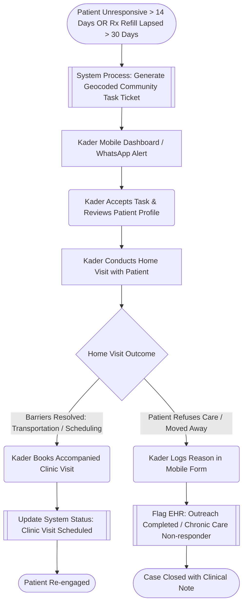

# RENAL-PULSE: System Scope & User Flow Specification

> **Document Type:** System Architecture & User Flow Specification  
> **Status:** `Stable / Ready for Implementation`  
> **Version:** `1.0.0`  
> **Target Audience:** Engineering, Clinical Advisors, Product & UX Designers  
> **Clinical Baseline:** KDIGO 2024, CKD-EPI 2021, KFRE JAMA 2016  

---

## Table of Contents
1. [Executive Summary & Purpose](#1-executive-summary--purpose)
2. [Guiding Principles](#2-guiding-principles)
3. [Actor & Stakeholder Matrix](#3-actor--stakeholder-matrix)
4. [Macro End-to-End System Flow](#4-macro-end-to-end-system-flow)
5. [User Flow 1: Frontline Physician (Clinical Copilot)](#5-user-flow-1-frontline-physician-clinical-copilot)
6. [User Flow 2: Asymptomatic Patient (WhatsApp Engagement Agent)](#6-user-flow-2-asymptomatic-patient-whatsapp-engagement-agent)
7. [User Flow 3: Community Escalation Loop (Kader / CHW)](#7-user-flow-3-community-escalation-loop-kader--chw)
8. [System Scope & Boundaries](#8-system-scope--boundaries)
9. [Related Resources & Verification](#9-related-resources--verification)

---

## 1. Executive Summary & Purpose

The chronic disease burden across both emerging health economies (e.g., Indonesia's BPJS Kesehatan) and advanced health networks (e.g., Abu Dhabi Department of Health) is disproportionately driven by catastrophic end-stage organ failure—predominantly **End-Stage Kidney Disease (ESKD)** requiring lifelong hemodialysis.

**RENAL-PULSE** bridges the *"Signal-to-Action Translation Chasm"* by converting latent, routine primary care laboratory and vital sign records into proactive, guideline-directed intervention before irreversible nephron destruction occurs.

This document formally specifies:
* The end-to-end multi-stakeholder system architecture.
* The detailed user flows and decision branching logic for clinicians, patients, and community health workers.
* The system boundaries, input requirements, and safety fail-safes.

---

## 2. Guiding Principles

1. **Closed-Loop Action:** A risk signal must never terminate in a passive dashboard. Every detected risk triggers automated, protocolized actions across primary care clinicians and patients.
2. **Zero Specialized Hardware:** 100% software-based. Clinicians operate on existing web browsers, patients on standard WhatsApp, and labs on existing diagnostic equipment.
3. **Upstream First:** Intercept cardiorenal decline at Stages 1–3a at primary care clinics (FKTP/Puskesmas), long before hospital-level dialysis is reached.
4. **Evidence-Based Clinical Decision Support:** All alerts and order sets strictly cite validated international guidelines (KDIGO 2024, CKD-EPI NEJM 2021, KFRE JAMA 2016).

---

## 3. Actor & Stakeholder Matrix

| Actor / Persona | Primary Interface | Core Goal | Primary Friction Addressed |
| :--- | :--- | :--- | :--- |
| **Frontline Physician** *(Primary Care / Puskesmas)* | Web App (*Doctor Clinical Copilot*) | Identify rapid progressors and prescribe GDMT (SGLT2i + ARB) within a 3–5 min consult. | Therapeutic inertia and anxiety regarding transient hemodynamic creatinine dips. |
| **Asymptomatic Patient** *(Hypertensive / Diabetic)* | Mobile Messaging (*WhatsApp Agent*) | Understand kidney vulnerability without panic, overcome pill fears, and confirm clinic booking. | The "Asymptomatic Trap"—denial of illness due to total lack of physical pain/swelling. |
| **Community Health Worker** *(Kader / CHW)* | Mobile Task Sheet / WhatsApp | Re-engage high-risk patients who have lapsed on prescriptions (>30 days) or missed visits. | Care fragmentation and patient loss to follow-up in the community. |
| **Population Health Director** *(Payer / DoH / BPJS)* | Command Center Dashboard | Monitor regional risk heatmaps and track projected dialysis costs averted. | Unpredictable catastrophic claims and uncoordinated regional screening programs. |

---

## 4. Macro End-to-End System Flow

The macro flow tracks how routine data moves through automated mathematical risk calculation to dual clinician and patient activation:

---

## 5. User Flow 1: Frontline Physician (Clinical Copilot)

### 5.1 Context & Goal
Primary care clinicians routinely face 40–60 patients per shift with 3–5 minutes per consultation. They lack longitudinal slope calculators and frequently hesitate to initiate SGLT2 inhibitors or ACEi/ARBs due to benign hemodynamic serum creatinine increases. 

### 5.2 Flow Diagram

### 5.3 Detailed Step Anatomy

| Step / Screen | Description & Content | Key Decision / Action | Fail-Safe / Annotation |
| :--- | :--- | :--- | :--- |
| **Patient Overview Screen** | Displays patient demographics, baseline BP, latest lab values (Creatinine, uACR). | Auto-queries trajectory engine. | If serial creatinine points $<2$, prompts for repeat test to establish slope. |
| **Risk Trajectory Visualizer** | Interactive dual-chart displaying historical eGFR, linear regression slope ($mL/min/1.73m^2/year$), and projected trajectory to ESKD (eGFR $<15$). | Physician visually inspects acceleration of renal decline. | Clear colored indicators: Red ($<-5$), Orange ($-3$ to $-5$), Green ($>-1$). |
| **1-Click GDMT Card** | Pre-calculated organ-protective medication bundle:  • Dapagliflozin 10 mg QD or Empagliflozin 10 mg QD • Losartan 50 mg QD (or equivalent ARB) • Reflex order: 4-week Serum Creatinine + Potassium safety check. | One-click authorization or dosage customization. | Cites KDIGO 2024 Grade 1A recommendations; displays contraindication checks (e.g., eGFR $<20$). |
| **Hemodynamic Dip Modal** | Explains that a 10%–25% acute eGFR dip within 2–4 weeks is expected hemodynamic reduction of intraglomerular pressure, not structural injury. | Reassures clinician to prevent premature drug discontinuation. | Explicit threshold: Only investigate if creatinine rises $>30\%$. |

---

## 6. User Flow 2: Asymptomatic Patient (WhatsApp Engagement Agent)

### 6.1 Context & Goal
Early chronic kidney disease causes zero physical discomfort. Standard medical alerts stating *"Your creatinine is 1.4 mg/dL"* fail because patients feel completely healthy and assume the test is erroneous or unnecessary. The WhatsApp agent translates filtration loss into culturally grounded metaphors and converts intent into a confirmed appointment.

### 6.2 Flow Diagram

### 6.3 Conversational Design Specifications
* **Language Support:** Bahasa Indonesia and English.
* **Tone:** Empathetic, reassuring, non-alarmist, actionable.
* **Metaphor Used:** *"Saringan Dapur"* (Kitchen Water Filter)—explaining that just like a household water filter that gets clogged gradually without making a sound, kidneys filter blood silently until fully stopped.

---

## 7. User Flow 3: Community Escalation Loop (Kader / CHW)

### 7.1 Context & Goal
For underserved or elderly populations, digital notifications alone may not bridge care delivery. When a high-risk patient misses appointments or fails to pick up chronic medication refills for over 30 days, the platform escalates the case to local Community Health Workers (*Kader Kesehatan* / Posbindu).

---

## 8. System Scope & Boundaries

### 8.1 Functional Scope Matrix

| System Domain | In-Scope (Implemented & Supported) | Out-of-Scope (Deferred / Excluded) |
| :--- | :--- | :--- |
| **Data Ingestion** | Routine primary care EHR vitals (BP, Age, Sex), standard biochemistry (Serum Creatinine, Fasting Glucose, HbA1c), urinalysis (dipstick protein, spot uACR). | High-complexity radiology (Renal Ultrasound/CT/MRI), renal biopsy histology, genetic screening. |
| **Clinical Mathematics** | • CKD-EPI 2021 Creatinine eGFR equation (race-free) • Ordinary Least Squares (OLS) longitudinal eGFR slope • Tangri 4-Variable KFRE (2-year & 5-year failure risk) • KDIGO 2024 G1–G5 x A1–A3 staging matrix | Acute Kidney Injury (AKI) dialysis dosing calculators, pediatric nephrology formulas (<18 years old). |
| **Clinical Copilot (Physician)** | Web-based responsive dashboard, rapid decline alerts, 1-click evidence-based GDMT order set cards, transient dip clinical guidance. | Full inpatient hospital EHR, complex multi-specialty surgery scheduling, hospital billing modules. |
| **Patient Engagement (WhatsApp)** | Asynchronous AI messaging, kitchen-filter analogy, myth busting on kidney medication, interactive clinic booking. | Real-time live emergency triage (e.g., acute chest pain, pulmonary edema), unverified herbal medicine prescribing. |
| **Population Health Command Center** | Macro heatmaps by health district, high-risk registry, Markov state-transition model of projected dialysis costs avoided. | Pharmaceutical supply chain procurement and direct warehouse inventory management. |

### 8.2 Technical Requirements & Non-Functional Specifications
* **Accessibility & Latency:** Doctor Copilot screens render within $<400\text{ ms}$ (Doherty Threshold) to prevent friction during clinical visits.
* **Security & Privacy:** Compliant with healthcare data regulations (FHIR profile compatibility, anonymized patient identifiers in messaging queues).
* **Interoperability:** Standardized REST APIs accepting JSON/FHIR formats, adaptable to both Indonesia's SATUSEHAT / BPJS PCare and Abu Dhabi's Malaffi HIE.

---

## 9. Related Resources & Verification

* **Clinical Formulas:** See [docs/CLINICAL_FORMULAS.md](file:///Users/mb-rci-backup/Documents/antigravity/future-health/docs/CLINICAL_FORMULAS.md) for complete mathematical proofs, benchmark test fixtures, and KDIGO matrices.
* **Track Analysis & Competition Strategy:** See [docs/INITIAL_CONTEXT.md](file:///Users/mb-rci-backup/Documents/antigravity/future-health/docs/INITIAL_CONTEXT.md).
* **Synthetic Patient Generator:** See [`scripts/generate_synthetic_patients.py`](file:///Users/mb-rci-backup/Documents/antigravity/future-health/scripts/generate_synthetic_patients.py) and data schema at [`data/schemas/patient_schema.json`](file:///Users/mb-rci-backup/Documents/antigravity/future-health/data/schemas/patient_schema.json).
