# Draft Slide Presentasi: Sintesis Riset & Eksplorasi Ideasi
## Tinjauan Strategis: Dari 21 Ide Berbasis Kamera Menuju Solusi Pencegahan Penyakit Terbaik

> **Cakupan Dokumen:** Bagian Pembuka — Executive Summary & Strategic Rationale s/d Section 6 (Multi-Criteria Scoring & Ranking)  
> **Rujukan Utama:** [`docs/research/RESEARCH_AND_IDEATION_SYNTHESIS.md`](file:///Users/mb-rci-backup/Documents/antigravity/future-health/docs/research/RESEARCH_AND_IDEATION_SYNTHESIS.md)  
> **Target Audiens:** Juri Evaluator Inovasi, Tim Penilai Kesehatan Masyarakat, Dewan Juri Teknis & Medis Awam  
> **Bahasa:** Bahasa Indonesia (Bahasa Medis Awam, Mudah Dipahami, Minim Istilah Rumit)  
> **Format:** 11 Slide Tinjauan Strategis & Metodologi Riset

---

## Alur Cerita Bagian Riset (Story Arc)

```mermaid
flowchart LR
    Mandate["1. Mandat & Filosofi<br/>Konteks Kompetisi"] --> Rubric["2. Kriteria Juri<br/>5 Pilar Penilaian"]
    Rubric --> Ideation["3. Eksplorasi 21 Ide<br/>5 Klaster Kamera/OCR"]
    Ideation --> Domains["4. Peta 8 Penyakit<br/>Ginjal, Jantung, Otak, dll."]
    Domains --> Gaps["5. 5 Jurang Kegagalan<br/>Mengapa Skrining Macet?"]
    Gaps --> Problems["6. 8 Masalah (P1-P8)<br/>Spesifikasi Masalah"]
    Problems --> Scoring["7. Skoring Transparan<br/>Matriks 8 Kriteria"]
    Scoring --> Champion["8. Juara Riset<br/>Mengapa Ginjal (P1) Menang?"]
```

---

## Slide 1: Judul & Pembuka (Title Slide)

* **Judul:** **Menemukan Masalah yang Paling Berharga untuk Diselesaikan**
* **Sub-judul:** Sintesis Riset & Evaluasi 21 Ide Inovasi Kamera/OCR untuk Pencegahan Penyakit di Fasilitas Kesehatan Primer
* **Pesan Utama:** Kami melakukan riset komprehensif melintasi 8 bidang penyakit untuk menemukan di mana kecerdasan buatan berbasis kamera dapat menyelamatkan nyawa terbanyak dan menghemat biaya kesehatan terbesar.

### Rancangan Visual
* Latar belakang bersih dan berwibawa (biru tua korporat dipadu aksen emas/toska).
* Diagram alur: Peta 8 bidang penyakit $\rightarrow$ Corong seleksi 21 ide $\rightarrow$ Matriks skoring multi-kriteria $\rightarrow$ Solusi Juara #1.
* Label konteks: *Future Health Digital Innovation Challenge — Track: Population Health*.

### Poin Konten
* **Misi Utama:** Menjawab tantangan global: bagaimana mengubah hasil pemeriksaan kesehatan rutin yang selama ini pasif menjadi tindakan pencegahan nyata di masyarakat.
* **Pendekatan Ilmiah:** Mengevaluasi 21 konsep solusi secara objektif berdasarkan bukti medis global, urgensi kebutuhan masyarakat, dan kemudahan penerapan di lapangan.
* **Fokus Riset:** Menghubungkan kenyataan di lapangan (kertas lab manual di puskesmas) dengan sistem kesehatan digital modern (seperti SatuSehat di Indonesia dan Malaffi di Abu Dhabi).

### Catatan Pembicara (Speaker Notes)
> *"Bapak dan Ibu Dewan Juri yang terhormat, inovasi terbaik tidak lahir dari tebakan acak, melainkan dari proses riset yang disiplin dan jujur. Sebelum kami menulis satu baris kode pun, tim kami melakukan pemetaan mendalam terhadap 21 ide solusi kecerdasan buatan di 8 bidang penyakit kronis. Kami ingin menjawab satu pertanyaan paling mendasar: 'Di mana teknologi kamera smartphone sederhana bisa memberikan dampak penyelamatan nyawa paling besar dan mencegah kebangkrutan anggaran kesehatan?' Hari ini, kami memaparkan perjalanan riset kami dari evaluasi masalah hingga menemukan solusi dengan skor tertinggi."*

---

## Slide 2: Mandat Kompetisi & Filosofi Utama (The Track Mandate)

* **Judul:** **Mandat Kesehatan Populasi: Dari Mendeteksi Menuju Melindungi**
* **Pesan Utama:** Skrining yang hanya mencatat angka tanpa tindakan pengobatan adalah kesia-siaan. Filosofi kami: *"To Sense is to Predict; To Predict is to Protect"*.

### Rancangan Visual
* Dua panel kontras berdampingan:
  * **Model Lama (Reaktif):** Pasien jatuh sakit $\rightarrow$ Masuk IGD $\rightarrow$ Perawatan mahal di rumah sakit rujukan.
  * **Model Baru (Preventif):** Deteksi dini di puskesmas $\rightarrow$ Prediksi arah penyakit $\rightarrow$ Resep pelindung sejak dini sebelum ada keluhan.
* Slogan tercetak tegas: *"Mendeteksi untuk Memprediksi; Memprediksi untuk Melindungi"*.

### Poin Konten
* **Tantangan Jalur Kesehatan Populasi (Population Health):** Bukan sekadar membuat dashboard pemantau data, melainkan memotong rantai penyakit sebelum pasien jatuh ke fase kritis.
* **Jurang Terbesar Saat Ini:** Banyak orang sudah menjalani cek darah atau tes kesehatan berkala, tetapi hasilnya hanya berhenti sebagai arsip tanpa ada dokter yang menindaklanjuti.
* **Misi Penyelamatan Dini:** Memindahkan fokus layanan kesehatan dari "mengobati orang yang sudah sekarat di rumah sakit" menjadi "melindungi orang yang masih merasa sehat di klinik faskes pertama".

### Catatan Pembicara
> *"Trek Population Health dalam kompetisi ini memiliki mandat yang sangat tegas: menutup celah antara skrining dan perawatan nyata. Di seluruh dunia, sistem kesehatan menghabiskan triliunan rupiah untuk mengobati komplikasi penyakit stadium akhir. Mengapa? Karena skrining yang ada selama ini bersifat pasif: pasien dicek darah, diberi selembar kertas, lalu pulang tanpa tindak lanjut. Filosofi kami sangat jelas: 'To Sense is to Predict, To Predict is to Protect'—Mendeteksi risiko hanyalah langkah awal; tujuan utamanya adalah memprediksi laju perburukan dan melindungi organ pasien sebelum kerusakan terjadi."*

---

## Slide 3: Kriteria Penilaian Resmi (The Evaluation Rubric)

* **Judul:** **5 Pilar Penentu Solusi Unggulan**
* **Pesan Utama:** Kami merancang dan menguji seluruh ide riset agar memenuhi bobot tertinggi dari 5 pilar penilaian resmi kompetisi.

### Rancangan Visual
* Diagram lingkaran / kartu bobot 5 pilar penilaian:
  * **Inovasi & Keaslian Ide (25%)**
  * **Dampak Penyelamatan & Finansial (25%)**
  * **Kelayakan Teknis & Standar Medis (20%)**
  * **Kesiapan Prototipe (15%)**
  * **Kemudahan Penerapan / Skalabilitas (15%)**

### Poin Konten
* **Inovasi Nyata (25%):** Menolak sekadar membuat chatbot tanya-jawab umum. Solusi harus memecahkan sumbatan nyata: membaca dokumen kertas fisik dan mengatasi ketakutan dokter meresepkan obat.
* **Dampak Klinis Terukur (25%):** Harus ada bukti angka penurunan risiko kematian dan pencegahan biaya penyakit katastropik termahal (seperti cuci darah).
* **Fondasi Medis Teruji (20%):** Perhitungan risiko tidak boleh menggunakan rumus asal-asalan; wajib mengadopsi standar kedokteran dunia resmi (KDIGO 2024 & CKD-EPI 2021).
* **Pengalaman Pengguna Tanpa Hambatan (15%):** Waktu respons dokter di bawah 30 detik dan komunikasi pasien yang sangat ramah via WhatsApp.
* **Dapat Diterapkan di Mana Saja (15%):** Bekerja sama baiknya di puskesmas pelosok Indonesia (BPJS) maupun jaringan rumah sakit terpadu Abu Dhabi (Malaffi HIE).

### Catatan Pembicara
> *"Agar solusi yang kami hasilkan tidak melenceng dari harapan dewan juri, kami membedah rubrik penilaian resmi menjadi kompas kerja kami. Lima pilar ini menuntut keseimbangan sempurna: Inovasi 25% dan Dampak 25% adalah porsi terbesar. Artinya, juri tidak menginginkan aplikasi main-main yang hanya bagus di atas kertas; juri mencari terobosan yang memecahkan masalah nyata dan menyelamatkan anggaran kesehatan dalam jumlah raksasa. Tiga pilar lainnya—kelayakan medis, prototipe yang responsif, dan skalabilitas lintas negara—menjadi pagar pengaman bahwa solusi ini benar-benar bisa langsung dipakai di dunia nyata."*

---

## Slide 4: Eksplorasi 21 Ide Solusi Berbasis Kamera (The 21 Ideas)

* **Judul:** **Eksplorasi Luas: 21 Konsep Inovasi Penglihatan Komputer**
* **Pesan Utama:** Kami mengelompokkan dan menguji 21 ide solusi berbasis kamera/OCR ke dalam 5 klaster kesehatan masyarakat.

### Rancangan Visual
* Bagan matriks 5 Klaster Inovasi:
  1. *Klaster 1:* Menutup Rantai Skrining Lab Kertas (5 Ide)
  2. *Klaster 2:* Perlindungan Pekerja Lapangan dari Cuaca Panas (5 Ide)
  3. *Klaster 3:* Peringatan Dini Penyakit & Absensi Karyawan (4 Ide)
  4. *Klaster 4:* Deteksi Dini Daya Ingat & Otak Lansia (3 Ide)
  5. *Klaster 5:* Skrining Genetik & Tumbuh Kembang Seumur Hidup (4 Ide)

### Poin Konten
* **Mengapa Kamera Smartphone?:** Kamera ponsel adalah alat pemindai termurah, paling merata, dan sudah dimiliki oleh miliaran warga serta tenaga kesehatan di seluruh dunia.
* **Eksplorasi Multidimensi:** Kami tidak hanya melihat satu penyakit. Kami meneliti kertas hasil lab darah, kertas grafik tes pernapasan, buku vaksin anak, kartu tes urine pekerja proyek, hingga coretan pohon riwayat penyakit keluarga.
* **Menghubungkan Dunia Fisik ke Komputer:** Semua ide bertujuan sama: mengambil data kesehatan yang selama ini 'terjebak' di kertas manual dan mengubahnya menjadi data digital yang bisa dianalisis otomatis.

### Catatan Pembicara
> *"Langkah kedua riset kami adalah menjelajahi berbagai kemungkinan pemanfaatan teknologi penglihatan komputer (computer vision) dan pembaca tulisan (OCR). Mengapa kamera? Karena kamera di saku kita adalah alat paling demokratis di dunia: tidak perlu biaya tambahan, tidak perlu pengadaan mesin baru. Kami menyusun katalog 21 ide solusi yang mencakup 5 klaster besar: mulai dari membaca kertas lab darah, melindungi buruh dari sengatan panas ekstrem, menganalisis surat sakit kantor, mendeteksi kepikunan lansia dari tes menggambar jam, hingga membaca buku posyandu balita. Dari katalog luas inilah kami memulai penyaringan ketat."*

---

## Slide 5: Peta Peluang di 8 Bidang Penyakit (8-Disease Map)

* **Judul:** **Menyelidiki 8 Bidang Penyakit Kronis Utama**
* **Pesan Utama:** Kami membedah 8 area beban penyakit terbesar untuk melihat di mana letak 'kebutuhan yang belum terjawab' (unmet need) paling parah.

### Rancangan Visual
* Tabel perbandingan 8 bidang penyakit dengan ikon ramah:
  1. 🫘 **Penyakit Ginjal & Diabetes:** Penurunan daya saring darah (sangat senyap, bukti obat sangat kuat).
  2. 🫀 **Darah Tinggi & Penyakit Jantung:** Risiko stroke dan serangan jantung mendadak.
  3. ☀️ **Sengatan Panas Pekerja Proyek:** Dehidrasi berat dan kerusakan ginjal akibat kerja fisik di terik matahari.
  4. 🧠 **Kesehatan Otak & Pikun Lansia:** Gejala awal demensia vs. gangguan memori yang bisa disembuhkan.
  5. 🫁 **Kesehatan Paru Pekerja Industri:** Penurunan fungsi napas akibat debu semen/tambang.
  6. 👶 **Tumbuh Kembang Anak & Imunisasi:** Keterlambatan bicara/gerak dan jadwal vaksin yang bolong.
  7. 🧬 **Riwayat Penyakit Keluarga:** Deteksi dini risiko diabetes dan jantung turunan.
  8. 📋 **Pencatatan Kader Posyandu:** Keterlambatan pelaporan buku catatan fisik posyandu ke dinas.

### Poin Konten
* **Identifikasi Beban Biaya:** Penyakit ginjal, jantung, dan cuci darah menempati urutan teratas dalam menyedot kas asuransi kesehatan nasional.
* **Tingkat 'Kebutaan Gejala':** Penyakit ginjal dan sengatan panas menonjol sebagai kondisi yang paling sering tidak disadari oleh penderita hingga kerusakan organ sudah parah.
* **Ketersediaan Obat Pencegahan:** Tidak semua penyakit memiliki obat pencegah yang ampuh. Penyakit ginjal memiliki bukti medis paling mutakhir di mana obat kelas baru terbukti mampu membalikkan tren perburukan organ.

### Catatan Pembicara
> *"Di tahap ini, kami menguji 8 bidang penyakit utama di masyarakat. Kita tahu stroke, serangan jantung, dan demensia adalah masalah besar. Namun ketika kami bedah lebih dalam, ada perbedaan mencolok dalam hal ketersediaan solusi pencegahan. Pada penyakit paru atau demensia lanjut, misalnya, ketika organ sudah rusak, sulit sekali mengembalikannya seperti semula. Tetapi pada penyakit ginjal akibat diabetes dan darah tinggi, dunia kedokteran baru saja menemukan terobosan besar: ada obat pelindung ginjal modern yang jika diberikan tepat waktu saat saringan ginjal mulai bocor, mampu menurunkan risiko cuci darah hingga 39 persen! Inilah peluang emas terbesar yang sedang terbuka lebar."*

---

## Slide 6: Mengapa Skrining Sering Gagal? (The 5 Failure Archetypes)

* **Judul:** **5 Jurang Pemisah: Mengapa Hasil Tes Lab Tidak Berujung Tindakan?**
* **Pesan Utama:** Skrining terputus bukan karena masyarakat tidak mau sehat, melainkan karena ada 5 sumbatan sistemik di lapangan.

### Rancangan Visual
* Diagram 5 Batu Sandungan (The 5 Gaps):
  1. **Jurang Kertas (The Paper Trap):** >85% hasil tes dicetak di kertas lab swasta dan tersimpan di laci rumah.
  2. **Jebakan Tanpa Gejala (The Asymptomatic Trap):** Pasien merasa bugar, sehingga menganggap angka lab sedikit tinggi bukan masalah.
  3. **Waktu Periksa Singkat (The 3-Minute Crunch):** Dokter puskesmas kewalahan memeriksa antrean 40 pasien sehari.
  4. **Ketakutan Efek Obat (The Hesitation Barrier):** Dokter ragu memulai obat karena khawatir angka fungsi ginjal turun sedikit di awal.
  5. **Hilang Kontak (The Lost-to-Followup):** Pasien tidak pernah diingatkan untuk cek darah ulang, rantai rujukan pun putus.

### Poin Konten
* **Bukan Masalah Pasien Semata:** Sistem layanan kesehatan saat ini tidak dirancang untuk menjemput bola pasien yang belum mengeluh sakit.
* **Informasi Terkunci:** Lab swasta tidak terhubung ke rekam medis puskesmas, sehingga dokter tidak tahu pasien sudah pernah tes darah.
* **Komunikasi yang Terlalu Menakutkan atau Kaku:** Saat dihubungi dengan istilah medis rumit, pasien cenderung menyangkal (*denial*) atau takut minum obat kimia.

### Catatan Pembicara
> *"Mengapa program skrining pemerintah sering kali gagal menurunkan angka cuci darah? Riset kami membuktikan ada 5 jurang pemisah. Pertama, hasil tes tercetak di kertas lab swasta dan masuk laci rumah. Kedua, pasien merasa badannya segar bugar, jadi buat apa ke dokter? Ketiga, saat pasien datang pun, dokter di puskesmas hanya punya waktu 3 menit per pasien, tidak sempat menghitung tren laju saringan ginjal. Keempat, dokter ragu memberikan obat pelindung ginjal karena takut ada efek samping di awal. Kelima, tidak ada yang mengingatkan pasien untuk kontrol ulang. Bila kita ingin menutup celah skrining, kita harus meruntuhkan kelima batu sandungan ini sekaligus."*

---

## Slide 7: 8 Pernyataan Masalah Terstruktur (P1 – P8)

* **Judul:** **Memetakan 8 Rumusan Masalah Spesifik**
* **Pesan Utama:** Kami merumuskan 8 pernyataan masalah formal (P1 s/d P8) dengan target populasi, sinyal bahaya, dan dampak kegagalan yang jelas.

### Rancangan Visual
* Kartu matriks 8 Masalah:
  * **P1 (Ginjal Senyap):** Pasien diabetes & hipertensi dengan kebocoran saringan ginjal tak bergejala.
  * **P2 (Sengatan Panas Pekerja):** Buruh bangunan di terik 48°C yang mengalami dehidrasi berat harian.
  * **P3 (Surat Sakit Gelap):** Data diagnosis surat sakit karyawan pabrik yang tertumpuk manual di HRD.
  * **P4 (Tes Kepikunan Lansia):** Lansia kesulitan tes digital & salah diagnosis akibat gangguan memori palsu.
  * **P5 (Kertas Spirometri Paru):** Kertas struk kasir tes pernapasan buruh tambang yang cepat pudar.
  * **P6 (Buku Vaksinasi Anak):** Keterlambatan jadwal imunisasi dan skrining bicara balita pada buku fisik.
  * **P7 (Pohon Silsilah Genetik):** Coretan silsilah riwayat sakit keluarga yang sulit dianalisis komputer.
  * **P8 (Buku Catatan Kader):** Buku tulis kader posyandu yang terlambat dilaporkan ke dinas kesehatan.

### Poin Konten
* **Setiap Masalah Diuji dengan 5 Pertanyaan Kunci:**
  1. Siapa yang berisiko?
  2. Apa sinyal awal yang bisa dibaca kamera?
  3. Tindakan pencegahan apa yang seharusnya dilakukan?
  4. Mengapa tindakan itu saat ini gagal terjadi?
  5. Apa akibat fatal jika dibiarkan tanpa tindakan?

### Catatan Pembicara
> *"Dari pemetaan awal, kami memformulasikan 8 pernyataan masalah terstruktur yang kami beri kode P1 sampai P8. Setiap masalah kami telusuri secara rinci: Siapa korbannya? Apa data kertas yang bisa dibaca kamera? Dan apa akibat fatalnya bila kita biarkan? Sebagai contoh, pada P1, korbannya adalah jutaan penderita diabetes dan hipertensi; sinyalnya adalah angka kreatinin dan protein urin di kertas lab; akibat fatalnya adalah cuci darah seumur hidup. Pada P2, korbannya buruh proyek luar ruangan yang ginjalnya rusak akibat dehidrasi terik matahari. Semua masalah ini sangat nyata dan mendesak untuk diselesaikan."*

---

## Slide 8: Sorotan Dua Kandidat Terkuat (P1 vs P2)

* **Judul:** **Dua Masalah Paling Kritis: Ginjal Senyap vs Sengatan Panas Pekerja**
* **Pesan Utama:** Masalah P1 (Penyakit Ginjal Kardiorenal) dan P2 (Sengatan Panas Pekerja) muncul sebagai dua kandidat dengan skor dampak tertinggi di kawasan Teluk dan Asia Tenggara.

### Rancangan Visual
* Perbandingan dua sisi (Head-to-Head Comparison):
  * **Kandidat A (P1 - Penyakit Ginjal Kardiorenal):**
    * *Populasi:* >20 juta penderita diabetes/tensi tinggi di Indonesia, >850 ribu di UAE.
    * *Biaya Katastropik:* Rp 150 Juta per pasien per tahun (cuci darah seumur hidup).
    * *Kekuatan Bukti Medis:* Bukti uji klinis Kelas 1A (Obat SGLT2i menurunkan risiko gagal ginjal hingga 39%).
  * **Kandidat B (P2 - Sengatan Panas Buruh Proyek):**
    * *Populasi:* >2,5 juta pekerja konstruksi & migran di terik matahari Timur Tengah.
    * *Risiko Akut:* Sengatan panas mendadak (*heat stroke*) & gagal ginjal akut berulang.
    * *Tantangan Lapangan:* Jam tangan pintar (*smartwatch*) sering rusak di suhu 48°C dan ditakuti buruh karena takut gajinya dipotong jika denyut jantungnya terpantau lelah.

### Poin Konten
* **Kedua Masalah Sangat Sejalan dengan Prioritas Tuan Rumah:** Abu Dhabi sangat peduli pada perlindungan buruh cuaca panas (OSHAD) sekaligus penanganan penyakit metabolik kronis (DoH / Malaffi).
* **Perbedaan di Tingkat Solusi:** P2 memerlukan kepatuhan operasional mandor proyek di lapangan, sedangkan P1 langsung menyentuh resep dokter di faskes primer dengan dampak penghematan biaya asuransi yang luar biasa pasti.

### Catatan Pembicara
> *"Saat kami mengelompokkan masalah, ada dua kandidat yang nilainya melesat jauh di atas yang lain: P1 (Penyakit Ginjal Kardiorenal) dan P2 (Sengatan Panas Pekerja Lapangan). Masalah P2 sangat menarik karena membongkar mitos jam tangan pintar: di gurun pasir bersuhu 48 derajat Celsius, smartwatch canggih sering mati kepanasan, dan para kuli proyek takut memakainya karena khawatir gaji mereka dipotong bila ketahuan istirahat. Namun, masalah P1 memiliki keunggulan yang tidak tertandingi: kepastian uji klinis kedokteran. Obat pelindung ginjal terbukti secara mutlak menyelamatkan nyawa pasien dan menghindarkan sistem asuransi dari tagihan cuci darah yang menjadi beban nomor satu anggaran kesehatan."*

---

## Slide 9: Matriks Penilaian Multikriteria Transparan (Scoring Matrix)

* **Judul:** **Evaluasi Multikriteria yang Transparan & Terukur**
* **Pesan Utama:** Kami menilai 8 masalah menggunakan 8 parameter terbobot ketat untuk memastikan objektivitas pemilihan solusi juara.

### Rancangan Visual
* Tabel matriks skor komprehensif (Highlight baris P1 dan P2):

| Kode Masalah | Dampak Kesehatan (20%) | Bukti Medis (15%) | Kebutuhan Mendesak (15%) | Pencegahan Dini (15%) | Kemudahan Sebar (10%) | Kelayakan Teknis (10%) | Inovasi (10%) | Kesesuaian Jalur (5%) | Total Skor Akhir | Peringkat |
| :--- | :---: | :---: | :---: | :---: | :---: | :---: | :---: | :---: | :---: | :---: |
| **P1: Ginjal Kardiorenal** | **5.0** | **5.0** | **5.0** | **5.0** | 4.5 | 4.5 | 4.2 | **5.0** | **4.82** | 🥇 **#1** |
| **P2: Sengatan Panas Buruh** | 4.8 | 4.6 | 4.9 | 4.8 | **4.8** | 4.4 | **4.9** | **5.0** | **4.77** | 🥈 **#2** |
| **P4: Daya Ingat & Otak Lansia** | 4.4 | 4.5 | 4.6 | 4.5 | 4.3 | 4.0 | 4.8 | 4.8 | **4.47** | 🥉 **#3** |
| **P6: Vaksin & Tumbuh Kembang** | 4.1 | 4.5 | 4.3 | 4.6 | 4.2 | 4.2 | 3.9 | 4.4 | **4.28** | **#4** |
| **P3: Surat Sakit Perusahaan** | 4.0 | 4.2 | 4.4 | 4.2 | 4.6 | 4.1 | 4.3 | 4.4 | **4.24** | **#5** |
| **P7: Silsilah Genetik Keluarga** | 4.3 | 4.4 | 4.2 | 4.5 | 3.2 | 3.2 | 4.7 | 4.5 | **4.16** | **#6** |
| **P5: Spirometri Kertas Paru** | 4.0 | 4.4 | 3.9 | 4.2 | 3.5 | 3.9 | 4.2 | 4.1 | **4.04** | **#7** |
| **P8: Catatan Posyandu Fisik** | 4.0 | 4.0 | 4.2 | 4.0 | 4.4 | 3.8 | 3.8 | 4.0 | **4.03** | **#8** |

### Poin Konten
* **Skor Sempurna (5.0) untuk P1 di 5 Kategori:** Dampak Kesehatan, Kekuatan Bukti Medis, Kebutuhan Mendesak, Pencegahan Dini, dan Kesesuaian Trek.
* **P2 Juara Inovasi:** Memperoleh skor inovasi tertinggi (4.9) karena keberaniannya menolak ketergantungan pada perangkat keras jam tangan pintar.
* **Transparansi Tanpa Bias:** Penilaian dilakukan secara kuantitatif tanpa memaksakan ide awal, menghasilkan keputusan yang dapat dipertanggungjawabkan di hadapan dewan juri ahli.

### Catatan Pembicara
> *"Tabel ini adalah jantung dari proses seleksi kami. Kami tidak memilih masalah berdasarkan selera pribadi, melainkan menggunakan matriks evaluasi 8 kriteria terbobot. Mari kita perhatikan baris teratas: Masalah P1 meraih skor tertinggi 4.82 dari skala 5.00. P1 memperoleh nilai sempurna 5.0 pada dampak klinis, kekuatan bukti medis, dan urgensi kebutuhan masyarakat. Masalah P2 membayangi ketat di posisi kedua dengan skor 4.77 dan menjadi juara dalam aspek keaslian inovasi. Namun secara keseluruhan dampak kesehatan populasi dan penyelamatan anggaran, P1 adalah pemenang mutlak."*

---

## Slide 10: Mengapa Solusi Ginjal (P1) Meraih Peringkat #1?

* **Judul:** **Mengapa Pencegahan Gagal Ginjal (P1) Menjadi Juara Seleksi?**
* **Pesan Utama:** Penyakit ginjal adalah titik temu paling sempurna antara beban biaya termahal bagi negara dan ketersediaan obat pencegahan yang paling terbukti secara ilmiah.

### Rancangan Visual
* Infografis Segitiga Emas Kemenangan P1:
  1. **Beban Biaya Termahal:** Cuci darah menyedot anggaran kesehatan terbesar di BPJS maupun UAE ($35.000–$60.000 per orang per tahun).
  2. **Bukti Medis Terbaik di Dunia:** Obat penghambat SGLT2 memiliki uji klinis Class 1A (*DAPA-CKD*, *EMPA-KIDNEY*) yang membuktikan penurunan risiko cuci darah sebesar 39%.
  3. **Hanya Butuh 19 Pasien:** *Number Needed to Treat (NNT)* hanya 19 orang untuk menyelamatkan 1 nyawa dari kematian atau cuci darah (efikasi pencegahan sangat tinggi).

### Poin Konten
* **Bukan Sekadar Memperpanjang Sakit, tapi Menyelamatkan Organ:** Obat pelindung ginjal modern bekerja meredakan tekanan di dalam saringan ginjal, menjaga saringan tetap awet puluhan tahun.
* **Sangat Cocok untuk Kamera Smartphone:** Kertas hasil lab darah sudah memuat angka kreatinin, protein urin, dan tensi. Tidak perlu beli alat tes baru; cukup foto kertas yang sudah dipegang pasien.
* **Kesiapan Adopsi Faskes Primer:** Begitu angka lab terbaca dari kertas, dokter umum di puskesmas bisa langsung meresepkan obat generik yang sudah tersedia di formularium obat nasional.

### Catatan Pembicara
> *"Mengapa masalah ginjal P1 terpilih sebagai juara? Karena dalam dunia kedokteran, sangat jarang kita menemukan kondisi di mana masalah termahal memiliki obat pencegahan yang begitu terbukti ampuh. Biaya cuci darah adalah beban katastropik nomor satu bagi BPJS dan asuransi global. Dan di sisi lain, uji klinis internasional membuktikan bahwa kita hanya perlu mengobati 19 pasien dengan obat pelindung ginjal untuk menyelamatkan 1 orang dari cuci darah seumur hidup! Ditambah lagi, semua data yang kita butuhkan sudah ada di kertas hasil lab yang dipegang pasien. Ini adalah perpaduan sempurna: masalah raksasa, bukti obat mutlak, dan data yang siap dibaca kamera ponsel."*

---

## Slide 11: Kesimpulan Riset & Arah Solusi Juara

* **Judul:** **Kesimpulan Strategis: Membangun Solusi 100% Perangkat Lunak**
* **Pesan Utama:** Dari hasil riset ini, kami memantapkan arah: mengembangkan **RENAL-PULSE**—sistem pencegahan cerdas tanpa alat keras yang mengubah foto kertas lab menjadi tindakan medis nyata.

### Rancangan Visual
* Bagan transisi mulus dari Riset ke Solusi Produk:
  * **Hasil Riset:** Masalah Terpilih: P1 (Pencegahan Gagal Ginjal Dini / Kardiorenal).
  * **Prinsip Utama:** Murni Perangkat Lunak (Zero Hardware) $\rightarrow$ Cukup Kamera Smartphone Biasa.
  * **Produk yang Dilahirkan:** **RENAL-PULSE**
    * *Pindai Cepat Kertas Lab (Snap-to-Care Gateway)*
    * *Mesin Prediksi Laju Penurunan Ginjal (Trajectory Engine)*
    * *Asisten Resep Dokter 1-Klik (Doctor Clinical Copilot)*
    * *Pesan Edukasi Ramah Pasien (WhatsApp Saringan Dapur)*
* Kutipan penutup: *"Menutup Celah Pemeriksaan ke Pengobatan — Menyelamatkan Ginjal Sebelum Terlambat."*

### Poin Konten
* **Validasi Riset Tuntas:** Proses seleksi membuktikan bahwa fokus pada penyakit ginjal kardiorenal adalah keputusan paling strategis untuk memenangkan kompetisi dan memberi dampak nyata bagi masyarakat.
* **Menghindari Jebakan Pengadaan Alat:** Tanpa perlu pengadaan mesin lab baru, solusi ini bisa langsung diunduh dan digunakan di ribuan puskesmas besok pagi.
* **Siap Masuk ke Rincian Produk:** Fondasi riset yang kokoh ini menjadi pijakan kami dalam merancang fitur teknis, arsitektur data FHIR, dan tata kelola keselamatan klinis.

### Catatan Pembicara
> *"Bapak dan Ibu Dewan Juri, riset kami menyimpulkan dengan sangat tegas: untuk menutup celah skrining kesehatan secara massal, kita tidak butuh mesin baru yang mahal. Kita hanya butuh kecerdasan buatan yang cerdas di ponsel yang sudah ada. Berangkat dari kesimpulan ilmiah inilah, kami melahirkan RENAL-PULSE: sebuah sistem terpadu yang memotret kertas lab, memprediksi tren kerusakan ginjal, membantu dokter meresepkan pelindung ginjal dalam 1 klik, dan mendampingi pasien lewat WhatsApp dengan bahasa saringan dapur yang hangat. Inilah wujud nyata dari filosofi 'To Sense is to Predict; To Predict is to Protect'. Terima kasih, dan mari kita lihat bagaimana solusi ini bekerja."*
