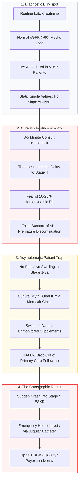
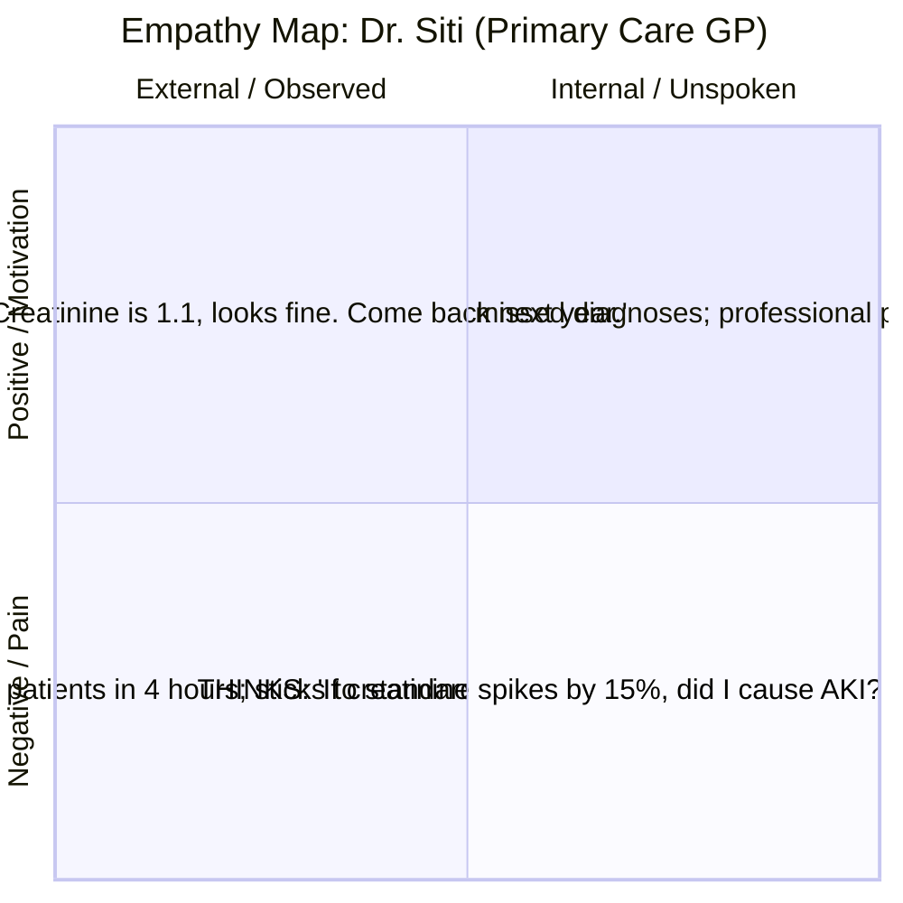
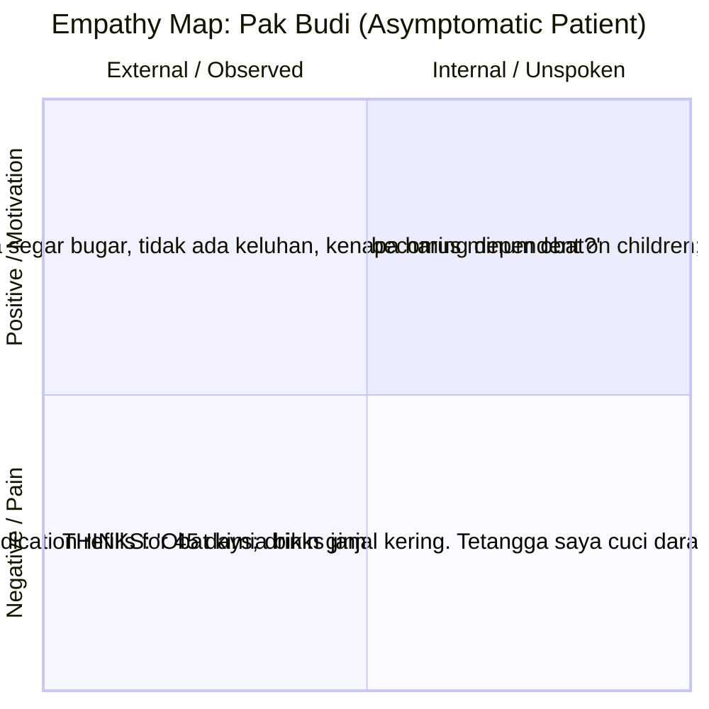

# Problem Space Research & Discovery: Upstream Cardiorenal Interception
**Project:** RENAL-PULSE (Cardiorenal Population Health & Upstream Prevention Engine)  
**Track:** Population Health — *Turning Health Risk Signals into Upstream Preventive Action and Scalable Chronic Disease Risk Management*  
**Framework:** UX Research Discovery & Synthesis (Method Selection, JTBD, Empathy Mapping, Journey Mapping, Insight Generation)  
**Date:** October 2026  

---

## Executive Summary & Research Thesis

Chronic Kidney Disease (CKD) represents one of the most catastrophic and financially destabilizing health crises globally. In Indonesia alone, the national health insurance agency (**BPJS Kesehatan**) spends over **Rp 13.0 – 13.38 trillion (~$850M+ USD)** annually on kidney failure and hemodialysis. While kidney disease ranks second to heart disease in total national expenditure, **it ranks #1 in per-patient cost**: absorbing massive national resources across a concentrated cohort of ~640,000 patients undergoing hemodialysis 2–3 times every week for life. In high-resource economies like the UAE (**Department of Health – Abu Dhabi / Malaffi**), diabetes prevalence reaches nearly 18–20%, making diabetic kidney disease (DKD) a premier strategic target for digital health registries and predictive population health management.

Yet, this tragedy is mathematically and clinically preventable:
1. **The 5-to-10 Year Asymptomatic Window:** Glomerular decline (Stages 1–3a) progresses silently over years before overt clinical manifestations emerge.
2. **Game-Changing Pharmacotherapy:** Class 1A guideline-directed medical therapies (GDMT)—specifically **SGLT2 inhibitors** (Dapagliflozin, Empagliflozin) and **RAS inhibitors** (ACEi/ARBs)—reduce the relative risk of kidney failure, dialysis, or cardiorenal death by **30% to 39%** (NNT = 14–19 in DAPA-CKD and EMPA-KIDNEY trials), effectively adding 5 to 10+ years of dialysis-free life.
3. **The Signal-to-Action Translation Chasm:** Despite routine lab results sitting in electronic medical records and Puskesmas databases (serum creatinine, blood pressure, dipstick urinalysis, glucose), **less than 15% of high-risk diabetic and hypertensive patients receive timely urine albumin-to-creatinine ratio (uACR) testing, and less than 10% receive guideline-directed organ-protective therapies in primary care.**

This research discovery report analyzes the root causes of this chasm across clinical, cognitive, cultural, behavioral, and economic dimensions, producing actionable UX insights for the RENAL-PULSE engine.

---

## 1. Macro Problem Space: Epidemiology & Economic Stakes

### 1.1 The Dual-Environment Reality: Indonesia vs. Abu Dhabi

| Dimension | Emerging Healthcare Economy (Indonesia / BPJS Kesehatan) | Advanced Digital Health Economy (Abu Dhabi DoH / Malaffi HIE) |
| :--- | :--- | :--- |
| **Primary Payers / System** | BPJS Kesehatan, FKTP / Puskesmas, Kemenkes SatuSehat | Department of Health Abu Dhabi, Malaffi HIE, M42, Daman |
| **Financial Burden of ESKD** | **Rp 13.0–13.38 Trillion/year** on renal failure; #2 catastrophic cost category; #1 per-capita expense. | High per-patient dialysis cost ($40,000–$65,000/patient/year); severe productivity loss among working-age nationals. |
| **Underlying Driver** | High prevalence of uncontrolled hypertension (34.1% Riskesdas) and type 2 diabetes (10.9%), with increasing onset in youth (20–40 yrs). | Elevated diabetes and metabolic syndrome prevalence (18–20% adult population); cardiovascular-renal comorbidity clustering. |
| **Primary Care Bottleneck** | Extreme volume: 50–80 patients/day per GP at Puskesmas; 3–5 minutes per consultation; manual paper/siloed EHR entries. | Highly digitized records in Malaffi, but primary care physicians face alert fatigue, fragmented specialist referrals, and delayed lifestyle action. |
| **Diagnostic Availability** | Serum creatinine available in 70%+ of primary labs; quantitative uACR unavailable or un-reimbursed in >85% of primary clinics (dipstick used instead). | Complete lab panels available, but longitudinal trajectory tracking across fragmented provider networks requires automated synthesis. |
| **Community Infrastructure** | Cadre / Kader Posyandu/Posbindu: dense, trusted, grassroots human network, but lacking digital triage tools. | Mobile app notifications and telemedicine, but vulnerable to app churn and passive ignore rates. |

---

## 2. Systems Breakdown: The 4 Friction Points of the Translation Chasm



### Friction Point 1: Diagnostic Blindspot & Glomerular Masking
- **The Creatinine Fallacy:** Serum creatinine is non-linear. In early disease (hyperfiltration and early nephron dropout), up to **50% of functional nephrons can be destroyed before serum creatinine rises above the normal lab cutoff (1.2 mg/dL)**.
- **The Missing uACR:** Urine dipsticks often miss microalbuminuria (30–300 mg/g). Quantitative uACR testing rates in primary care globally remain under 15% due to lack of reflex lab protocols, separate urine collection friction, or cost restrictions.
- **Static vs. Dynamic Velocity:** A patient whose eGFR drops from 95 to 65 mL/min/1.73m² over 2 years is labeled "Normal / Stage 2" by static EHR thresholds, despite having a catastrophic loss rate of $-15\text{ mL/min/year}$ (guaranteeing dialysis in 3 years). Without automated **OLS longitudinal slope regression**, clinicians miss rapid progressors completely.

### Friction Point 2: Clinician Therapeutic Inertia & The "Hemodynamic Dip" Fear
- **3-to-5 Minute Time Pressure:** Frontline primary care doctors review dozens of lab panels daily with no time to perform longitudinal slope regressions or calculate complex multivariable equations like the 4-variable KFRE.
- **The Acute Hemodynamic Dip Dilemma:** When initiating an SGLT2 inhibitor or ACEi/ARB, tubuloglomerular feedback induces afferent arteriolar constriction or efferent vasodilation, leading to a physiological intraglomerular pressure drop. This manifests as a transient **10% to 25% drop in eGFR (rise in creatinine) within 2–4 weeks**.
- **The Tragedy of Misinterpretation:** Unprepared clinicians mistake this protective hemodynamic dip for acute drug-induced nephrotoxicity (AKI), panicking and discontinuing the very therapy that would have prevented dialysis. In reality, landmark trials (DAPA-CKD, EMPA-KIDNEY) prove that **patients with the initial hemodynamic dip experience the slowest long-term functional loss**.

### Friction Point 3: The Asymptomatic Trap & The "Obat Kimia Merusak Ginjal" Myth
- **Zero Somatic Feedback:** Unlike angina (chest pain) or osteoarthritis (joint pain), nephron loss generates no physical sensation, edema, or pain until eGFR plunges below 15–20 mL/min/1.73m² (Stage 4/5). Patients genuinely feel healthy.
- **The "Chemical Medicine Damages the Kidneys" Paradox:** Qualitative research reveals a widespread, deeply ingrained belief across Indonesian and regional communities: *"Minum obat kimia setiap hari bikin ginjal rusak/kering"* (Taking daily chemical pills will destroy your kidneys).
- **The Fatal Reversal:** When diabetic patients eventually develop end-stage kidney failure after years of unmedicated, uncontrolled hypertension or hyperglycemia, their family attributes the kidney failure to the pills the patient took, reinforcing the myth. Consequently, patients discontinue antihypertensives/hypoglycemics and turn to unregulated herbal mixtures (*jamu pegal linu*, often adulterated with steroids or NSAIDs), accelerating kidney destruction.

### Friction Point 4: Payer & Delivery Fragmentation
- Primary care clinics are reimbursed on capitation or episodic fee-for-service, creating financial incentives for short, rapid consultations rather than proactive chronic progression interception.
- Payers only foot the bill when the catastrophe occurs (emergency dialysis vascular access, ICU admissions for uremic encephalopathy, peritoneal dialysis catheters), bearing a 100x cost multiplier compared to upstream preventive oral GDMT ($0.30/day vs. $1,200/month).

---

## 3. Jobs-to-be-Done (JTBD) Framework

Applying the JTBD methodology to decode what key stakeholders are trying to achieve, their emotional anxieties, and existing compensatory behaviors:

```
[When situation] -> [I want to motivation] -> [So I can outcome]
```

### 3.1 Frontline Primary Care Physician (Puskesmas / Clinic GP)
* **Core Job-to-be-Done:**  
  *When* a patient with diabetes or hypertension sits in my examination room for a 4-minute routine refill,  
  *I want to* instantly know if their kidney filtration is silently deteriorating without manually digging through 3 years of lab PDFs,  
  *So that I can* safely initiate evidence-based organ-protective therapy (GDMT) without worrying about causing acute drug toxicity or navigating complex dosing regimens.
* **Emotional Job:** Feel confident, competent, and legally protected; eliminate fear of causing harm (non-maleficence).
* **Social Job:** Be recognized as a modern, proactive clinician providing guideline-grade care rather than a passive prescription dispenser.
* **Current Workaround:** Glances at the latest serum creatinine number; if `< 1.3`, marks it "normal" and maintains status quo; only refers to nephrology when patient exhibits ankle edema or macroscopic proteinuria (Stage 4).
* **Core Anxieties:** "What if the patient's creatinine increases next month and they blame my prescription?", "I don't have time to calculate eGFR slopes and look up dosing guidelines."

### 3.2 Asymptomatic High-Risk Patient (Diabetic / Hypertensive)
* **Core Job-to-be-Done:**  
  *When* I receive a message from my health center about my kidney test results,  
  *I want to* understand what is happening inside my body in clear, reassuring, relatable language without medical jargon,  
  *So that I can* protect my ability to work and care for my family without being trapped in lifelong dialysis or poisoning my body with harmful pills.
* **Emotional Job:** Alleviate fear of mortality and disability; feel in control; preserve hope and dignity.
* **Social Job:** Avoid being a physical or financial burden on children/family; maintain social identity as a healthy, active individual.
* **Current Workaround:** Ignores routine clinic appointments because "I have no pain or swelling"; stops taking medications when feeling well; drinks traditional herbal tea (*jamu*) believed to "cleanse" the kidneys.
* **Core Anxieties:** "The doctor is going to tell me my kidneys are failing and I need dialysis", "These daily chemical pills will poison my liver and dry out my kidneys."

### 3.3 Community Health Worker (Kader Kesehatan Posyandu / CHW)
* **Core Job-to-be-Done:**  
  *When* I conduct my monthly home visits or Posbindu screenings in the neighborhood,  
  *I want to* know exactly which specific high-risk neighbors have stopped taking their kidney-protective medications or missed their doctor visits,  
  *So that I can* visit them directly, address their personal fears, and guide them back to the clinic before they become bedridden.
* **Emotional Job:** Feel purposeful, respected, and supported by the clinical team; know that their community visits actually save lives.
* **Social Job:** Serve as the trusted, caring neighborhood guardian (*ibu panutan*).
* **Current Workaround:** Maintains cumbersome paper logbooks (*buku register*); wanders door-to-door without risk prioritization; receives no feedback from the Puskesmas on whether patient outcomes improved.
* **Core Anxieties:** "I don't understand complicated medical lab charts", "I don't know what to say when a neighbor says pills will ruin their kidneys."

### 3.4 Payer & Population Health Executive (BPJS / Abu Dhabi DoH)
* **Core Job-to-be-Done:**  
  *When* allocating the annual catastrophic healthcare budget,  
  *I want to* identify and halt chronic kidney disease progressors at Stages 2 and 3 across the entire regional population,  
  *So that I can* reduce multi-trillion rupiah hemodialysis claims and preserve the financial solvency of the national health system.
* **Emotional Job:** Move from anxiety over uncontrolled catastrophic deficit growth to predictability and governance.
* **Social Job:** Deliver measurable, internationally recognized public health impact aligned with national prevention mandates.
* **Current Workaround:** Reviews lagging claims data 6–12 months after hemodialysis has already commenced; pays catastrophic hospital claims reactively.

---

## 4. User Personas & Empathy Maps

### Persona 1: Dr. Siti Nurhaliza (Frontline Puskesmas GP)



- **Demographics:** 34 years old, General Practitioner at a Sub-District Puskesmas (Puskesmas Kecamatan), West Java / Jakarta periphery.
- **Context:** Treats 60–80 patients per morning shift. Consult duration: 3.5 minutes. Uses basic electronic medical record software with no longitudinal analytical tools.
- **Pain Points:** Severe cognitive overload, fear of causing acute kidney injury (AKI), lacks an intuitive tool to show patients why they need new medications.
- **Key Quote:** *"I want to practice evidence-based medicine, but when I have 60 patients waiting outside, I don't have 10 minutes to plot longitudinal creatinine graphs or explain complex nephron physiology."*

---

### Persona 2: Pak Budi Santoso (Asymptomatic High-Risk Diabetic)



- **Demographics:** 53 years old, small business owner / warung operator, diagnosed with Type 2 Diabetes 7 years ago, BP 142/88 mmHg, serum creatinine 1.2 mg/dL, dipstick protein 1+.
- **Context:** Feels energetic, no edema, no flank pain. Receives WhatsApp messages from children asking him to be careful with his health.
- **Pain Points:** Deep suspicion of lifelong chemical medication, fear of dialysis, skepticism toward healthcare warnings that lack physical symptoms.
- **Key Quote:** *"If my kidneys were really sick, wouldn't my back hurt or my legs swell? I feel totally fine, so why do I need two new pills every single morning?"*

---

### Persona 3: Ibu Ratna Dewi (Community Health Worker / Kader Posyandu)

- **Demographics:** 47 years old, Community Health Cadre for 11 years, highly respected in RW 04, smartphone user (WhatsApp daily).
- **Context:** Conducts monthly Posbindu PTM screenings (blood pressure, fingerstick glucose) and home visits.
- **Pain Points:** Carries heavy paper registers; doesn't know which diabetic neighbor is in immediate danger of kidney failure; lacks simple analogies to convince stubborn neighbors to take their medication.
- **Key Quote:** *"Pak Budi respects me as a neighbor, but when I tell him to go to the doctor, he says he's healthy. If I had a clear task on my phone explaining how to reassure him, he would listen."*

---

## 5. Journey Mapping: Status Quo Breakdown vs. RENAL-PULSE Upstream Interception

```mermaid
journey
    title Patient Journey: Status Quo Catastrophic Cliff vs. RENAL-PULSE Upstream Interception
    section 1. Early Decline (eGFR 80 to 55)
      Status Quo: Patient feels healthy; lab shows Cr 1.1; GP says 'normal'; no uACR: 2: Patient, GP
      RENAL-PULSE: Engine calculates eGFR slope (-4.2/yr); flags rapid progressor: 5: Engine, GP
    section 2. Clinical Encounter
      Status Quo: GP renews basic metformin; no GDMT; no trajectory visualizer: 2: GP
      RENAL-PULSE: Doctor Copilot displays 5-yr trajectory; 1-click GDMT card (SGLT2i+ARB): 5: GP
    section 3. Patient Engagement
      Status Quo: Patient told 'watch your kidneys'; patient hears 'kidney failure'; quits meds: 1: Patient
      RENAL-PULSE: WhatsApp agent uses 'Kitchen Filter' metaphor; debunks pill myth; 1-click booking: 5: Patient
    section 4. 4-Week Follow-Up (Hemodynamic Dip)
      Status Quo: Cr rises 15%; GP panics, suspects AKI, stops medication permanently: 1: GP, Patient
      RENAL-PULSE: Copilot explains benign hemodynamic dip (≤30%); confirms long-term protection: 5: GP, Patient
    section 5. 5-Year Horizon
      Status Quo: Patient crashes into Stage 5 ESKD; emergency jugular hemodialysis; Rp 13T cost: 1: Patient, Payer
      RENAL-PULSE: Filtration slope stabilized; dialysis averted by 7-10+ years; huge payer savings: 5: Patient, Payer
```

### Detailed Journey Comparison

| Journey Stage | Current Status Quo (The Breakdown) | RENAL-PULSE Interception (The Closed Loop) |
| :--- | :--- | :--- |
| **Stage 1: Routine Lab Ingestion** | Lab checks serum creatinine; displays static value ($1.1\text{ mg/dL}$). Marked in green as "within normal range". uACR not ordered. | System ingests serial creatinine via FHIR/CSV, calculates race-free CKD-EPI 2021, and executes OLS regression: flags $\text{slope} = -4.5\text{ mL/min/yr}$ (*Rapid Progressor*). |
| **Stage 2: Doctor Consultation** | GP has 3 minutes; glances at normal creatinine cutoff; repeats Metformin monotherapy. Patient leaves without kidney protection. | Doctor Clinical Copilot surfaces an intuitive trajectory alert: *"Accelerated filtration decline: Dialysis projected in 4.2 years without GDMT"*. 1-click pre-filled order card for SGLT2i + Losartan. |
| **Stage 3: Patient Perception & Communication** | If doctor mentions "kidney damage", patient enters panic/denial. Patient stops taking medications fearing "toxic chemicals". | Automated WhatsApp message sent in conversational Bahasa Indonesia/English: uses the *"Kitchen Water Filter"* (*Saringan Dapur*) analogy. Pre-emptively clarifies: *"Obat ini bukan merusak ginjal, melainkan pelindung saringan agar tidak cepat bocor."* |
| **Stage 4: 4-Week Follow-Up (The Critical Dip)** | Routine check shows creatinine rose from $1.1$ to $1.25\text{ mg/dL}$ ($14\%$ dip). GP panics, diagnoses iatrogenic AKI, discontinues SGLT2i forever. | Copilot presents the Hemodynamic Dip Card: *"Creatinine rise of 13.6% detected. This confirms therapeutic lowering of intraglomerular pressure (KDIGO 2024 Class 1A). Do not discontinue."* |
| **Stage 5: Community Adherence Safety Net** | Patient skips pharmacy refill after 2 months. No one notices until emergency hospital admission 3 years later. | Engine detects $>30\text{-day}$ prescription refill lapse; automatically generates a prioritized micro-task for local Kader Posyandu with geolocated guidance. |

---

## 6. Competitive & Architectural Landscape

| Solution / Approach | Strengths | Critical Gaps & Failures | RENAL-PULSE Differentiation |
| :--- | :--- | :--- | :--- |
| **Standard EHR Alerts (Epic BPA / Cerner)** | Embedded in major hospital workflows; captures inpatient data. | Extreme alert fatigue (95%+ override rate); interruptive modals; lacks patient communication channel; no outreach to community cadres. | Non-interruptive, 1-click actionable order set; pre-calculated dosing; patient and cadre closed-loop coordination. |
| **Consumer Health Apps (Diabetes/BP Trackers)** | High initial visual appeal; direct-to-consumer. | 90% 30-day churn; only reaches the "worried well"; disconnected from primary care EHR prescription mechanisms; ignored by elderly patients. | Zero-app-install conversational WhatsApp channel; meets patients on the platform they already check 20 times a day. |
| **Standalone Risk Calculators (MDCalc / QxMD)** | Clinically accurate mathematical formulas (CKD-EPI, KFRE). | Requires manual data re-entry; zero integration with clinic EHR; does not address clinician fear of the hemodynamic dip; zero patient activation. | Automated background ingestion; reflex calculations; integrated educational guidance on hemodynamic dips. |
| **Government Population Portals (SatuSehat / Malaffi)** | Centralized health data infrastructure; massive population scale. | Primarily acts as a data repository / registry; lacks front-line clinical decision copilots and automated patient behavioral nudging. | Sits on top of FHIR / SatuSehat / Malaffi APIs as the active intelligence layer that translates latent signals into preventive action. |

---

## 7. Synthesized Research Insights & Design Implications

Applying the standard research insight formula:  
`[User group] [struggles/needs/believes] [specific observation] because [underlying reason]`

### Insight 1: The Illusion of Normalcy in Static Numbers
- **Insight:** Primary care physicians **frequently miss rapidly progressing renal failure** in diabetic patients with creatinine $< 1.3\text{ mg/dL}$ **because traditional EHR interfaces present lab results as isolated static snapshots with binary normal/abnormal color flags, completely obscuring rate-of-change velocity.**
- **Design Implication:** The Doctor Copilot must lead with **eGFR Slope Velocity ($\text{mL/min/1.73m}^2/\text{year}$)** and a **Projected Dialysis Horizon Countdown ("Dialysis projected in 4.8 years")**, transforming an abstract lab value into an urgent, tangible timeline.

### Insight 2: The Hemodynamic Dip Triggers Avoidance Behavior
- **Insight:** Frontline clinicians **routinely discontinue or avoid initiating foundational SGLT2 inhibitors** when post-initiation follow-up labs show a slight creatinine increase **because medical training instills an acute fear of drug-induced nephrotoxicity (AKI), and clinicians lack real-time reassurance that a $\le 30\%$ dip is evidence of intraglomerular pressure reduction.**
- **Design Implication:** The GDMT Order Set must include an **embedded, upfront Hemodynamic Dip Reassurance Notice** with visual guidance: *"Expect a 10–25% eGFR dip at week 4. This confirms renal microvascular protection. Maintain therapy unless dip exceeds 30%."*

### Insight 3: The "Kitchen Filter" Metaphor Beats Diagnostic Shaming
- **Insight:** Asymptomatic chronic disease patients **ignore medical follow-up notices and resist taking daily medications** when sent technical lab results or alarming terms like *"Gagal Ginjal"* **because patients feel completely healthy, fear being labeled disabled, and harbor deep cultural beliefs that chemical pills destroy kidney tissue.**
- **Design Implication:** The WhatsApp Conversational Agent must entirely replace frightening nephrology jargon with the intuitive **"Kitchen Water Filter" (*Saringan Dapur*) Metaphor**:  
  *"Bayangkan ginjal Bapak seperti saringan air di dapur yang pori-porinya mulai bekerja terlalu keras. Obat ini bekerja seperti pelindung saringan agar air mengalir santai dan saringan tidak cepat robek."*

### Insight 4: Community Cadres Need Micro-Tasks, Not Raw Data
- **Insight:** Community health cadres (Kader Posyandu) **fail to intervene effectively with medication-defaulting neighbors** when given broad patient lists **because cadres lack medical training to interpret lab values, but excel when provided actionable, script-guided conversational prompts.**
- **Design Implication:** The Kader Tasking View must provide **binary, actionable prompts**: *"Pak Budi has missed his refill by 32 days. Visit him and share this 2-sentence reassurance regarding pill safety."*

---

## 8. Summary of Strategic Pillars for Product Implementation

```
┌─────────────────────────────────────────────────────────────────────────────┐
│                           RENAL-PULSE ECOSYSTEM                              │
└─────────────────────────────────────────────────────────────────────────────┘
          │                                                  │
          ▼                                                  ▼
┌──────────────────────────────────────┐   ┌───────────────────────────────────┐
│     CLINICAL COPILOT (Doctor)        │   │    BEHAVIORAL AGENT (Patient)     │
│ 1. Race-Free CKD-EPI 2021            │   │ 1. Zero-Install WhatsApp Channel  │
│ 2. OLS Longitudinal eGFR Slope       │   │ 2. 'Kitchen Filter' Metaphor      │
│ 3. 4-Variable KFRE 2 & 5-Yr Risk     │   │ 3. Debunk 'Chemical Pill' Myth    │
│ 4. 1-Click GDMT Order Set            │   │ 4. 1-Click Appointment Booking    │
│ 5. Hemodynamic Dip Guidance (≤30%)   │   │ 5. Culturally Tuned (Indo/English)│
└──────────────────────────────────────┘   └───────────────────────────────────┘
          │                                                  │
          └──────────────────────────┬───────────────────────┘
                                     ▼
┌─────────────────────────────────────────────────────────────────────────────┐
│                 COMMUNITY & POPULATION COMMAND LAYER                        │
│ 1. Geolocated Kader Escalation for >30-Day Medication Lapses               │
│ 2. Regional Cardiorenal Heatmap (KDIGO 2024 Staging Grid)                   │
│ 3. Markov Health-Economic Simulation (Dialysis Averted & Budget Solvency)   │
└─────────────────────────────────────────────────────────────────────────────┘
```

This research discovery foundation directly validates and informs the engineering, design tokens, interaction flows, and mathematical algorithms implemented across the RENAL-PULSE platform.
