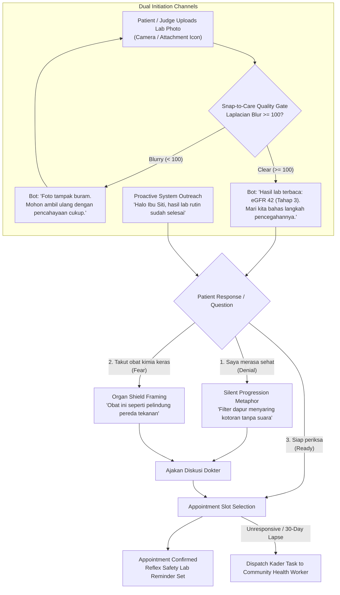

# Feature Specification: In-Browser WhatsApp Patient Engagement Simulator

**Feature Branch**: `003-whatsapp-simulator`  
**Created**: 2026-10-20  
**Status**: Ready for Planning  
**Target User**: Competition Judges, Patient Demonstrators, Healthcare Evaluators  
**Primary Standards**: Behavioral Economics (Nudge Theory), Health Literacy Guardrails

---

## 1. Summary & Objectives

The **In-Browser WhatsApp Patient Engagement Simulator** bridges the communication divide between the clinical detection of asymptomatic chronic kidney disease and actual patient attendance at primary care clinics. 

Patients in early CKD (Stages 1–3) have zero physical symptoms; notifying them with clinical jargon like *"Your eGFR is 48 with microalbuminuria"* leads to denial, fear, or dismissal. 

This simulator demonstrates how RENAL-PULSE overcomes denial using:
1. **Snap-to-Care Lab Photo Upload Entry Point:** Direct camera/attachment icon in the chat mockup allowing the patient (or judge) to upload a printed lab slip photo to immediately trigger OCR ingestion and trajectory calculation.
2. **Photorealistic In-Browser WhatsApp Client:** A zero-dependency mobile phone mockup inside the web app with authentic message bubbles, status ticks, timestamps, and quick-reply buttons.
3. **Culturally Grounded Behavioral Scripting:** The intuitive **"Kitchen Filter" / "Filter Air Dapur"** metaphor to explain filtration decline without terrifying the patient.
4. **Interactive Multi-Turn Dialogue Tree:** Addressing real patient objections (denial of symptoms, fear of "harsh chemicals" destroying kidneys, scheduling conflicts).
5. **Community Health Worker (*Kader*) Escalation:** Immediate task dispatch when a patient lapses or misses their appointment.

---

## 2. User Scenarios & Prioritized User Stories

### User Story 0 - Lab Photo Upload & Snap-to-Care Activation (Priority: P1)
As a patient holding a paper lab slip from an external diagnostic center (e.g., Prodia, PureHealth, SEHA) or an evaluator running a live demo,  
I want to tap the camera/attachment icon in the WhatsApp interface to upload a photo of my lab results,  
So that the automated Snap-to-Care Vision Gateway ingests the document, extracts key biomarkers in $<2\text{ seconds}$, and initiates a personalized care loop right in the chat.

- **Acceptance Scenarios:**
  1. **Given** the simulator view, **When** clicking the paperclip/camera icon, **Then** open a file picker with pre-populated demo lab slip presets (e.g. "Prodia High-Risk Progressor", "SEHA Borderline CKD", "Blurry Unreadable Slip").
  2. **Given** a valid lab slip photo selected, **Then** show an uploaded image bubble in the chat with a "Scanning document with Snap-to-Care AI..." system status pill.
  3. **Given** successful extraction ($\text{blur variance} \ge 100$, confidence $\ge 90\%$), **Then** bot automatically responds with personalized greeting, extracted eGFR summary, and the "Kitchen Filter" opening question.
  4. **Given** a blurry image selected ($\text{blur variance} < 100$), **Then** bot immediately replies: *"Foto tampak buram. Mohon ambil ulang foto dengan pencahayaan cukup agar hasil akurat."* (*"Photo appears blurry. Please retake under good lighting."*)

---

### User Story 1 - Photorealistic WhatsApp Mobile Interface (Priority: P1)
As a hackathon judge or evaluator,  
I want to experience the patient's conversational journey inside a realistic smartphone mockup directly in my browser,  
So that I can evaluate the patient experience without needing physical phones, third-party Twilio accounts, or live WhatsApp API credentials.

- **Acceptance Scenarios:**
  1. Renders authentic iOS/Android WhatsApp container with header (avatar, contact name, online status indicator).
  2. Messages appear with animated delivery ticks (sent, delivered, read double-blue checkmarks) and typing indicators.
  3. Interactive quick-reply option chips allow single-click progression through dialogue paths.

---

### User Story 2 - Behavioral Dialogue Engine with "Kitchen Filter" Metaphor (Priority: P1)
As an asymptomatic kidney patient who feels completely healthy,  
I want to receive clear, non-threatening explanations about my lab findings using everyday analogies,  
So that I understand why early prevention is critical before irreversible damage occurs.

- **Acceptance Scenarios:**
  1. **Dual Language Support:** Toggle between Bahasa Indonesia (*"Filter Air Dapur"*) and English (*"Kitchen Water Filter"*).
  2. **Branch 1 (Symptom Denial):** Patient selects *"Saya merasa sehat, apakah ada salah periksa?"* $\rightarrow$ Agent explains that kidney filtration loss is completely silent until 80% is gone, just like a water filter working quietly until it clogs.
  3. **Branch 2 (Medication Fear):** Patient asks *"Apakah obat ini kimia keras yang bikin ginjal rusak?"* $\rightarrow$ Agent reframes SGLT2i as an organ shield that relieves high water pressure inside the filter.

---

### User Story 3 - Interactive Clinic Appointment Booking (Priority: P1)
As a patient guided through the conversation,  
I want to select an available appointment slot directly within the chat flow,  
So that I confirm my follow-up clinic visit immediately without leaving WhatsApp.

- **Acceptance Scenarios:**
  1. Patient selects preferred date/time chip (e.g., *"Besok Jam 09.00"* / *"Tomorrow 09:00 AM"*).
  2. Simulator emits confirmed booking event, updating the patient's care status from `OUTREACH_PENDING` to `APPOINTMENT_CONFIRMED`.

---

### User Story 4 - Community Health Worker (*Kader*) Escalation (Priority: P2)
As a public health coordinator,  
I want the system to demonstrate automated escalation to local Community Health Workers (*Kader* in Indonesia) if a high-risk patient does not respond or misses their visit,  
So that vulnerable patients do not fall through the cracks.

- **Acceptance Scenarios:**
  1. Clicking "Simulate 30-Day Lapse" triggers an automated home-visit outreach task for the local Puskesmas Kader, complete with patient location and pre-written talking points.

---

## 3. Behavioral Script Flowchart

---

## 4. Success Criteria

- **SC-001 (Zero External Dependency):** 100% in-browser client-side simulation requiring zero external network APIs or SMS credentials.
- **SC-002 (Bilingual Parity):** All dialogue branches fully translated and culturally verified in both Bahasa Indonesia and English.
- **SC-003 (Loop Completion):** Judge can complete full conversational journey from lab slip photo upload to confirmed booking in $< 90\text{ seconds}$.
- **SC-004 (Visual Feedback):** Image uploads trigger simulated processing states, blur re-prompting, and instant biomarker feedback within 1.5 seconds.
