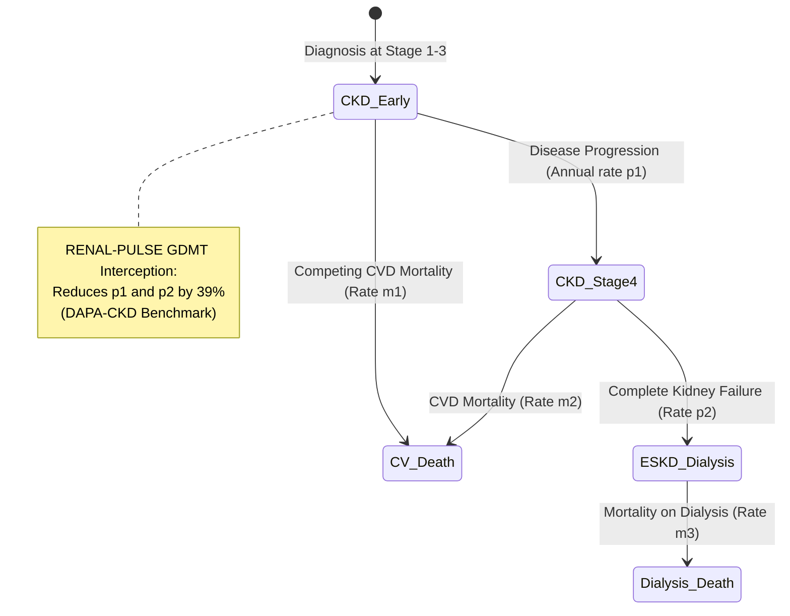

# Feature Specification: Population Health Command Center & Markov Economic Engine

**Feature Branch**: `004-population-command-center`  
**Created**: 2026-10-20  
**Status**: Ready for Planning  
**Target User**: Health System Leadership, Payers (BPJS Kesehatan, DoH Abu Dhabi), Health Economists  
**Primary Standards**: Markov Decision Process (State-Transition Modeling), Health Economics & Outcomes Research (HEOR)

---

## 1. Summary & Objectives

The **Population Health Command Center & Markov Economic Engine** provides healthcare executives, national payers (BPJS Kesehatan), and health authorities (DoH Abu Dhabi) with macro-level epidemiological surveillance and actuarial evidence.

It answers the executive questions:
1. *Where are our silent, high-risk cardiorenal progressor clusters located?*
2. *How many dialysis cases will our health system avert over the next 5 years by deploying RENAL-PULSE?*
3. *What is our concrete net budgetary ROI in national currency (IDR Trillions or USD Millions)?*

---

## 2. User Scenarios & Prioritized User Stories

### User Story 1 - Regional Cardiorenal Risk Heatmap (Priority: P1)
As a public health director or regional health authority official,  
I want to view an interactive cardiorenal risk map of primary care clinics (Puskesmas / Clinics),  
So that I can identify geographic clusters of rapid progressors and allocate clinical resources where dialysis risk is highest.

- **Acceptance Scenarios:**
  1. Interactive map with clinic pins clustered by average patient eGFR slope and high-risk KFRE percentage.
  2. Clicking a clinic cluster filters the aggregate registry table below to that specific region.
  3. Visual distinction between regions with high interception rates vs. unaddressed care chasm gaps.

---

### User Story 2 - 5-Year Markov State-Transition Model (Priority: P1)
As a health economist or actuarial analyst,  
I want a validated 5-year Markov state-transition simulation comparing "Standard Care" vs. "RENAL-PULSE Interception",  
So that I can demonstrate the scientific validity of averted dialysis cases and cardiovascular events.

- **Model States:**
  1. CKD Stage 1–3 (eGFR $\ge 30$)
  2. CKD Stage 4 (eGFR $15–29$)
  3. ESKD on Maintenance Hemodialysis (eGFR $< 15$)
  4. Cardiovascular / All-Cause Mortality
- **Acceptance Scenarios:**
  1. Implements DAPA-CKD / EMPA-KIDNEY trial efficacy parameters: 39% relative risk reduction in progression to dialysis.
  2. Simulates annual cohort cycles over 5 consecutive years.
  3. Outputs cumulative dialysis-years averted and quality-adjusted life years (QALYs) gained.

---

### User Story 3 - Interactive Dual-Currency Budgetary Impact Simulator (Priority: P2)
As a competition judge or payer decision-maker,  
I want to adjust population size and screening interception parameters using interactive sliders and see real-time cost savings in IDR or USD,  
So that I can independently verify the financial return on investment for my specific regional population.

- **Acceptance Scenarios:**
  1. **Indonesia Context (BPJS):**
     - Hemodialysis cost benchmark: $\text{Rp } 150\text{ Million/patient/year}$.
     - Interception drug cost (generic SGLT2i + ARB): $\text{Rp } 1.8\text{ Million/patient/year}$.
     - 5-year net national savings projected in Trillions of Rupiah (target $\ge \text{Rp } 1.8\text{ Trillion}$ at scale).
  2. **Abu Dhabi Context (DoH / Malaffi):**
     - Hemodialysis cost benchmark: $\$50,000\text{/patient/year}$.
     - 5-year savings per intercepted patient: $\$120,000–\$200,000$.
     - Live display updates smoothly ($< 50\text{ ms}$) as sliders are adjusted.

---

### User Story 4 - Screening-to-Care Conversion Funnel Analytics (Priority: P2)
As a population health program manager,  
I want to monitor the end-to-end pipeline metrics from initial paper slip capture through to confirmed GDMT initiation,  
So that I can detect operational drop-offs and quantify how effectively the "Screening-to-Care Loop" is being closed across pilot facilities.

- **Acceptance Scenarios:**
  1. Funnel visualization tracking the 6 pipeline stages:
     - `Stage 1: Documents Ingested` (Breakdown: Electronic feeds vs. Snap-to-Care paper scans).
     - `Stage 2: FHIR Normalization` (Auto-promoted $\ge 90\%$ vs. HITL nurse triaged).
     - `Stage 3: Trajectory Evaluation` (Stable vs. Rapid Progressors identified).
     - `Stage 4: WhatsApp Outreach` (Delivered, Read, Conversational Engagement Rate).
     - `Stage 5: Clinic Attendance` (Confirmed Appointments vs. Kader Home Visits).
     - `Stage 6: GDMT Interception` (1-Click Order Sets authorized with safety reflex labs).
  2. Aggregated operational KPIs: Ingestion throughput, mean time to clinic booking, and dialysis prevention yield.

---

## 3. Mathematical Specification: Markov Transition Matrix

$$\text{Net ROI} = \sum_{t=1}^5 \left( \Delta \text{ESKD Cases}_t \times \text{Cost}_{\text{Dialysis}} \right) - \left( N_{\text{Treated}} \times \text{Cost}_{\text{GDMT}} \right)$$

---

## 4. Success Criteria

- **SC-001 (Actuarial Rigor):** Markov model outputs match published clinical trial hazard ratios ($0.61$ for CKD progression under SGLT2i).
- **SC-002 (Real-Time Responsiveness):** Slider adjustments recalculate and re-render economic charts in $< 50\text{ ms}$ without UI lag.
- **SC-003 (Dual-Currency Support):** Seamless, verified conversion between IDR (Puskesmas scale) and USD (DoH scale).
