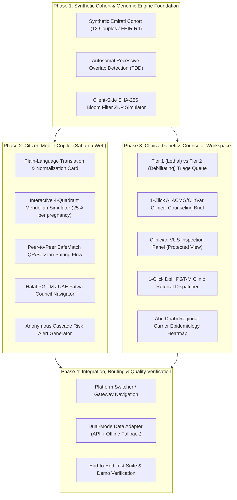

# GENO-BRIDGE: Implementation Sprint Plan & Execution Roadmap

> **Document Type:** Project Planning & Engineering Strategy Specification  
> **Target Alignment:** Future Health Digital Innovation Challenge (Hack2skill / Abu Dhabi Global Initiative)  
> **Track:** Fertility — *Challenge 03: Understanding and Reducing Inherited Disease Risk*  
> **Status:** `Active / Ready for Implementation`  
> **Architecture Mode:** Full-Stack Integrated Delivery with Dual-Mode Offline Resiliency (FastAPI + React 19 / FSD)

---

## 1. System Overview & Strategic Milestones

GENO-BRIDGE operates alongside the existing platform services, introducing dedicated genomic micro-services and user interfaces without breaking current project assets.

---

## 2. Detailed Task Breakdown & Dependency Matrix

### Phase 1: Synthetic Cohort & Core Genomic Matching Engine
*Target Specs:* [`006-geno-engine-zkp.md`](file:///Users/mb-rci-backup/Documents/antigravity/future-health/docs/specs/006-geno-engine-zkp.md) & [`009-geno-synthetic-cohort.md`](file:///Users/mb-rci-backup/Documents/antigravity/future-health/docs/specs/009-geno-synthetic-cohort.md)

- [ ] **Task 1.1: Synthetic FHIR R4 Cohort Generation**
  - Path: `data/synthetic/geno_bridge_cohort.json`
  - Generate 12 complete synthetic couples covering *HBB, SMN1, CFTR, CYP21A2, PCDH15*, non-overlapping pairs, and wild-type controls conforming to HL7 FHIR R4.
- [ ] **Task 1.2: Pydantic Domain Models & Schemas**
  - Path: `backend/app/models/genomics.py`
  - Define `GenomicVariant`, `PartnerGenomicProfile`, `CoupleCompatibilityResult`, and ZKP request/response contracts.
- [ ] **Task 1.3: Recessive Carrier Matching Engine (TDD)**
  - Path: `backend/app/services/genomic_matcher.py` & `backend/tests/test_genomic_matcher.py`
  - Write test fixtures for homozygous, compound heterozygous, and non-overlapping carrier scenarios.
  - Implement clinical evaluation logic with recurrence probabilities (25% affected, 50% carrier, 25% unaffected).
- [ ] **Task 1.4: Cryptographic Bloom Filter ZKP Simulator**
  - Path: `backend/app/services/zkp_engine.py` & `backend/tests/test_zkp_engine.py`
  - Implement salted HMAC-SHA256 Bloom filter generator and set intersection verification.
- [ ] **Task 1.5: FastAPI Router Mount**
  - Path: `backend/app/api/endpoints/genomics.py` & `backend/app/main.py`
  - Expose `/api/v1/genomics/match`, `/api/v1/genomics/zkp/*`, and `/api/v1/genomics/cohort`.

---

### Phase 2: Citizen Mobile Copilot (Sahatna-Aligned Web Experience)
*Target Spec:* [`007-geno-citizen-copilot.md`](file:///Users/mb-rci-backup/Documents/antigravity/future-health/docs/specs/007-geno-citizen-copilot.md)

- [ ] **Task 2.1: Client Genomics Entity & Dual-Mode Adapter**
  - Path: `frontend/src/entities/genomics/`
  - Create TypeScript types, offline mock fixture loader, and Web Crypto Bloom filter implementation mirroring backend logic.
- [ ] **Task 2.2: Plain-Language Variant Translation Card**
  - Path: `frontend/src/widgets/geno-carrier-summary/ui/GenoCarrierSummaryCard.tsx`
  - Implement empathetic carrier explanation with Arabic/English terminology, medical detail accordions, and persistent clinical disclaimer.
- [ ] **Task 2.3: Interactive 4-Quadrant Mendelian Inheritance Simulator**
  - Path: `frontend/src/widgets/geno-mendelian-simulator/ui/GenoMendelianSimulator.tsx`
  - Build interactive 4-quadrant Punnett matrix with animated pregnancy outcome roll disproving the Gambler's Fallacy.
- [ ] **Task 2.4: Pre-Engagement SafeMatch Flow**
  - Path: `frontend/src/widgets/geno-safematch-card/ui/GenoSafeMatchCard.tsx`
  - Create QR code / 6-digit session pairing UI and client-side ZKP verification execution with zero raw variant exposure.
- [ ] **Task 2.5: Halal PGT-M & Thiqa Healthcare Navigator**
  - Path: `frontend/src/widgets/geno-halal-roadmap/ui/GenoHalalRoadmap.tsx`
  - Render official UAE Fatwa Council rulings, required DoH milestones, and accredited fertility clinic directory (Cleveland Clinic Abu Dhabi, Fakih IVF).
- [ ] **Task 2.6: Anonymous Cascade Risk Alert Generator**
  - Path: `frontend/src/features/generate-cascade-token/ui/CascadeAlertModal.tsx`
  - Encrypted shareable token and WhatsApp-ready message copy for siblings and first cousins.
- [ ] **Task 2.7: Citizen Mobile Page Integration**
  - Path: `frontend/src/pages/geno-citizen/ui/GenoCitizenPage.tsx`
  - Mobile container viewport (max-width `430px`) with navigation tabs (`Results`, `Simulator`, `SafeMatch`, `Halal PGT-M`).

---

### Phase 3: Clinical Genetics Counselor Workspace
*Target Spec:* [`008-geno-counselor-workspace.md`](file:///Users/mb-rci-backup/Documents/antigravity/future-health/docs/specs/008-geno-counselor-workspace.md)

- [ ] **Task 3.1: Prioritized Couple Triage Queue**
  - Path: `frontend/src/widgets/geno-triage-table/ui/GenoTriageTable.tsx`
  - Severity-tiered sorting (`TIER_1_URGENT`, `TIER_1_ROUTINE`, `TIER_2_MODERATE`, `COMPATIBLE`), wedding proximity indicator, search by Emirates ID hash / couple ID.
- [ ] **Task 3.2: 1-Click AI Clinical Brief Generator Modal**
  - Path: `frontend/src/widgets/geno-clinical-brief-modal/ui/GenoClinicalBriefModal.tsx`
  - Pre-compiled counseling summary with ACMG classifications, ClinVar IDs, OMIM links, suggested counseling talking points, and 1-click Malaffi HIE markdown copy.
- [ ] **Task 3.3: Clinician VUS Audit Panel**
  - Path: Display protected Variants of Uncertain Significance with ClinVar evidence links, safely sequestered from citizen views.
- [ ] **Task 3.4: 1-Click DoH PGT-M Referral Dispatcher**
  - Path: `frontend/src/widgets/geno-referral-dialog/ui/GenoReferralDialog.tsx`
  - Referral order set for licensed DoH fertility centers under Thiqa pre-authorization.
- [ ] **Task 3.5: Population Carrier Epidemiology & Health Economics Heatmap**
  - Path: `frontend/src/widgets/geno-population-heatmap/ui/GenoPopulationHeatmap.tsx`
  - Geospatial breakdown across Abu Dhabi, Al Ain, Al Dhafra, carrier prevalence by gene, and $>AED\ 250M$ health economic savings calculator.
- [ ] **Task 3.6: Counselor Workspace Page Integration**
  - Path: `frontend/src/pages/geno-counselor/ui/GenoCounselorPage.tsx`
  - Full desktop dashboard with tabbed triage table, detail drawer, and population analytics.

---

### Phase 4: Platform Switcher, Routing & Quality Verification

- [ ] **Task 4.1: Unified Application Routing & Platform Switcher**
  - Path: `frontend/src/app/App.tsx` & `frontend/src/shared/config/routes.ts`
  - Mount `/geno-bridge` routes (`/geno-bridge/citizen`, `/geno-bridge/counselor`, `/geno-bridge/safematch`) and provide an elegant platform switcher in the top navigation header.
- [ ] **Task 4.2: Dual-Mode Network Status Pill**
  - Visual indicator in the footer showing connected API mode vs offline in-memory engine mode.
- [ ] **Task 4.3: Automated Quality Gate Verification**
  - Run frontend test/build checks (`npm run build`, `npm run test` or `bun test`), backend tests (`pytest`).
  - Verify zero regression in existing Renal-Pulse code.

---

## 3. Definition of Done & Acceptance Gates

| Gate | Verification Command | Exit Criteria |
| :--- | :--- | :--- |
| **G1: Backend Genomics TDD** | `pytest backend/tests/test_genomic_matcher.py backend/tests/test_zkp_engine.py` | 100% pass; mathematical formulas and ZKP privacy verified. |
| **G2: Synthetic Cohort Parity** | `python scripts/validate_geno_cohort.py` | All 12 couples validate against FHIR R4 schema. |
| **G3: Frontend Build & Typecheck** | `cd frontend && npm run build` | Zero TypeScript errors, bundle completes cleanly. |
| **G4: Dual-Mode Demo Test** | Browser verification with API server killed | Full UI renders and performs SafeMatch & Mendelian simulations using local engine. |
