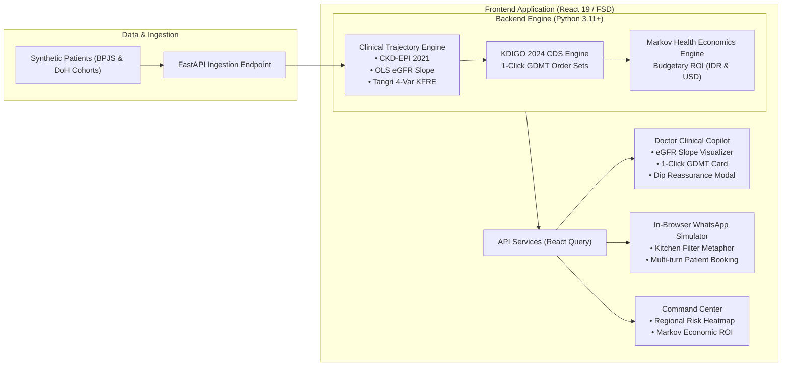

# RENAL-PULSE: Implementation Roadmap & Execution Plan

> **Document Type:** Project Planning & Engineering Strategy Specification  
> **Status:** `Active / In Progress`  
> **Target Alignment:** Future Health Digital Innovation Challenge (Hack2skill / Abu Dhabi Global Initiative)  
> **Execution Strategy:** Full-Stack Integrated Delivery with Dual Health System Context (BPJS Indonesia & DoH Abu Dhabi)

---

## 1. Strategic Context & Business Rationale

### 1.1 The North Star Metric
$$\text{North Star Metric} = \textbf{Confirmed Upstream GDMT Interceptions Rate}$$
*(Percentage of identified high-risk cardiorenal progressors successfully prescribed guideline-directed medical therapy and scheduled for safety lab monitoring before reaching Stage 4 CKD).*

### 1.2 Health Economic ROI (Dual-Context Modeling)
* **Context A — Indonesia (BPJS Kesehatan / Puskesmas):**
  * Target Population: Hypertensive & Diabetic patients in primary care.
  * Baseline Cost: Catastrophic hemodialysis claims $> \text{Rp } 11\text{ Trillion/year}$.
  * Target Impact: SGLT2i + ARB initiation delays or averts dialysis in $30\%–40\%$ of rapid progressors (NNT 14–19), yielding a projected 5-year savings of $\ge \text{Rp } 1.8\text{ Trillion}$ at national scale.
* **Context B — Abu Dhabi (Department of Health / Malaffi HIE):**
  * Target Population: High-risk cardiorenal cohort within the unified health information exchange.
  * Baseline Cost: $\$35,000–\$60,000$ per patient/year on hemodialysis.
  * Target Impact: Avoided renal replacement therapy saving $\$120,000–\$200,000$ per intercepted patient over 5 years.

---

## 2. Architecture & Data Flow

---

## 3. Sprint Breakdown & Milestones

### Phase 0: Design System Governance & AI-Ready Component Foundation
> **Specification:** [`docs/DESIGN_SYSTEM_GOVERNANCE.md`](file:///Users/mb-rci-backup/Documents/antigravity/future-health/docs/DESIGN_SYSTEM_GOVERNANCE.md) | [`DESIGN.md`](file:///Users/mb-rci-backup/Documents/antigravity/future-health/DESIGN.md)  
> **Status:** `Completed`  
* **Goal:** Establish a robust design system governance model, clinical usability gates, and machine-readable AI component metadata to guarantee safe, deterministic UI generation across all application slices.
* **Deliverables:**
  1. **Canonical Governance Manual (`docs/DESIGN_SYSTEM_GOVERNANCE.md`):** Hybrid ownership, 7-stage RFC lifecycle, DACI decision rights, semantic versioning, and deprecation protocols.
  2. **Core Clinical Primitives (`frontend/src/shared/ui/`):** React 19 primitives (`Button`, `Card`, `Badge`, `Input`, `Modal`) strictly honoring Mediora squircle geometry and token boundaries.
  3. **Machine-Readable AI Metadata (`frontend/src/shared/ui/metadata/`):** Structured metadata for each primitive conforming to the `/ai-component-metadata` standard, detailing runnable patterns, explicit anti-patterns, ARIA semantics, and prompt context.
  4. **Automated Verification Pipeline (`scripts/validate_ai_metadata.py` / `make check-ds`):** CI gate validating 1-to-1 component-metadata parity and compiling `ai-catalog.json`.
  5. **Agent Governance Rules (`.agents/rules/30-frontend.md`):** Mandate for autonomous coding agents to inspect metadata and adhere to zero ad-hoc styling and clinical dual-encoding rules.
* **Success Gate:** `make check-ds` passes with 100% component-to-metadata parity and zero schema errors.

---

### Phase 1: Algorithmic Trajectory Engine (Backend / Python FastAPI)
> **Specification:** [`docs/specs/001-algorithmic-trajectory-engine.md`](file:///Users/mb-rci-backup/Documents/antigravity/future-health/docs/specs/001-algorithmic-trajectory-engine.md)  
> **Spec Kit:** [`specs/001-algorithmic-trajectory-engine/spec.md`](file:///Users/mb-rci-backup/Documents/antigravity/future-health/specs/001-algorithmic-trajectory-engine/spec.md) | [Plan](file:///Users/mb-rci-backup/Documents/antigravity/future-health/specs/001-algorithmic-trajectory-engine/plan.md) | [Tasks](file:///Users/mb-rci-backup/Documents/antigravity/future-health/specs/001-algorithmic-trajectory-engine/tasks.md)  
* **Goal:** Deliver mathematically rigorous, benchmark-tested clinical services adhering to KDIGO 2024 and Tangri JAMA 2016.
* **Tasks:**
  1. `tests/test_ckd_epi.py`: Write test fixtures with verified published eGFR values (NEJM 2021).
  2. `backend/app/services/ckd_epi.py`: Implement race-free CKD-EPI 2021 Creatinine formula.
  3. `tests/test_egfr_slope.py`: Unit tests for OLS linear regression with synthetic serial creatinine dates.
  4. `backend/app/services/egfr_slope.py`: Implement OLS slope and rapid progressor classification.
  5. `tests/test_kfre.py`: Unit tests verifying Tangri 4-variable 2-year and 5-year survival formulas.
  6. `backend/app/services/kfre.py`: Implement 4-variable KFRE linear predictor and baseline survival logic.
  7. `backend/app/api/endpoints/`: Expose REST endpoints:
     * `GET /api/v1/patients`: Patient registry list with risk stratification.
     * `GET /api/v1/patients/{id}/trajectory`: Historical observations, slope, and projected 5-year ESKD horizon.
     * `POST /api/v1/clinical-decision/gdmt`: Guideline-directed prescription recommendation with contraindication checks.
* **Success Gate:** All backend tests pass with 100% mathematical parity against published clinical benchmarks.

---

### Phase 2: Doctor Clinical Copilot Integration (Frontend / React 19)
> **Specification:** [`docs/specs/002-doctor-clinical-copilot.md`](file:///Users/mb-rci-backup/Documents/antigravity/future-health/docs/specs/002-doctor-clinical-copilot.md)  
> **Spec Kit:** [`specs/002-doctor-clinical-copilot/spec.md`](file:///Users/mb-rci-backup/Documents/antigravity/future-health/specs/002-doctor-clinical-copilot/spec.md)  
* **Goal:** Seamlessly integrate the clinical algorithms with the React 19 Doctor Copilot UI, overcoming therapeutic inertia within a 3–5 minute consult.
* **Tasks:**
  1. **Dual-Mode System Context:** Build global context toggle in navigation header:
     * **Mode 1:** Indonesia (BPJS Kesehatan / Puskesmas — IDR, Indonesian clinical copy, Kader escalation).
     * **Mode 2:** Abu Dhabi (DoH / Malaffi HIE — AED/USD, English clinical copy, Malaffi sync).
  2. **Trajectory Visualizer (`widgets/egfr-trajectory-chart`):**
     * Display past eGFR points, OLS regression slope line, and projected drop to dialysis ($eGFR < 15$).
     * Visual speedometers for rapid progression ($<-3\text{ mL/min/1.73m}^2/\text{yr}$).
  3. **1-Click GDMT Card (`widgets/gdmt-prescription-card`):**
     * Pre-filled Dapagliflozin/Empagliflozin 10 mg + Losartan 50 mg.
     * Automated reflex order for 4-week Potassium and Creatinine safety monitoring.
  4. **Hemodynamic Dip Reassurance Modal:**
     * Interactive pop-up explaining that an initial $\le 30\%$ drop in eGFR represents benign intraglomerular pressure decompression.
* **Success Gate:** Physician can view patient risk, review trajectory, and authorize GDMT in $<3\text{ clicks}$ ($<30\text{ seconds}$).

---

### Phase 3: In-Browser WhatsApp Patient Engagement Simulator
> **Specification:** [`docs/specs/003-whatsapp-simulator.md`](file:///Users/mb-rci-backup/Documents/antigravity/future-health/docs/specs/003-whatsapp-simulator.md)  
> **Spec Kit:** [`specs/003-whatsapp-simulator/spec.md`](file:///Users/mb-rci-backup/Documents/antigravity/future-health/specs/003-whatsapp-simulator/spec.md)  
* **Goal:** Provide competition judges with an interactive, photorealistic simulation of patient engagement without needing physical phones or external SMS credentials.
* **Tasks:**
  1. **WhatsApp Simulator Widget (`widgets/whatsapp-simulator`):**
     * Realistic WhatsApp mobile screen UI (chat bubbles, delivery ticks, quick-reply buttons).
  2. **Behavioral Dialogue Script:**
     * Multilingual support: Bahasa Indonesia (*"Filter Air Dapur"*) & English (*"Kitchen Filter"*).
     * Interactive branching logic:
       * *Branch 1:* "Saya merasa sehat, apakah ada salah periksa?" $\rightarrow$ Educates on silent progression.
       * *Branch 2:* "Apakah obat ini kimia keras yang merusak ginjal?" $\rightarrow$ Reframes SGLT2i as an organ shield.
       * *Branch 3:* "Saya ingin periksa" $\rightarrow$ Direct interactive calendar booking.
  3. **Community Escalation Trigger:**
     * Button to simulate a missed appointment or 30-day medication lapse, showing the instant task generation for Community Health Workers (*Kader*).
* **Success Gate:** Complete end-to-end multi-turn conversation finishing with a verified clinic appointment.

---

### Phase 4: Population Health Command Center & Markov Economic Engine
> **Specification:** [`docs/specs/004-population-command-center.md`](file:///Users/mb-rci-backup/Documents/antigravity/future-health/docs/specs/004-population-command-center.md)  
> **Spec Kit:** [`specs/004-population-command-center/spec.md`](file:///Users/mb-rci-backup/Documents/antigravity/future-health/specs/004-population-command-center/spec.md)  
* **Goal:** Deliver macro visibility and actuarial evidence for health system decision-makers.
* **Tasks:**
  1. **Regional Risk Heatmap:** Interactive cardiorenal map displaying high-risk clusters across clinics/Puskesmas.
  2. **Markov Health Economic Engine (`backend/app/services/markov_model.py`):**
     * 5-year state-transition model: CKD Stages 1–3 $\rightarrow$ Stage 4 $\rightarrow$ ESKD / Dialysis $\rightarrow$ Cardiovascular Death.
     * Compares "Standard Care" vs. "RENAL-PULSE Interception" (39% relative risk reduction from DAPA-CKD).
     * Live display of dialysis cases prevented and budgetary savings in IDR (Trillions) or USD (Millions).
* **Success Gate:** Live slider allowing judges to adjust population size and view real-time budget impact.

---

### Phase 5: Pitch Deck, Video Demo & Competition Polish
* **Goal:** Assemble all judging criteria materials into a cohesive presentation package for the Abu Dhabi Global Initiative / Hack2skill judges.
* **Tasks:**
  1. **3-Minute Demonstration Script:** Structured script highlighting the problem, live demo of Doctor Copilot, WhatsApp engagement, and economic ROI.
  2. **Quality Audit:** Execute full lint, type check, and automated tests (`make check`).
  3. **Documentation Integrity:** Ensure all documentation links in `README.md`, `AGENTS.md`, and `docs/` are synchronized.
* **Success Gate:** Ready-to-record live walkthrough with zero runtime errors.

---

## 4. Immediate Execution Next Step: Sprint 1 (Backend Algorithmic Engine)
We will immediately proceed with **Sprint 1**:
1. Implement the clinical test suite (`tests/test_ckd_epi.py`, `tests/test_egfr_slope.py`, `tests/test_kfre.py`).
2. Implement backend calculation services in `backend/app/services/`.
3. Wire up FastAPI endpoints in `backend/app/api/endpoints/`.
